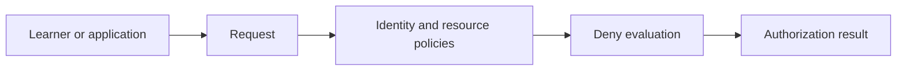
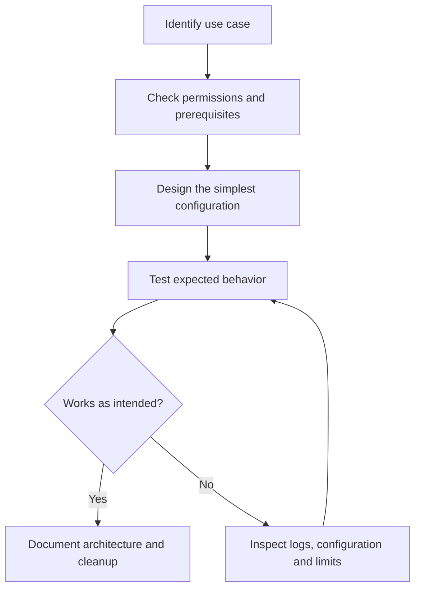
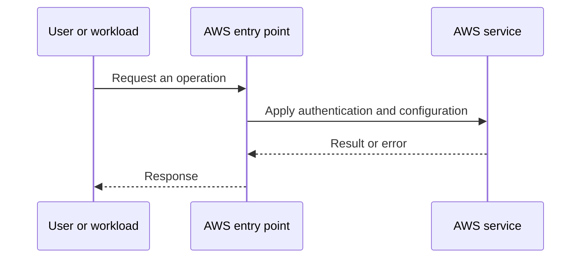
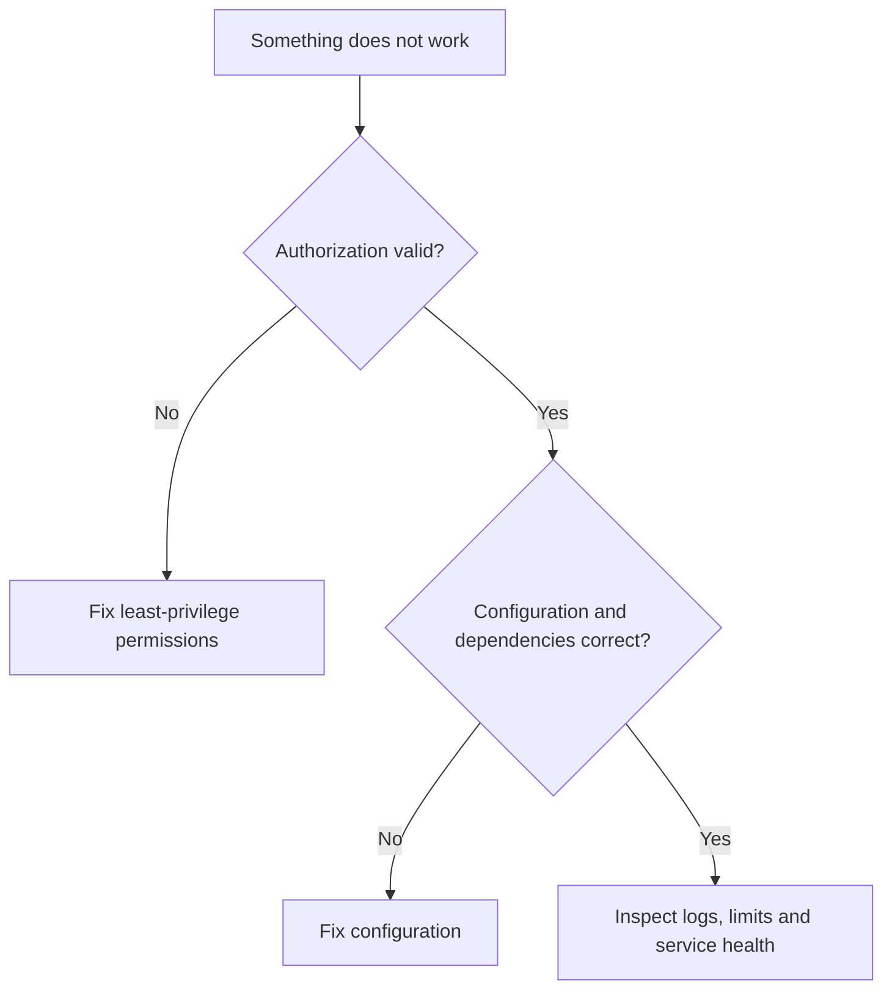

# Lesson 6: AWS IAM Policies (Identity & Resource-Based Policies) & User Groups Explained — Explained Simply

*AWS Education Notes · Author: Jayesh Sharma*

> **Source and scope:** Video 6 of [AWS from Basics to Advanced](https://www.youtube.com/playlist?list=PL6W8uoQQ2c60g3PAgzVPpi0YWwxITD43p), Concept && Coding – by Shrayansh. Its playlist title and position are verified; the full spoken transcript was not available. This is an **original topic-based learning companion**, not a word-for-word or attributed summary of unseen video explanations. Verify production behavior against [official AWS documentation](https://docs.aws.amazon.com/).

## Contents
- [1. The big picture](#1-the-big-picture)
- [2. Everyday analogy](#2-everyday-analogy)
- [3. JSON policy anatomy](#3-json-policy-anatomy)
- [4. Identity-based policy](#4-identity-based-policy)
- [5. Resource-based policy](#5-resource-based-policy)
- [6. Implicit vs explicit deny](#6-implicit-vs-explicit-deny)
- [7. User groups](#7-user-groups)
- [8. Conditions and least privilege](#8-conditions-and-least-privilege)
- [9. Policy evaluation practice](#9-policy-evaluation-practice)
- [10. Dangerous policy mistakes](#10-dangerous-policy-mistakes)
- [11. End-to-end workflow](#11-end-to-end-workflow)
- [12. Practical exercise](#12-practical-exercise)
- [13. Failure modes and best practices](#13-failure-modes-and-best-practices)
- [14. Interview questions and revision](#14-interview-questions-and-revision)

## 1. The big picture

In this lesson you learn **how permissions are evaluated**. Many cloud problems get easier when we divide a big system into small responsibilities, identify what AWS manages, and test one concept at a time.

**Learning goals:** Explain the important terms to a beginner; draw the request path; identify where permissions, costs and failures matter; and reason through a simple scenario without memorizing console clicks.

## 2. Everyday analogy

A building grants access through an employee badge and may also have a door-specific visitor list.

An analogy is only a memory aid: cloud systems have specific constraints such as API permissions, network direction, limits and failure domains.

## 3. JSON policy anatomy

IAM policy statements contain Effect, Action, Resource and optional Condition fields. Version usually indicates the policy language version rather than an individual policy revision.

**Think about it:** Which requirement or failure case would make this important in a production application?

## 4. Identity-based policy

An identity-based policy is attached to a user, group or role and describes what that identity can do.

**Think about it:** Which requirement or failure case would make this important in a production application?

## 5. Resource-based policy

A resource policy is attached to a supported resource, such as an S3 bucket, and can name principals allowed to access it. Cross-account permissions require careful evaluation.

**Think about it:** Which requirement or failure case would make this important in a production application?

## 6. Implicit vs explicit deny

By default requests are denied. An applicable allow is needed, and an explicit deny overrides an allow. Multiple policy layers and special cases affect the final decision.

**Think about it:** Which requirement or failure case would make this important in a production application?

## 7. User groups

A group is a collection of IAM users to which managed policies can be attached. The group is not itself a principal that can sign API requests.

**Think about it:** Which requirement or failure case would make this important in a production application?

## 8. Conditions and least privilege

Use conditions such as source restrictions or resource tags where appropriate; validate whether a condition is evaluated by the target service.

**Think about it:** Which requirement or failure case would make this important in a production application?

## 9. Policy evaluation practice

Start with a read-only policy scoped to one resource, test it in a safe sandbox, and deliberately observe AccessDenied for other resources.

**Think about it:** Which requirement or failure case would make this important in a production application?

## 10. Dangerous policy mistakes

Using Action '*' with Resource '*' broadly grants permissions; avoid treating wildcard access or a trust policy as ordinary application convenience.

**Think about it:** Which requirement or failure case would make this important in a production application?

## 11. End-to-end workflow

Start with the desired business action and walk through each decision:

**Why this matters:** A service may appear healthy while permissions, security rules or resource dependencies stop the application from working.

## 12. Practical exercise

1. Draw the main objects and request path from this guide.
2. Open the AWS documentation for the service; identify its Region, pricing and permission requirements.
3. Use a sandbox account with MFA and a small AWS Budget or billing alert before deploying any paid resources.
4. Make one deliberate change at a time, and predict the effect before testing it.
5. Record expected behavior, actual behavior and the service-level evidence.
6. Clean up test resources, including gateways, storage, load balancers, or public IPs where applicable.

**Cost warning:** AWS Free Tier eligibility varies. NAT gateways, application load balancers, data transfer and some other resources can incur charges even during a short lab.

## 13. Failure modes and best practices

| Risk | Practical response |
|---|---|
| Access denied | Check the caller identity, policies, service trust and resource scope |
| Service not reachable | Check routing, security, health checks and the target application |
| Configuration drift | Compare deployed resources with the declared/approved configuration |
| Unexpected charges | Inspect pricing first; tag resources; clean up labs |
| Single point of failure | Identify and, when required, replicate critical dependencies |
| Leaked credentials | Prefer roles and short-lived credentials; rotate/revoke exposed secrets |

## 14. Interview questions and revision

1. In your own words, explain **JSON policy anatomy** and give one AWS example.
2. In your own words, explain **Identity-based policy** and give one AWS example.
3. In your own words, explain **Resource-based policy** and give one AWS example.
4. In your own words, explain **Implicit vs explicit deny** and give one AWS example.
5. In your own words, explain **User groups** and give one AWS example.
6. In your own words, explain **Conditions and least privilege** and give one AWS example.
7. In your own words, explain **Policy evaluation practice** and give one AWS example.
8. In your own words, explain **Dangerous policy mistakes** and give one AWS example.
9. Which component would fail first if traffic or usage increased tenfold?
10. What must be secured or monitored before going live?
11. How would you diagnose a failed request end to end?

### Quick revision
- **JSON policy anatomy:** IAM policy statements contain Effect, Action, Resource and optional Condition fields.
- **Identity-based policy:** An identity-based policy is attached to a user, group or role and describes what that identity can do.
- **Resource-based policy:** A resource policy is attached to a supported resource, such as an S3 bucket, and can name principals allowed to access it.
- **Implicit vs explicit deny:** By default requests are denied.
- **User groups:** A group is a collection of IAM users to which managed policies can be attached.
- **Conditions and least privilege:** Use conditions such as source restrictions or resource tags where appropriate; validate whether a condition is evaluated by the target service.
- **Policy evaluation practice:** Start with a read-only policy scoped to one resource, test it in a safe sandbox, and deliberately observe AccessDenied for other resources.
- **Dangerous policy mistakes:** Using Action '*' with Resource '*' broadly grants permissions; avoid treating wildcard access or a trust policy as ordinary application convenience.

**One-minute answer:** AWS IAM Policies (Identity & Resource-Based Policies) & User Groups Explained is about how permissions are evaluated. Explain the main components, the direction of requests, security boundaries, operational trade-offs and a simple failure scenario. Then verify the design with a small reproducible test.

### Useful references

- [Course playlist](https://www.youtube.com/playlist?list=PL6W8uoQQ2c60g3PAgzVPpi0YWwxITD43p)
- [AWS documentation](https://docs.aws.amazon.com/)
- [AWS Well-Architected Framework](https://docs.aws.amazon.com/wellarchitected/latest/framework/welcome.html)
