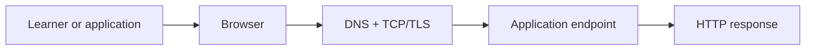
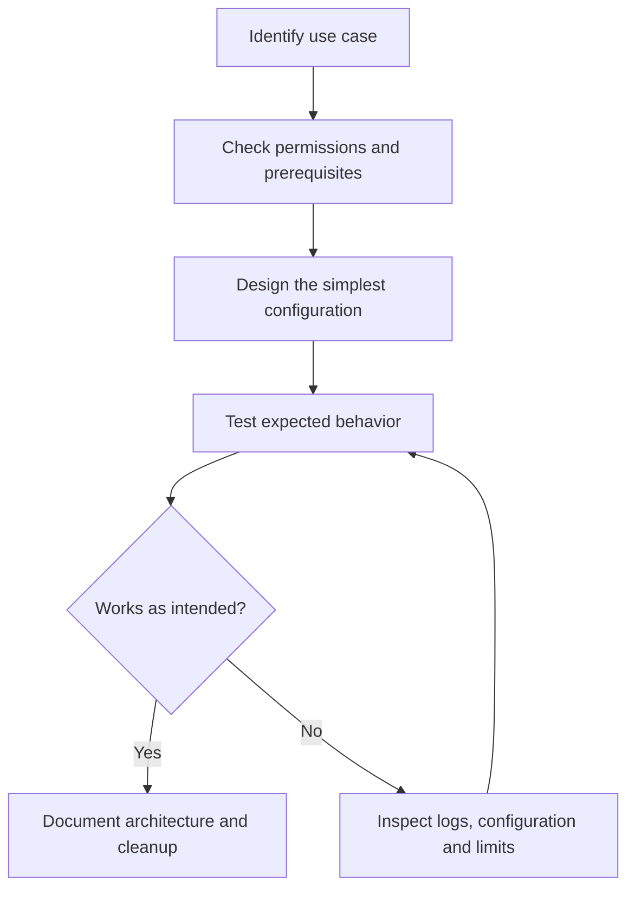
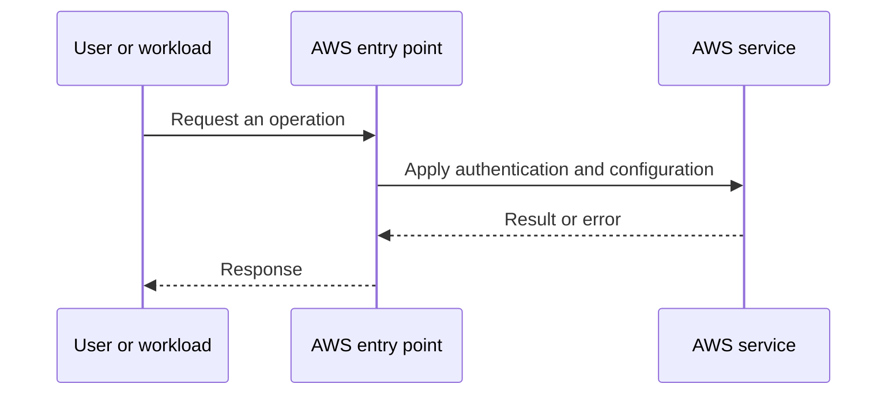
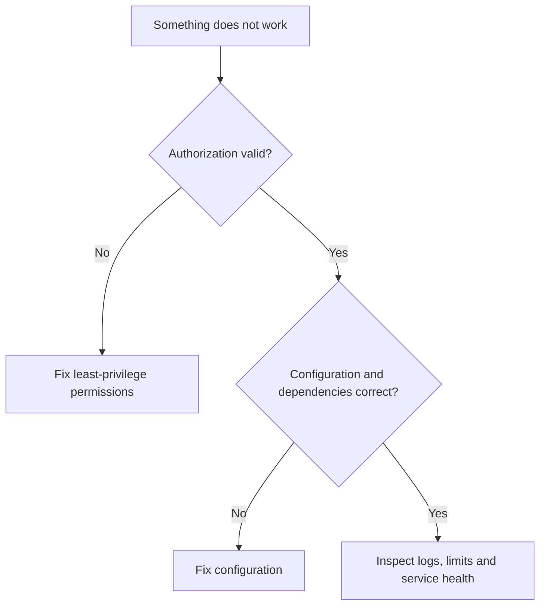

# Lesson 8: AWS Networking (Part-1): Fundamentals — Explained Simply

*AWS Education Notes · Author: Jayesh Sharma*

> **Source and scope:** Video 8 of [AWS from Basics to Advanced](https://www.youtube.com/playlist?list=PL6W8uoQQ2c60g3PAgzVPpi0YWwxITD43p), Concept && Coding – by Shrayansh. Its playlist title and position are verified; the full spoken transcript was not available. This is an **original topic-based learning companion**, not a word-for-word or attributed summary of unseen video explanations. Verify production behavior against [official AWS documentation](https://docs.aws.amazon.com/).

## Contents
- [1. The big picture](#1-the-big-picture)
- [2. Everyday analogy](#2-everyday-analogy)
- [3. IP addresses](#3-ip-addresses)
- [4. CIDR and subnet maths](#4-cidr-and-subnet-maths)
- [5. DNS](#5-dns)
- [6. TCP, UDP and ports](#6-tcp-udp-and-ports)
- [7. HTTP vs HTTPS](#7-http-vs-https)
- [8. Routing](#8-routing)
- [9. Latency and bandwidth](#9-latency-and-bandwidth)
- [10. NAT, proxies and load balancers](#10-nat-proxies-and-load-balancers)
- [11. End-to-end workflow](#11-end-to-end-workflow)
- [12. Practical exercise](#12-practical-exercise)
- [13. Failure modes and best practices](#13-failure-modes-and-best-practices)
- [14. Interview questions and revision](#14-interview-questions-and-revision)

## 1. The big picture

In this lesson you learn **basic networking vocabulary for AWS**. Many cloud problems get easier when we divide a big system into small responsibilities, identify what AWS manages, and test one concept at a time.

**Learning goals:** Explain the important terms to a beginner; draw the request path; identify where permissions, costs and failures matter; and reason through a simple scenario without memorizing console clicks.

## 2. Everyday analogy

Sending a parcel requires an address, a route and rules at the destination; sending a packet is similar.

An analogy is only a memory aid: cloud systems have specific constraints such as API permissions, network direction, limits and failure domains.

## 3. IP addresses

An IPv4 address identifies a network interface. Public addresses may be Internet-routable; private ranges are used inside private networks. An address alone does not guarantee Internet access.

**Think about it:** Which requirement or failure case would make this important in a production application?

## 4. CIDR and subnet maths

CIDR notation such as 10.0.0.0/16 describes a network prefix. /24 is smaller than /16. In AWS VPC IPv4 subnets, AWS reserves five IP addresses per subnet.

**Think about it:** Which requirement or failure case would make this important in a production application?

## 5. DNS

DNS resolves names such as api.example.com into addresses or other record types. It does not itself guarantee a successful TCP connection.

**Think about it:** Which requirement or failure case would make this important in a production application?

## 6. TCP, UDP and ports

TCP provides an ordered reliable byte stream; UDP sends datagrams without built-in delivery guarantees. Ports identify application endpoints.

**Think about it:** Which requirement or failure case would make this important in a production application?

## 7. HTTP vs HTTPS

HTTP describes application requests/responses. HTTPS protects HTTP using TLS, authenticates the server and encrypts data in transit.

**Think about it:** Which requirement or failure case would make this important in a production application?

## 8. Routing

Routers forward packets based on destination prefixes and route tables; firewalls decide which traffic may pass.

**Think about it:** Which requirement or failure case would make this important in a production application?

## 9. Latency and bandwidth

Latency is waiting time per request or round trip. Bandwidth is how much data can be transferred per second. Both matter for user experience.

**Think about it:** Which requirement or failure case would make this important in a production application?

## 10. NAT, proxies and load balancers

NAT translates addresses; a proxy communicates on a client's or server's behalf; a load balancer distributes requests among eligible targets.

**Think about it:** Which requirement or failure case would make this important in a production application?

## 11. End-to-end workflow

Start with the desired business action and walk through each decision:

**Why this matters:** A service may appear healthy while permissions, security rules or resource dependencies stop the application from working.

## 12. Practical exercise

1. Draw the main objects and request path from this guide.
2. Open the AWS documentation for the service; identify its Region, pricing and permission requirements.
3. Use a sandbox account with MFA and a small AWS Budget or billing alert before deploying any paid resources.
4. Make one deliberate change at a time, and predict the effect before testing it.
5. Record expected behavior, actual behavior and the service-level evidence.
6. Clean up test resources, including gateways, storage, load balancers, or public IPs where applicable.

**Cost warning:** AWS Free Tier eligibility varies. NAT gateways, application load balancers, data transfer and some other resources can incur charges even during a short lab.

## 13. Failure modes and best practices

| Risk | Practical response |
|---|---|
| Access denied | Check the caller identity, policies, service trust and resource scope |
| Service not reachable | Check routing, security, health checks and the target application |
| Configuration drift | Compare deployed resources with the declared/approved configuration |
| Unexpected charges | Inspect pricing first; tag resources; clean up labs |
| Single point of failure | Identify and, when required, replicate critical dependencies |
| Leaked credentials | Prefer roles and short-lived credentials; rotate/revoke exposed secrets |

## 14. Interview questions and revision

1. In your own words, explain **IP addresses** and give one AWS example.
2. In your own words, explain **CIDR and subnet maths** and give one AWS example.
3. In your own words, explain **DNS** and give one AWS example.
4. In your own words, explain **TCP, UDP and ports** and give one AWS example.
5. In your own words, explain **HTTP vs HTTPS** and give one AWS example.
6. In your own words, explain **Routing** and give one AWS example.
7. In your own words, explain **Latency and bandwidth** and give one AWS example.
8. In your own words, explain **NAT, proxies and load balancers** and give one AWS example.
9. Which component would fail first if traffic or usage increased tenfold?
10. What must be secured or monitored before going live?
11. How would you diagnose a failed request end to end?

### Quick revision
- **IP addresses:** An IPv4 address identifies a network interface.
- **CIDR and subnet maths:** CIDR notation such as 10.
- **DNS:** DNS resolves names such as api.
- **TCP, UDP and ports:** TCP provides an ordered reliable byte stream; UDP sends datagrams without built-in delivery guarantees.
- **HTTP vs HTTPS:** HTTP describes application requests/responses.
- **Routing:** Routers forward packets based on destination prefixes and route tables; firewalls decide which traffic may pass.
- **Latency and bandwidth:** Latency is waiting time per request or round trip.
- **NAT, proxies and load balancers:** NAT translates addresses; a proxy communicates on a client's or server's behalf; a load balancer distributes requests among eligible targets.

**One-minute answer:** AWS Networking (Part-1): Fundamentals is about basic networking vocabulary for AWS. Explain the main components, the direction of requests, security boundaries, operational trade-offs and a simple failure scenario. Then verify the design with a small reproducible test.

### Useful references

- [Course playlist](https://www.youtube.com/playlist?list=PL6W8uoQQ2c60g3PAgzVPpi0YWwxITD43p)
- [AWS documentation](https://docs.aws.amazon.com/)
- [AWS Well-Architected Framework](https://docs.aws.amazon.com/wellarchitected/latest/framework/welcome.html)
