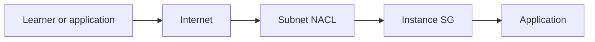
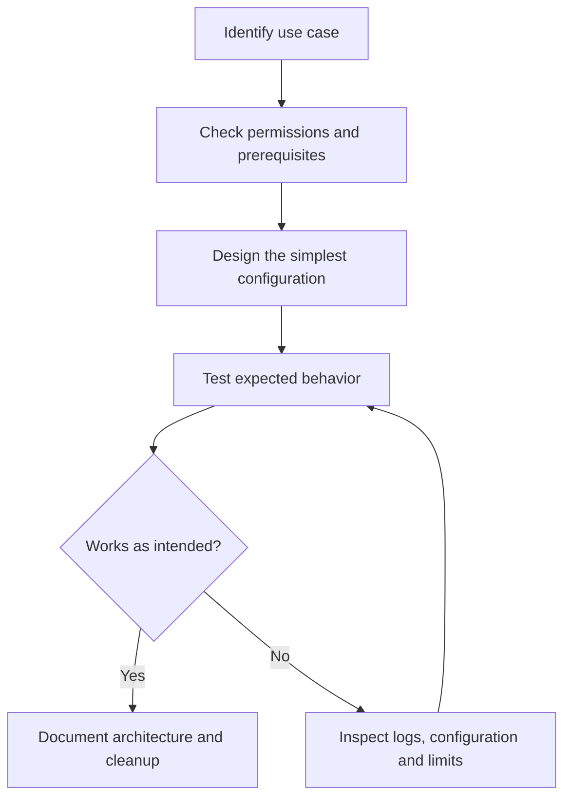
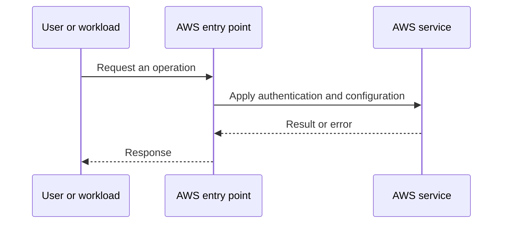
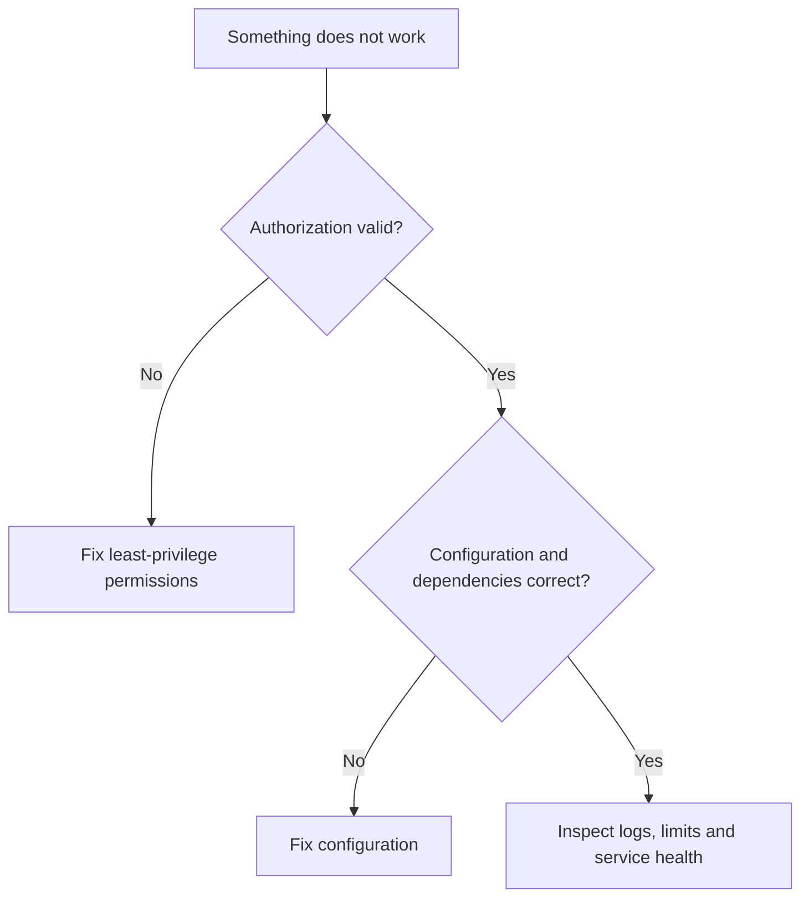

# Lesson 10: AWS Networking (Part-3): Security Groups and NACL — Explained Simply

*AWS Education Notes · Author: Jayesh Sharma*

> **Source and scope:** Video 10 of [AWS from Basics to Advanced](https://www.youtube.com/playlist?list=PL6W8uoQQ2c60g3PAgzVPpi0YWwxITD43p), Concept && Coding – by Shrayansh. Its playlist title and position are verified; the full spoken transcript was not available. This is an **original topic-based learning companion**, not a word-for-word or attributed summary of unseen video explanations. Verify production behavior against [official AWS documentation](https://docs.aws.amazon.com/).

## Contents
- [1. The big picture](#1-the-big-picture)
- [2. Everyday analogy](#2-everyday-analogy)
- [3. Security groups](#3-security-groups)
- [4. Network ACLs](#4-network-acls)
- [5. Rules and priorities](#5-rules-and-priorities)
- [6. Inbound and outbound](#6-inbound-and-outbound)
- [7. Ephemeral ports](#7-ephemeral-ports)
- [8. Typical web design](#8-typical-web-design)
- [9. Troubleshooting](#9-troubleshooting)
- [10. Least privilege](#10-least-privilege)
- [11. End-to-end workflow](#11-end-to-end-workflow)
- [12. Practical exercise](#12-practical-exercise)
- [13. Failure modes and best practices](#13-failure-modes-and-best-practices)
- [14. Interview questions and revision](#14-interview-questions-and-revision)

## 1. The big picture

In this lesson you learn **protecting VPC network traffic**. Many cloud problems get easier when we divide a big system into small responsibilities, identify what AWS manages, and test one concept at a time.

**Learning goals:** Explain the important terms to a beginner; draw the request path; identify where permissions, costs and failures matter; and reason through a simple scenario without memorizing console clicks.

## 2. Everyday analogy

A security group acts like an entry policy for a particular room; a network ACL works like rules at the entrance of an entire building wing.

An analogy is only a memory aid: cloud systems have specific constraints such as API permissions, network direction, limits and failure domains.

## 3. Security groups

A security group is a stateful virtual firewall associated with supported resources, commonly EC2 ENIs. Allowed response traffic is automatically tracked.

**Think about it:** Which requirement or failure case would make this important in a production application?

## 4. Network ACLs

A NACL is a stateless allow/deny rule list applied at a subnet boundary. Return traffic needs matching inbound and outbound allowance.

**Think about it:** Which requirement or failure case would make this important in a production application?

## 5. Rules and priorities

NACL rules are processed in rule-number order, starting from the lowest number; the first matching rule wins. SG rules don't have that same numbered ordering.

**Think about it:** Which requirement or failure case would make this important in a production application?

## 6. Inbound and outbound

Inbound applies to traffic arriving at the protected resource/subnet; outbound controls traffic leaving it. Explain direction from the relevant side.

**Think about it:** Which requirement or failure case would make this important in a production application?

## 7. Ephemeral ports

With stateless NACLs, return traffic may use ephemeral client ports, so a narrowly configured NACL can break apparently permitted connections.

**Think about it:** Which requirement or failure case would make this important in a production application?

## 8. Typical web design

Allow HTTP/HTTPS to public load balancer, then application ports from the LB security group to app SG, then database port from app SG to DB SG.

**Think about it:** Which requirement or failure case would make this important in a production application?

## 9. Troubleshooting

Use VPC Flow Logs and Reachability Analyzer to distinguish missing routes, SG errors, NACL blocks and service configuration.

**Think about it:** Which requirement or failure case would make this important in a production application?

## 10. Least privilege

Never treat 0.0.0.0/0 on SSH or RDP as a safe convenience. Use SSM Session Manager or narrowly controlled access.

**Think about it:** Which requirement or failure case would make this important in a production application?

## 11. End-to-end workflow

Start with the desired business action and walk through each decision:

**Why this matters:** A service may appear healthy while permissions, security rules or resource dependencies stop the application from working.

## 12. Practical exercise

1. Draw the main objects and request path from this guide.
2. Open the AWS documentation for the service; identify its Region, pricing and permission requirements.
3. Use a sandbox account with MFA and a small AWS Budget or billing alert before deploying any paid resources.
4. Make one deliberate change at a time, and predict the effect before testing it.
5. Record expected behavior, actual behavior and the service-level evidence.
6. Clean up test resources, including gateways, storage, load balancers, or public IPs where applicable.

**Cost warning:** AWS Free Tier eligibility varies. NAT gateways, application load balancers, data transfer and some other resources can incur charges even during a short lab.

## 13. Failure modes and best practices

| Risk | Practical response |
|---|---|
| Access denied | Check the caller identity, policies, service trust and resource scope |
| Service not reachable | Check routing, security, health checks and the target application |
| Configuration drift | Compare deployed resources with the declared/approved configuration |
| Unexpected charges | Inspect pricing first; tag resources; clean up labs |
| Single point of failure | Identify and, when required, replicate critical dependencies |
| Leaked credentials | Prefer roles and short-lived credentials; rotate/revoke exposed secrets |

## 14. Interview questions and revision

1. In your own words, explain **Security groups** and give one AWS example.
2. In your own words, explain **Network ACLs** and give one AWS example.
3. In your own words, explain **Rules and priorities** and give one AWS example.
4. In your own words, explain **Inbound and outbound** and give one AWS example.
5. In your own words, explain **Ephemeral ports** and give one AWS example.
6. In your own words, explain **Typical web design** and give one AWS example.
7. In your own words, explain **Troubleshooting** and give one AWS example.
8. In your own words, explain **Least privilege** and give one AWS example.
9. Which component would fail first if traffic or usage increased tenfold?
10. What must be secured or monitored before going live?
11. How would you diagnose a failed request end to end?

### Quick revision
- **Security groups:** A security group is a stateful virtual firewall associated with supported resources, commonly EC2 ENIs.
- **Network ACLs:** A NACL is a stateless allow/deny rule list applied at a subnet boundary.
- **Rules and priorities:** NACL rules are processed in rule-number order, starting from the lowest number; the first matching rule wins.
- **Inbound and outbound:** Inbound applies to traffic arriving at the protected resource/subnet; outbound controls traffic leaving it.
- **Ephemeral ports:** With stateless NACLs, return traffic may use ephemeral client ports, so a narrowly configured NACL can break apparently permitted connections.
- **Typical web design:** Allow HTTP/HTTPS to public load balancer, then application ports from the LB security group to app SG, then database port from app SG to DB SG.
- **Troubleshooting:** Use VPC Flow Logs and Reachability Analyzer to distinguish missing routes, SG errors, NACL blocks and service configuration.
- **Least privilege:** Never treat 0.

**One-minute answer:** AWS Networking (Part-3): Security Groups and NACL is about protecting VPC network traffic. Explain the main components, the direction of requests, security boundaries, operational trade-offs and a simple failure scenario. Then verify the design with a small reproducible test.

### Useful references

- [Course playlist](https://www.youtube.com/playlist?list=PL6W8uoQQ2c60g3PAgzVPpi0YWwxITD43p)
- [AWS documentation](https://docs.aws.amazon.com/)
- [AWS Well-Architected Framework](https://docs.aws.amazon.com/wellarchitected/latest/framework/welcome.html)
