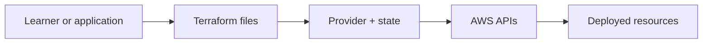
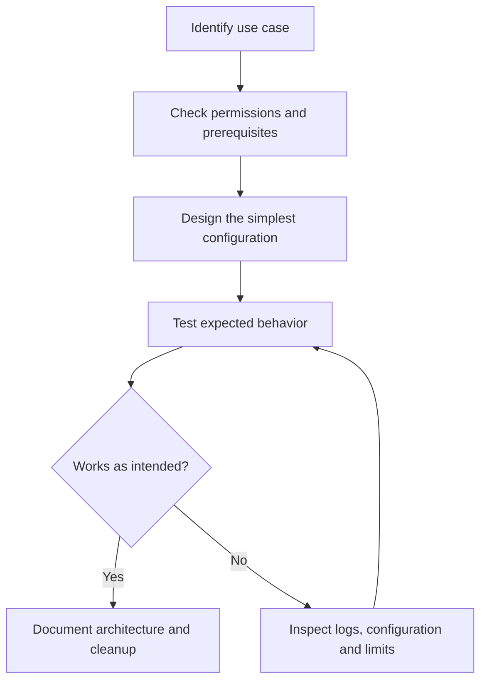
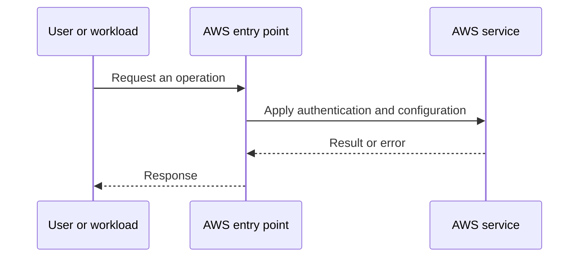
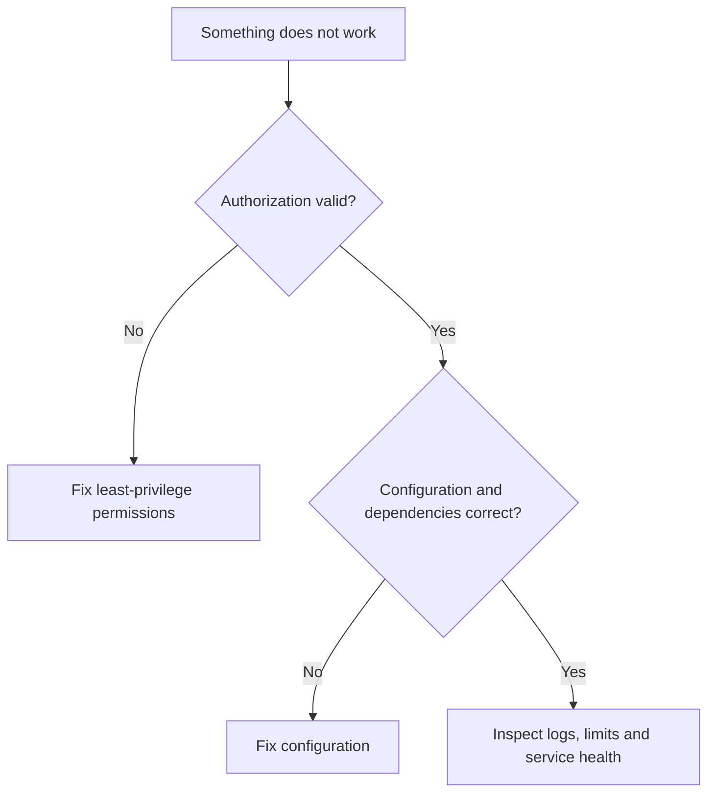

# Lesson 11: AWS: Terraform Architecture & Core Blocks Explained — Explained Simply

*AWS Education Notes · Author: Jayesh Sharma*

> **Source and scope:** Video 11 of [AWS from Basics to Advanced](https://www.youtube.com/playlist?list=PL6W8uoQQ2c60g3PAgzVPpi0YWwxITD43p), Concept && Coding – by Shrayansh. Its playlist title and position are verified; the full spoken transcript was not available. This is an **original topic-based learning companion**, not a word-for-word or attributed summary of unseen video explanations. Verify production behavior against [official AWS documentation](https://docs.aws.amazon.com/).

## Contents
- [1. The big picture](#1-the-big-picture)
- [2. Everyday analogy](#2-everyday-analogy)
- [3. Terraform workflow](#3-terraform-workflow)
- [4. Providers and resources](#4-providers-and-resources)
- [5. Variables and outputs](#5-variables-and-outputs)
- [6. State files](#6-state-files)
- [7. Remote state and locking](#7-remote-state-and-locking)
- [8. Data sources vs resources](#8-data-sources-vs-resources)
- [9. Modules](#9-modules)
- [10. Plan and drift](#10-plan-and-drift)
- [11. End-to-end workflow](#11-end-to-end-workflow)
- [12. Practical exercise](#12-practical-exercise)
- [13. Failure modes and best practices](#13-failure-modes-and-best-practices)
- [14. Interview questions and revision](#14-interview-questions-and-revision)

## 1. The big picture

In this lesson you learn **infrastructure as code for AWS**. Many cloud problems get easier when we divide a big system into small responsibilities, identify what AWS manages, and test one concept at a time.

**Learning goals:** Explain the important terms to a beginner; draw the request path; identify where permissions, costs and failures matter; and reason through a simple scenario without memorizing console clicks.

## 2. Everyday analogy

Instead of remembering how to build every office by hand, write a blueprint that can be reviewed and applied repeatedly.

An analogy is only a memory aid: cloud systems have specific constraints such as API permissions, network direction, limits and failure domains.

## 3. Terraform workflow

Write .tf declarations, run init to fetch providers/modules, validate formatting and configuration, review plan, and apply only after checking changes.

**Think about it:** Which requirement or failure case would make this important in a production application?

## 4. Providers and resources

A provider communicates with an API, such as AWS; a resource block declares the desired infrastructure object to manage.

**Think about it:** Which requirement or failure case would make this important in a production application?

## 5. Variables and outputs

Variables parameterize configurations; outputs expose useful deployment values such as a load balancer DNS name.

**Think about it:** Which requirement or failure case would make this important in a production application?

## 6. State files

Terraform state maps declared resource addresses to real deployed resources. Protect state because it can contain sensitive values and is essential for collaboration.

**Think about it:** Which requirement or failure case would make this important in a production application?

## 7. Remote state and locking

For team usage, use an appropriately protected remote backend with locking where supported. Never commit secrets or production state to Git.

**Think about it:** Which requirement or failure case would make this important in a production application?

## 8. Data sources vs resources

Resources create/manage objects; data sources read existing information such as AMIs or VPCs.

**Think about it:** Which requirement or failure case would make this important in a production application?

## 9. Modules

Modules package reusable IaC patterns and allow teams to standardize naming, tags and security defaults.

**Think about it:** Which requirement or failure case would make this important in a production application?

## 10. Plan and drift

A plan compares configuration, state and provider reads to propose changes. Out-of-band console edits can cause drift and unexpected reconciliation.

**Think about it:** Which requirement or failure case would make this important in a production application?

## 11. End-to-end workflow

Start with the desired business action and walk through each decision:

**Why this matters:** A service may appear healthy while permissions, security rules or resource dependencies stop the application from working.

## 12. Practical exercise

1. Draw the main objects and request path from this guide.
2. Open the AWS documentation for the service; identify its Region, pricing and permission requirements.
3. Use a sandbox account with MFA and a small AWS Budget or billing alert before deploying any paid resources.
4. Make one deliberate change at a time, and predict the effect before testing it.
5. Record expected behavior, actual behavior and the service-level evidence.
6. Clean up test resources, including gateways, storage, load balancers, or public IPs where applicable.

**Cost warning:** AWS Free Tier eligibility varies. NAT gateways, application load balancers, data transfer and some other resources can incur charges even during a short lab.

## 13. Failure modes and best practices

| Risk | Practical response |
|---|---|
| Access denied | Check the caller identity, policies, service trust and resource scope |
| Service not reachable | Check routing, security, health checks and the target application |
| Configuration drift | Compare deployed resources with the declared/approved configuration |
| Unexpected charges | Inspect pricing first; tag resources; clean up labs |
| Single point of failure | Identify and, when required, replicate critical dependencies |
| Leaked credentials | Prefer roles and short-lived credentials; rotate/revoke exposed secrets |

## 14. Interview questions and revision

1. In your own words, explain **Terraform workflow** and give one AWS example.
2. In your own words, explain **Providers and resources** and give one AWS example.
3. In your own words, explain **Variables and outputs** and give one AWS example.
4. In your own words, explain **State files** and give one AWS example.
5. In your own words, explain **Remote state and locking** and give one AWS example.
6. In your own words, explain **Data sources vs resources** and give one AWS example.
7. In your own words, explain **Modules** and give one AWS example.
8. In your own words, explain **Plan and drift** and give one AWS example.
9. Which component would fail first if traffic or usage increased tenfold?
10. What must be secured or monitored before going live?
11. How would you diagnose a failed request end to end?

### Quick revision
- **Terraform workflow:** Write .
- **Providers and resources:** A provider communicates with an API, such as AWS; a resource block declares the desired infrastructure object to manage.
- **Variables and outputs:** Variables parameterize configurations; outputs expose useful deployment values such as a load balancer DNS name.
- **State files:** Terraform state maps declared resource addresses to real deployed resources.
- **Remote state and locking:** For team usage, use an appropriately protected remote backend with locking where supported.
- **Data sources vs resources:** Resources create/manage objects; data sources read existing information such as AMIs or VPCs.
- **Modules:** Modules package reusable IaC patterns and allow teams to standardize naming, tags and security defaults.
- **Plan and drift:** A plan compares configuration, state and provider reads to propose changes.

**One-minute answer:** AWS: Terraform Architecture & Core Blocks Explained is about infrastructure as code for AWS. Explain the main components, the direction of requests, security boundaries, operational trade-offs and a simple failure scenario. Then verify the design with a small reproducible test.

### Useful references

- [Course playlist](https://www.youtube.com/playlist?list=PL6W8uoQQ2c60g3PAgzVPpi0YWwxITD43p)
- [AWS documentation](https://docs.aws.amazon.com/)
- [AWS Well-Architected Framework](https://docs.aws.amazon.com/wellarchitected/latest/framework/welcome.html)
