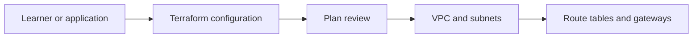
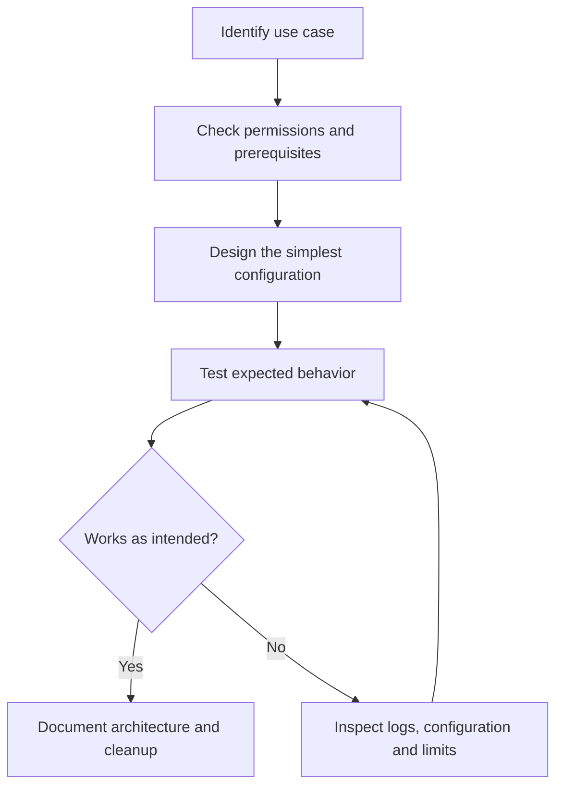
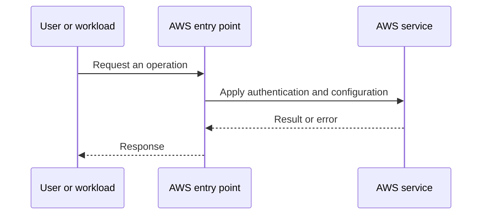
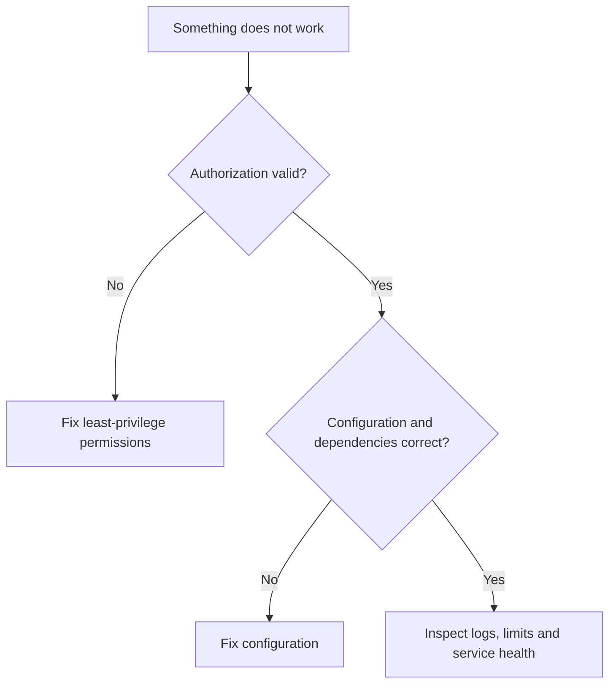

# Lesson 12: Terraform Hands-on | Build Complete AWS Networking Infrastructure using Terraform — Explained Simply

*AWS Education Notes · Author: Jayesh Sharma*

> **Source and scope:** Video 12 of [AWS from Basics to Advanced](https://www.youtube.com/playlist?list=PL6W8uoQQ2c60g3PAgzVPpi0YWwxITD43p), Concept && Coding – by Shrayansh. Its playlist title and position are verified; the full spoken transcript was not available. This is an **original topic-based learning companion**, not a word-for-word or attributed summary of unseen video explanations. Verify production behavior against [official AWS documentation](https://docs.aws.amazon.com/).

## Contents
- [1. The big picture](#1-the-big-picture)
- [2. Everyday analogy](#2-everyday-analogy)
- [3. Network plan](#3-network-plan)
- [4. Terraform resource dependencies](#4-terraform-resource-dependencies)
- [5. AZ-safe subnet design](#5-az-safe-subnet-design)
- [6. Public route](#6-public-route)
- [7. Private egress](#7-private-egress)
- [8. Validation](#8-validation)
- [9. Destroy lab](#9-destroy-lab)
- [10. Security hardening](#10-security-hardening)
- [11. End-to-end workflow](#11-end-to-end-workflow)
- [12. Practical exercise](#12-practical-exercise)
- [13. Failure modes and best practices](#13-failure-modes-and-best-practices)
- [14. Interview questions and revision](#14-interview-questions-and-revision)

## 1. The big picture

In this lesson you learn **VPC infrastructure coded as a repeatable blueprint**. Many cloud problems get easier when we divide a big system into small responsibilities, identify what AWS manages, and test one concept at a time.

**Learning goals:** Explain the important terms to a beginner; draw the request path; identify where permissions, costs and failures matter; and reason through a simple scenario without memorizing console clicks.

## 2. Everyday analogy

Write the same network drawing as Terraform code, then let the tool create it after you review the plan.

An analogy is only a memory aid: cloud systems have specific constraints such as API permissions, network direction, limits and failure domains.

## 3. Network plan

Choose a VPC CIDR, two AZs, public/private subnets, internet gateway, public route table and optionally NAT gateway. Sketch every target first.

**Think about it:** Which requirement or failure case would make this important in a production application?

## 4. Terraform resource dependencies

References such as aws_subnet.public.id create dependency edges. Use explicit depends_on only when implicit references are insufficient.

**Think about it:** Which requirement or failure case would make this important in a production application?

## 5. AZ-safe subnet design

A subnet belongs to one AZ. Create distinct nonoverlapping CIDR blocks for each AZ, with a private subnet for backend instances.

**Think about it:** Which requirement or failure case would make this important in a production application?

## 6. Public route

Associate the public route table with public subnet(s), adding a default route to the IGW.

**Think about it:** Which requirement or failure case would make this important in a production application?

## 7. Private egress

A private subnet can route IPv4 egress through a public NAT gateway; note NAT hourly/data charges.

**Think about it:** Which requirement or failure case would make this important in a production application?

## 8. Validation

Use terraform fmt, validate, plan and apply. Check route tables and actual network reachability rather than only successful create calls.

**Think about it:** Which requirement or failure case would make this important in a production application?

## 9. Destroy lab

Use terraform destroy after reviewing the plan. A partial destroy may occur if objects are still attached; inspect residual billable services.

**Think about it:** Which requirement or failure case would make this important in a production application?

## 10. Security hardening

Avoid creating wide-open inbound SG rules and passing secrets in Terraform variables committed to Git.

**Think about it:** Which requirement or failure case would make this important in a production application?

## 11. End-to-end workflow

Start with the desired business action and walk through each decision:

**Why this matters:** A service may appear healthy while permissions, security rules or resource dependencies stop the application from working.

## 12. Practical exercise

1. Draw the main objects and request path from this guide.
2. Open the AWS documentation for the service; identify its Region, pricing and permission requirements.
3. Use a sandbox account with MFA and a small AWS Budget or billing alert before deploying any paid resources.
4. Make one deliberate change at a time, and predict the effect before testing it.
5. Record expected behavior, actual behavior and the service-level evidence.
6. Clean up test resources, including gateways, storage, load balancers, or public IPs where applicable.

**Cost warning:** AWS Free Tier eligibility varies. NAT gateways, application load balancers, data transfer and some other resources can incur charges even during a short lab.

## 13. Failure modes and best practices

| Risk | Practical response |
|---|---|
| Access denied | Check the caller identity, policies, service trust and resource scope |
| Service not reachable | Check routing, security, health checks and the target application |
| Configuration drift | Compare deployed resources with the declared/approved configuration |
| Unexpected charges | Inspect pricing first; tag resources; clean up labs |
| Single point of failure | Identify and, when required, replicate critical dependencies |
| Leaked credentials | Prefer roles and short-lived credentials; rotate/revoke exposed secrets |

## 14. Interview questions and revision

1. In your own words, explain **Network plan** and give one AWS example.
2. In your own words, explain **Terraform resource dependencies** and give one AWS example.
3. In your own words, explain **AZ-safe subnet design** and give one AWS example.
4. In your own words, explain **Public route** and give one AWS example.
5. In your own words, explain **Private egress** and give one AWS example.
6. In your own words, explain **Validation** and give one AWS example.
7. In your own words, explain **Destroy lab** and give one AWS example.
8. In your own words, explain **Security hardening** and give one AWS example.
9. Which component would fail first if traffic or usage increased tenfold?
10. What must be secured or monitored before going live?
11. How would you diagnose a failed request end to end?

### Quick revision
- **Network plan:** Choose a VPC CIDR, two AZs, public/private subnets, internet gateway, public route table and optionally NAT gateway.
- **Terraform resource dependencies:** References such as aws_subnet.
- **AZ-safe subnet design:** A subnet belongs to one AZ.
- **Public route:** Associate the public route table with public subnet(s), adding a default route to the IGW.
- **Private egress:** A private subnet can route IPv4 egress through a public NAT gateway; note NAT hourly/data charges.
- **Validation:** Use terraform fmt, validate, plan and apply.
- **Destroy lab:** Use terraform destroy after reviewing the plan.
- **Security hardening:** Avoid creating wide-open inbound SG rules and passing secrets in Terraform variables committed to Git.

**One-minute answer:** Terraform Hands-on | Build Complete AWS Networking Infrastructure using Terraform is about VPC infrastructure coded as a repeatable blueprint. Explain the main components, the direction of requests, security boundaries, operational trade-offs and a simple failure scenario. Then verify the design with a small reproducible test.

### Useful references

- [Course playlist](https://www.youtube.com/playlist?list=PL6W8uoQQ2c60g3PAgzVPpi0YWwxITD43p)
- [AWS documentation](https://docs.aws.amazon.com/)
- [AWS Well-Architected Framework](https://docs.aws.amazon.com/wellarchitected/latest/framework/welcome.html)
