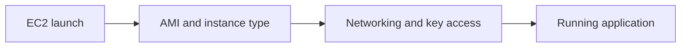
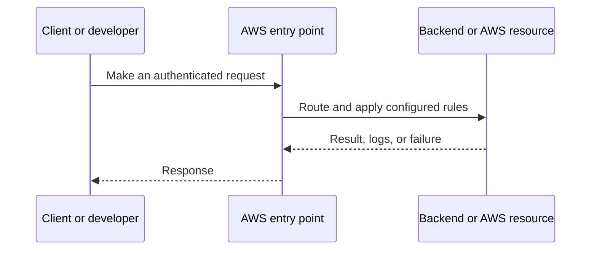
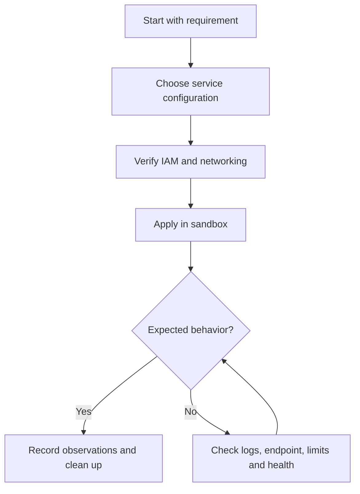
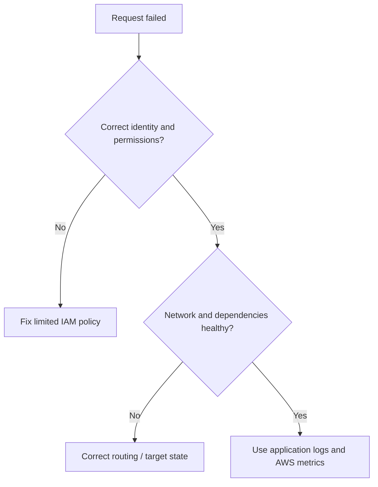

# Lesson 13: AWS: EC2 for Beginners | AMI, Instance Types, vCPU, Key Pair & Launch EC2 — Explained Simply

*AWS Education Notes · Author: Jayesh Sharma*

> **Source and scope:** Lesson 13 in [AWS from Basics to Advanced](https://www.youtube.com/playlist?list=PL6W8uoQQ2c60g3PAgzVPpi0YWwxITD43p), by Concept && Coding – by Shrayansh. The topic/order is verified but no full spoken transcript was accessible. These are **independently written educational explanations** and not an account of unseen video details. Confirm current implementation steps in [AWS documentation](https://docs.aws.amazon.com/).

## Contents
- [1. The big picture](#1-the-big-picture)
- [2. Everyday analogy](#2-everyday-analogy)
- [3. EC2 basics](#3-ec2-basics)
- [4. Amazon Machine Image (AMI)](#4-amazon-machine-image-ami)
- [5. Instance types and vCPU](#5-instance-types-and-vcpu)
- [6. Key pairs and Session Manager](#6-key-pairs-and-session-manager)
- [7. Security group and subnet](#7-security-group-and-subnet)
- [8. EBS root volume](#8-ebs-root-volume)
- [9. Instance lifecycle](#9-instance-lifecycle)
- [10. First instance lab](#10-first-instance-lab)
- [11. End-to-end workflow](#11-end-to-end-workflow)
- [12. Practical exercise](#12-practical-exercise)
- [13. Production pitfalls](#13-production-pitfalls)
- [14. Interview questions and quick revision](#14-interview-questions-and-quick-revision)

## 1. The big picture

This lesson explains **launching a virtual server on AWS**. To understand it well, follow the data and request path, ask who owns each responsibility, and test how failures are handled.

## 2. Everyday analogy

Renting a computer in a data center: you choose its size, operating system, disk and network access.

An analogy makes the concept memorable, but do not rely on it to decide security, cost or reliability properties. AWS documentation and real tests determine those.

## 3. EC2 basics

Elastic Compute Cloud provides virtual machine instances. An EC2 instance has compute resources, networking and attached storage; you manage the guest OS and application.

**Why it matters:** This affects at least one of correctness, security, cost, scale, or operational recovery. Explain the trade-off before choosing a production configuration.

## 4. Amazon Machine Image (AMI)

An AMI supplies bootable software details for an instance, such as an operating system and optionally preinstalled packages. Select a trusted maintained AMI.

**Why it matters:** This affects at least one of correctness, security, cost, scale, or operational recovery. Explain the trade-off before choosing a production configuration.

## 5. Instance types and vCPU

An instance family balances CPU, memory, network and accelerators. A vCPU is a virtual CPU thread as exposed to the guest; sizes and pricing differ by instance type.

**Why it matters:** This affects at least one of correctness, security, cost, scale, or operational recovery. Explain the trade-off before choosing a production configuration.

## 6. Key pairs and Session Manager

SSH key pairs support login to Linux instances where configured. AWS Systems Manager Session Manager offers a way to administer eligible instances without opening inbound SSH; its role and networking prerequisites must be met.

**Why it matters:** This affects at least one of correctness, security, cost, scale, or operational recovery. Explain the trade-off before choosing a production configuration.

## 7. Security group and subnet

The instance's subnet, routing, addressing, and security group control network reachability. A public IP alone does not make the app reachable.

**Why it matters:** This affects at least one of correctness, security, cost, scale, or operational recovery. Explain the trade-off before choosing a production configuration.

## 8. EBS root volume

Most EC2 instances use EBS root volumes. Disk size, encryption, deletion-on-termination and snapshots have cost and security implications.

**Why it matters:** This affects at least one of correctness, security, cost, scale, or operational recovery. Explain the trade-off before choosing a production configuration.

## 9. Instance lifecycle

Launching, running, stopping and terminating are distinct states. Stopping EBS-backed instances generally stops instance-compute charges but EBS storage continues to cost money.

**Why it matters:** This affects at least one of correctness, security, cost, scale, or operational recovery. Explain the trade-off before choosing a production configuration.

## 10. First instance lab

Choose Region and trusted AMI, pick an affordable instance type, use least privilege, enable required access, inspect system logs, and terminate plus remove residual volumes/addresses after testing.

**Why it matters:** This affects at least one of correctness, security, cost, scale, or operational recovery. Explain the trade-off before choosing a production configuration.

## 11. End-to-end workflow

Try this simple reasoning pattern: identify the caller, locate the resource, check permissions and networking, execute the operation, then verify the result.

**Example scenario:** A small Spring Boot API serves users through an AWS-managed component. What happens if credentials expire, a backend becomes unhealthy, or the network route is absent? Investigate one failure at a time rather than granting AdministratorAccess or opening every port.

## 12. Practical exercise

1. Draw the architecture of this lesson without reading the diagram above.
2. Locate the corresponding AWS service in the console and note its Region and required IAM permissions.
3. Predict one successful and one denied request before experimenting.
4. Use the smallest safe test environment and record service-level logs.
5. If any paid resources are created, delete them—including attached storage, gateways and unused addresses—and check billing.

**Cost warning:** Even brief EC2, EBS, NAT gateway, ALB, S3 request and transfer labs may incur charges depending on account eligibility, Region and configuration.

## 13. Production pitfalls

| Failure | Investigation or mitigation |
|---|---|
| Access denied | Check identity, trust, action, resource scope and explicit denies |
| Resource cannot be reached | Verify bind address, DNS, route, target health and firewall rules |
| Intermittent outage | Review AZ coverage, retry behavior, health checks and capacity |
| Wrong region or resource | Verify identifiers, ARN, Region and account |
| Unsafe permissions | Replace broad access with least privilege |
| Unexpected cost | Inspect running, detached and leftover resources; set alerts |

## 14. Interview questions and quick revision

1. Explain **EC2 basics** to a beginner with one real use case.
2. Explain **Amazon Machine Image (AMI)** to a beginner with one real use case.
3. Explain **Instance types and vCPU** to a beginner with one real use case.
4. Explain **Key pairs and Session Manager** to a beginner with one real use case.
5. Explain **Security group and subnet** to a beginner with one real use case.
6. Explain **EBS root volume** to a beginner with one real use case.
7. Explain **Instance lifecycle** to a beginner with one real use case.
8. Explain **First instance lab** to a beginner with one real use case.
9. What would break when traffic increases dramatically?
10. Which assumptions are specific to one AZ or Region?
11. What would your monitoring and rollback plan look like?

### Key terms
- **EC2 basics:** Elastic Compute Cloud provides virtual machine instances.
- **Amazon Machine Image (AMI):** An AMI supplies bootable software details for an instance, such as an operating system and optionally preinstalled packages.
- **Instance types and vCPU:** An instance family balances CPU, memory, network and accelerators.
- **Key pairs and Session Manager:** SSH key pairs support login to Linux instances where configured.
- **Security group and subnet:** The instance's subnet, routing, addressing, and security group control network reachability.
- **EBS root volume:** Most EC2 instances use EBS root volumes.
- **Instance lifecycle:** Launching, running, stopping and terminating are distinct states.
- **First instance lab:** Choose Region and trusted AMI, pick an affordable instance type, use least privilege, enable required access, inspect system logs, and terminate plus remove residual volumes/addresses after testing.

### One-minute answer

**AWS: EC2 for Beginners | AMI, Instance Types, vCPU, Key Pair & Launch EC2:** Explain the major components, the request and data flow, failure boundaries, least-privilege access, and the simplest test that proves your design works.

### References

- [Course playlist](https://www.youtube.com/playlist?list=PL6W8uoQQ2c60g3PAgzVPpi0YWwxITD43p)
- [Official AWS documentation](https://docs.aws.amazon.com/)
- [AWS Well-Architected](https://docs.aws.amazon.com/wellarchitected/latest/framework/welcome.html)
