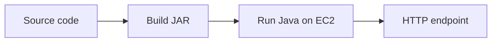
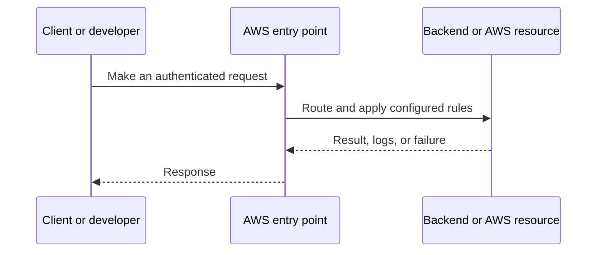
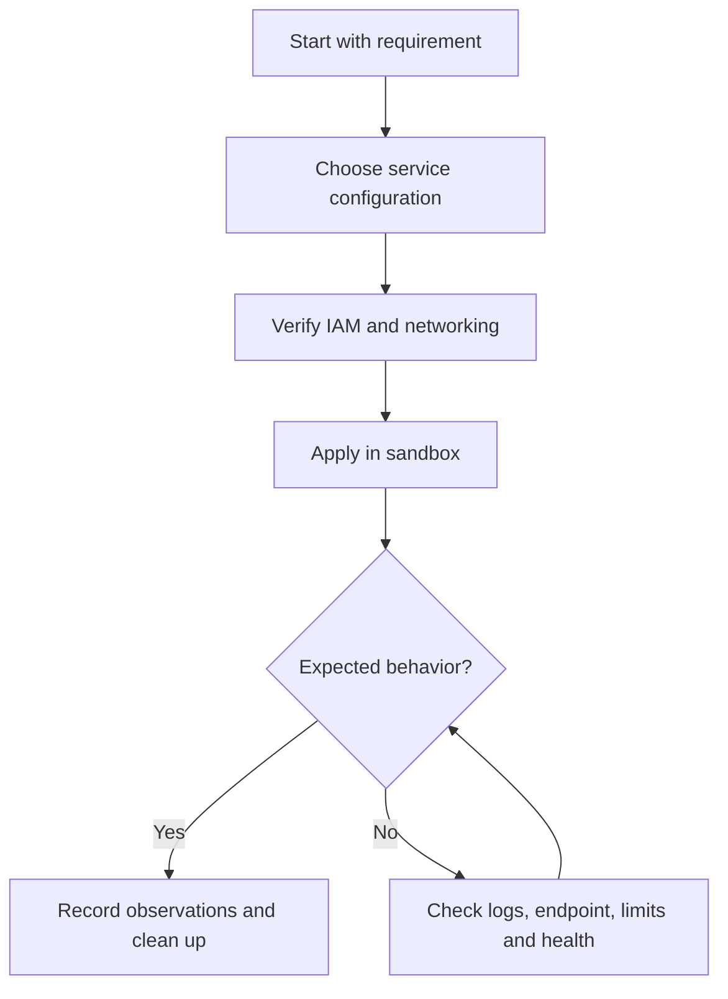
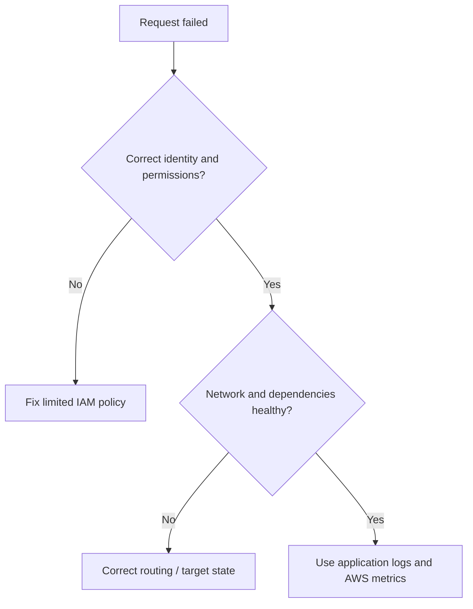

# Lesson 14: AWS: Deploy Spring Boot Application on EC2 — Explained Simply

*AWS Education Notes · Author: Jayesh Sharma*

> **Source and scope:** Lesson 14 in [AWS from Basics to Advanced](https://www.youtube.com/playlist?list=PL6W8uoQQ2c60g3PAgzVPpi0YWwxITD43p), by Concept && Coding – by Shrayansh. The topic/order is verified but no full spoken transcript was accessible. These are **independently written educational explanations** and not an account of unseen video details. Confirm current implementation steps in [AWS documentation](https://docs.aws.amazon.com/).

## Contents
- [1. The big picture](#1-the-big-picture)
- [2. Everyday analogy](#2-everyday-analogy)
- [3. Build Spring Boot JAR](#3-build-spring-boot-jar)
- [4. EC2 runtime prerequisites](#4-ec2-runtime-prerequisites)
- [5. Bind address and port](#5-bind-address-and-port)
- [6. Security and networking](#6-security-and-networking)
- [7. Systemd service](#7-systemd-service)
- [8. Environment configuration](#8-environment-configuration)
- [9. Verify deployment](#9-verify-deployment)
- [10. Production improvements](#10-production-improvements)
- [11. End-to-end workflow](#11-end-to-end-workflow)
- [12. Practical exercise](#12-practical-exercise)
- [13. Production pitfalls](#13-production-pitfalls)
- [14. Interview questions and quick revision](#14-interview-questions-and-quick-revision)

## 1. The big picture

This lesson explains **running a Java backend on a cloud VM**. To understand it well, follow the data and request path, ask who owns each responsibility, and test how failures are handled.

## 2. Everyday analogy

Publishing a book: building a JAR is preparing the book; deploying it means placing it in a library where readers can access it.

An analogy makes the concept memorable, but do not rely on it to decide security, cost or reliability properties. AWS documentation and real tests determine those.

## 3. Build Spring Boot JAR

Use Maven or Gradle to compile, test and package the Spring Boot application. Validate Java version compatibility with the EC2 runtime.

**Why it matters:** This affects at least one of correctness, security, cost, scale, or operational recovery. Explain the trade-off before choosing a production configuration.

## 4. EC2 runtime prerequisites

Install the correct JDK or JRE, create an unprivileged application account, supply configuration, and avoid running the service as root.

**Why it matters:** This affects at least one of correctness, security, cost, scale, or operational recovery. Explain the trade-off before choosing a production configuration.

## 5. Bind address and port

A server listening on localhost is not reachable from external clients. Configure the application bind interface and check the target HTTP port.

**Why it matters:** This affects at least one of correctness, security, cost, scale, or operational recovery. Explain the trade-off before choosing a production configuration.

## 6. Security and networking

Place the EC2 instance in a suitable subnet; open only the required ingress. Prefer TLS termination at a load balancer or reverse proxy rather than exposing many app ports.

**Why it matters:** This affects at least one of correctness, security, cost, scale, or operational recovery. Explain the trade-off before choosing a production configuration.

## 7. Systemd service

Use a systemd unit with Restart policies, sensible environment variables and resource limits so the app restarts after reboot.

**Why it matters:** This affects at least one of correctness, security, cost, scale, or operational recovery. Explain the trade-off before choosing a production configuration.

## 8. Environment configuration

Keep credentials out of application.properties committed to Git. Prefer IAM role credentials, Secrets Manager or Parameter Store where appropriate.

**Why it matters:** This affects at least one of correctness, security, cost, scale, or operational recovery. Explain the trade-off before choosing a production configuration.

## 9. Verify deployment

Check application logs, ss -lntp, local curl, instance health, SG rules, route tables and external endpoint behavior in that order.

**Why it matters:** This affects at least one of correctness, security, cost, scale, or operational recovery. Explain the trade-off before choosing a production configuration.

## 10. Production improvements

Use an ALB, Auto Scaling Group, HTTPS, centralized logs and automated releases when moving beyond one EC2 demo.

**Why it matters:** This affects at least one of correctness, security, cost, scale, or operational recovery. Explain the trade-off before choosing a production configuration.

## 11. End-to-end workflow

Try this simple reasoning pattern: identify the caller, locate the resource, check permissions and networking, execute the operation, then verify the result.

**Example scenario:** A small Spring Boot API serves users through an AWS-managed component. What happens if credentials expire, a backend becomes unhealthy, or the network route is absent? Investigate one failure at a time rather than granting AdministratorAccess or opening every port.

## 12. Practical exercise

1. Draw the architecture of this lesson without reading the diagram above.
2. Locate the corresponding AWS service in the console and note its Region and required IAM permissions.
3. Predict one successful and one denied request before experimenting.
4. Use the smallest safe test environment and record service-level logs.
5. If any paid resources are created, delete them—including attached storage, gateways and unused addresses—and check billing.

**Cost warning:** Even brief EC2, EBS, NAT gateway, ALB, S3 request and transfer labs may incur charges depending on account eligibility, Region and configuration.

## 13. Production pitfalls

| Failure | Investigation or mitigation |
|---|---|
| Access denied | Check identity, trust, action, resource scope and explicit denies |
| Resource cannot be reached | Verify bind address, DNS, route, target health and firewall rules |
| Intermittent outage | Review AZ coverage, retry behavior, health checks and capacity |
| Wrong region or resource | Verify identifiers, ARN, Region and account |
| Unsafe permissions | Replace broad access with least privilege |
| Unexpected cost | Inspect running, detached and leftover resources; set alerts |

## 14. Interview questions and quick revision

1. Explain **Build Spring Boot JAR** to a beginner with one real use case.
2. Explain **EC2 runtime prerequisites** to a beginner with one real use case.
3. Explain **Bind address and port** to a beginner with one real use case.
4. Explain **Security and networking** to a beginner with one real use case.
5. Explain **Systemd service** to a beginner with one real use case.
6. Explain **Environment configuration** to a beginner with one real use case.
7. Explain **Verify deployment** to a beginner with one real use case.
8. Explain **Production improvements** to a beginner with one real use case.
9. What would break when traffic increases dramatically?
10. Which assumptions are specific to one AZ or Region?
11. What would your monitoring and rollback plan look like?

### Key terms
- **Build Spring Boot JAR:** Use Maven or Gradle to compile, test and package the Spring Boot application.
- **EC2 runtime prerequisites:** Install the correct JDK or JRE, create an unprivileged application account, supply configuration, and avoid running the service as root.
- **Bind address and port:** A server listening on localhost is not reachable from external clients.
- **Security and networking:** Place the EC2 instance in a suitable subnet; open only the required ingress.
- **Systemd service:** Use a systemd unit with Restart policies, sensible environment variables and resource limits so the app restarts after reboot.
- **Environment configuration:** Keep credentials out of application.
- **Verify deployment:** Check application logs, ss -lntp, local curl, instance health, SG rules, route tables and external endpoint behavior in that order.
- **Production improvements:** Use an ALB, Auto Scaling Group, HTTPS, centralized logs and automated releases when moving beyond one EC2 demo.

### One-minute answer

**AWS: Deploy Spring Boot Application on EC2:** Explain the major components, the request and data flow, failure boundaries, least-privilege access, and the simplest test that proves your design works.

### References

- [Course playlist](https://www.youtube.com/playlist?list=PL6W8uoQQ2c60g3PAgzVPpi0YWwxITD43p)
- [Official AWS documentation](https://docs.aws.amazon.com/)
- [AWS Well-Architected](https://docs.aws.amazon.com/wellarchitected/latest/framework/welcome.html)
