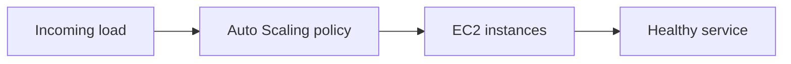
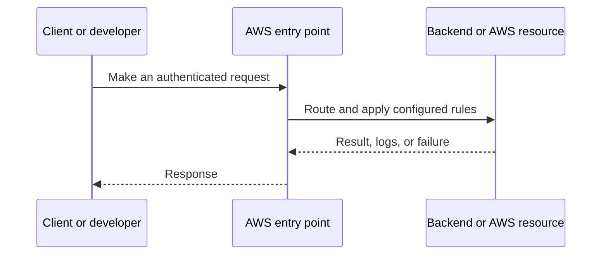
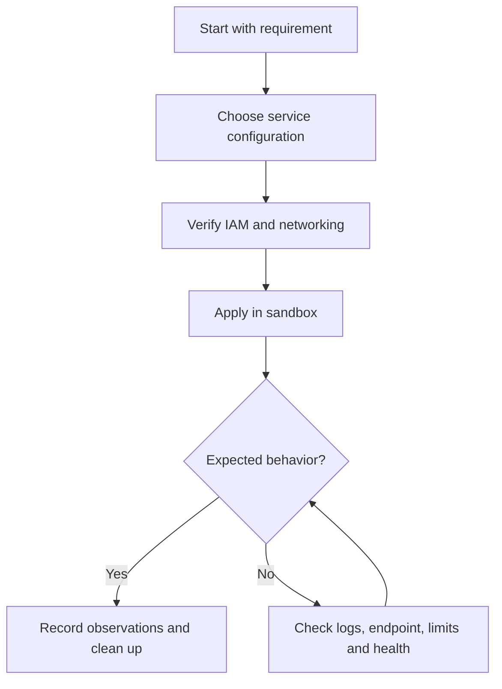
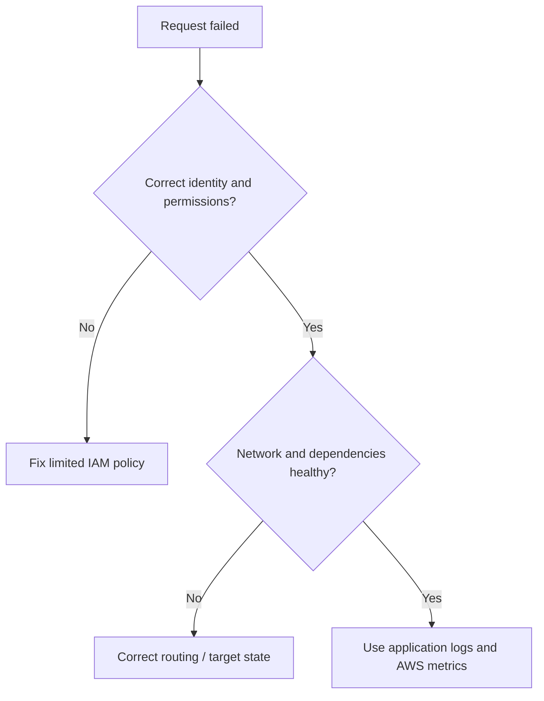

# Lesson 15: AWS Auto Scaling Group (ASG) Explained | Automatically Scale EC2 Instances — Explained Simply

*AWS Education Notes · Author: Jayesh Sharma*

> **Source and scope:** Lesson 15 in [AWS from Basics to Advanced](https://www.youtube.com/playlist?list=PL6W8uoQQ2c60g3PAgzVPpi0YWwxITD43p), by Concept && Coding – by Shrayansh. The topic/order is verified but no full spoken transcript was accessible. These are **independently written educational explanations** and not an account of unseen video details. Confirm current implementation steps in [AWS documentation](https://docs.aws.amazon.com/).

## Contents
- [1. The big picture](#1-the-big-picture)
- [2. Everyday analogy](#2-everyday-analogy)
- [3. Launch template](#3-launch-template)
- [4. Minimum desired maximum](#4-minimum-desired-maximum)
- [5. Health checks and replacement](#5-health-checks-and-replacement)
- [6. Target tracking policy](#6-target-tracking-policy)
- [7. Scale-out vs scale-in](#7-scale-out-vs-scale-in)
- [8. Multiple AZs](#8-multiple-azs)
- [9. Stateful application risks](#9-stateful-application-risks)
- [10. Cost and limits](#10-cost-and-limits)
- [11. End-to-end workflow](#11-end-to-end-workflow)
- [12. Practical exercise](#12-practical-exercise)
- [13. Production pitfalls](#13-production-pitfalls)
- [14. Interview questions and quick revision](#14-interview-questions-and-quick-revision)

## 1. The big picture

This lesson explains **automatically changing EC2 fleet size**. To understand it well, follow the data and request path, ask who owns each responsibility, and test how failures are handled.

## 2. Everyday analogy

A restaurant adds or removes staff according to customer queues, rather than always paying for the maximum staff.

An analogy makes the concept memorable, but do not rely on it to decide security, cost or reliability properties. AWS documentation and real tests determine those.

## 3. Launch template

Defines the AMI, instance type, security settings and other parameters used when launching replacement instances.

**Why it matters:** This affects at least one of correctness, security, cost, scale, or operational recovery. Explain the trade-off before choosing a production configuration.

## 4. Minimum desired maximum

Min is the floor, max is the ceiling, desired is the target count that the ASG tries to maintain.

**Why it matters:** This affects at least one of correctness, security, cost, scale, or operational recovery. Explain the trade-off before choosing a production configuration.

## 5. Health checks and replacement

If an instance fails a configured health check, the ASG can terminate and replace it. App-level checks may need a load balancer.

**Why it matters:** This affects at least one of correctness, security, cost, scale, or operational recovery. Explain the trade-off before choosing a production configuration.

## 6. Target tracking policy

A policy can adjust desired capacity toward a metric target such as average CPU utilization; scaling is not instantaneous.

**Why it matters:** This affects at least one of correctness, security, cost, scale, or operational recovery. Explain the trade-off before choosing a production configuration.

## 7. Scale-out vs scale-in

Scale-out adds instances during demand; scale-in removes them as demand falls. Cooldowns, warmup and connection draining help avoid disruption.

**Why it matters:** This affects at least one of correctness, security, cost, scale, or operational recovery. Explain the trade-off before choosing a production configuration.

## 8. Multiple AZs

Deploy ASG across eligible subnets in multiple AZs, with enough capacity in surviving AZs for failures.

**Why it matters:** This affects at least one of correctness, security, cost, scale, or operational recovery. Explain the trade-off before choosing a production configuration.

## 9. Stateful application risks

Keep user sessions and persistent data outside disposable EC2 instances, because ASG instances can be replaced at any time.

**Why it matters:** This affects at least one of correctness, security, cost, scale, or operational recovery. Explain the trade-off before choosing a production configuration.

## 10. Cost and limits

Instance capacity, load balancer, scaling policy and minimum count determine costs. Set maximums and alarms to avoid runaway spending.

**Why it matters:** This affects at least one of correctness, security, cost, scale, or operational recovery. Explain the trade-off before choosing a production configuration.

## 11. End-to-end workflow

Try this simple reasoning pattern: identify the caller, locate the resource, check permissions and networking, execute the operation, then verify the result.

**Example scenario:** A small Spring Boot API serves users through an AWS-managed component. What happens if credentials expire, a backend becomes unhealthy, or the network route is absent? Investigate one failure at a time rather than granting AdministratorAccess or opening every port.

## 12. Practical exercise

1. Draw the architecture of this lesson without reading the diagram above.
2. Locate the corresponding AWS service in the console and note its Region and required IAM permissions.
3. Predict one successful and one denied request before experimenting.
4. Use the smallest safe test environment and record service-level logs.
5. If any paid resources are created, delete them—including attached storage, gateways and unused addresses—and check billing.

**Cost warning:** Even brief EC2, EBS, NAT gateway, ALB, S3 request and transfer labs may incur charges depending on account eligibility, Region and configuration.

## 13. Production pitfalls

| Failure | Investigation or mitigation |
|---|---|
| Access denied | Check identity, trust, action, resource scope and explicit denies |
| Resource cannot be reached | Verify bind address, DNS, route, target health and firewall rules |
| Intermittent outage | Review AZ coverage, retry behavior, health checks and capacity |
| Wrong region or resource | Verify identifiers, ARN, Region and account |
| Unsafe permissions | Replace broad access with least privilege |
| Unexpected cost | Inspect running, detached and leftover resources; set alerts |

## 14. Interview questions and quick revision

1. Explain **Launch template** to a beginner with one real use case.
2. Explain **Minimum desired maximum** to a beginner with one real use case.
3. Explain **Health checks and replacement** to a beginner with one real use case.
4. Explain **Target tracking policy** to a beginner with one real use case.
5. Explain **Scale-out vs scale-in** to a beginner with one real use case.
6. Explain **Multiple AZs** to a beginner with one real use case.
7. Explain **Stateful application risks** to a beginner with one real use case.
8. Explain **Cost and limits** to a beginner with one real use case.
9. What would break when traffic increases dramatically?
10. Which assumptions are specific to one AZ or Region?
11. What would your monitoring and rollback plan look like?

### Key terms
- **Launch template:** Defines the AMI, instance type, security settings and other parameters used when launching replacement instances.
- **Minimum desired maximum:** Min is the floor, max is the ceiling, desired is the target count that the ASG tries to maintain.
- **Health checks and replacement:** If an instance fails a configured health check, the ASG can terminate and replace it.
- **Target tracking policy:** A policy can adjust desired capacity toward a metric target such as average CPU utilization; scaling is not instantaneous.
- **Scale-out vs scale-in:** Scale-out adds instances during demand; scale-in removes them as demand falls.
- **Multiple AZs:** Deploy ASG across eligible subnets in multiple AZs, with enough capacity in surviving AZs for failures.
- **Stateful application risks:** Keep user sessions and persistent data outside disposable EC2 instances, because ASG instances can be replaced at any time.
- **Cost and limits:** Instance capacity, load balancer, scaling policy and minimum count determine costs.

### One-minute answer

**AWS Auto Scaling Group (ASG) Explained | Automatically Scale EC2 Instances:** Explain the major components, the request and data flow, failure boundaries, least-privilege access, and the simplest test that proves your design works.

### References

- [Course playlist](https://www.youtube.com/playlist?list=PL6W8uoQQ2c60g3PAgzVPpi0YWwxITD43p)
- [Official AWS documentation](https://docs.aws.amazon.com/)
- [AWS Well-Architected](https://docs.aws.amazon.com/wellarchitected/latest/framework/welcome.html)
