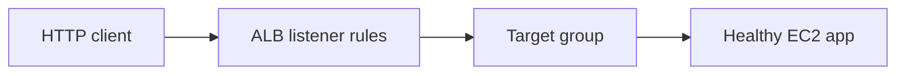
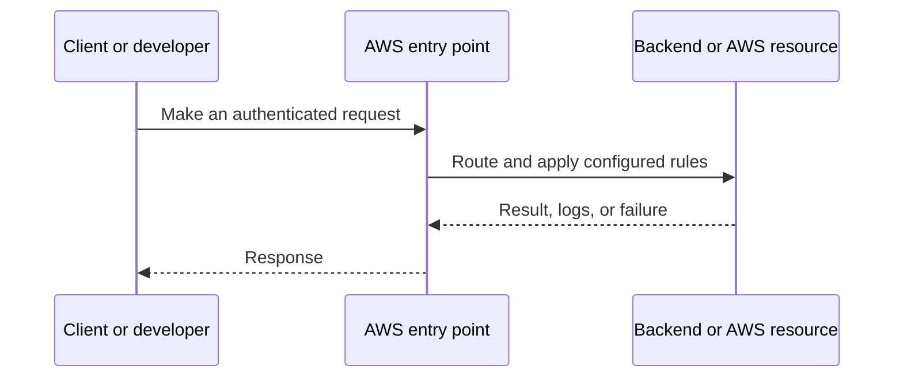
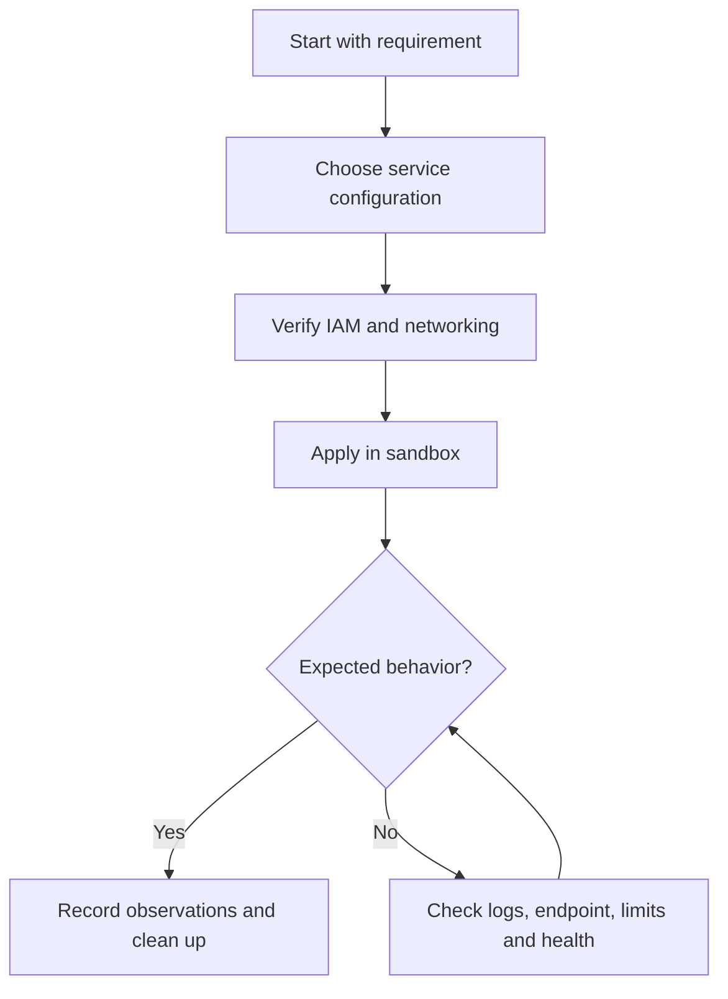
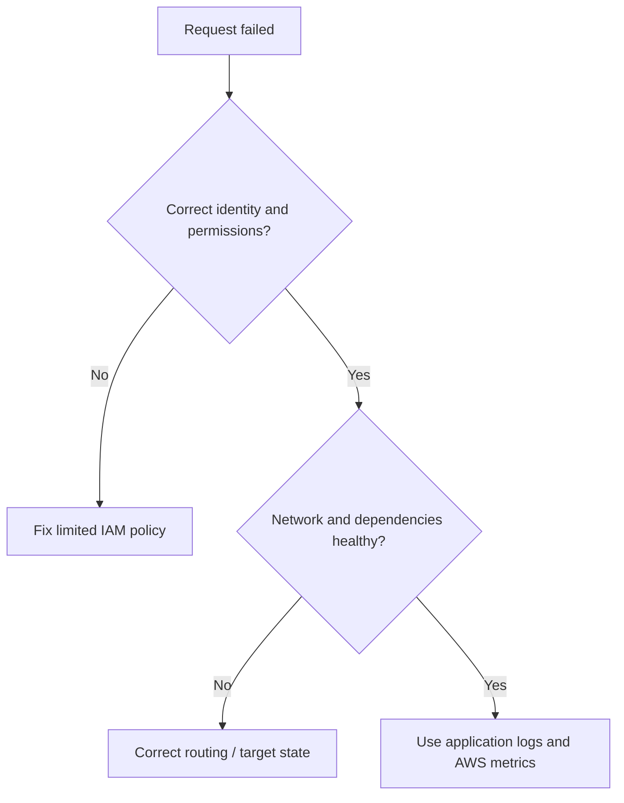

# Lesson 16: AWS Application Load Balancer (ALB) Explained & Complete Hands-On Setup | EC2 + ASG — Explained Simply

*AWS Education Notes · Author: Jayesh Sharma*

> **Source and scope:** Lesson 16 in [AWS from Basics to Advanced](https://www.youtube.com/playlist?list=PL6W8uoQQ2c60g3PAgzVPpi0YWwxITD43p), by Concept && Coding – by Shrayansh. The topic/order is verified but no full spoken transcript was accessible. These are **independently written educational explanations** and not an account of unseen video details. Confirm current implementation steps in [AWS documentation](https://docs.aws.amazon.com/).

## Contents
- [1. The big picture](#1-the-big-picture)
- [2. Everyday analogy](#2-everyday-analogy)
- [3. Layer 7 load balancing](#3-layer-7-load-balancing)
- [4. Listeners and rules](#4-listeners-and-rules)
- [5. Target groups](#5-target-groups)
- [6. Health checks](#6-health-checks)
- [7. Cross-AZ resilience](#7-cross-az-resilience)
- [8. TLS termination](#8-tls-termination)
- [9. ASG integration](#9-asg-integration)
- [10. Troubleshooting 502/503/504](#10-troubleshooting-502503504)
- [11. End-to-end workflow](#11-end-to-end-workflow)
- [12. Practical exercise](#12-practical-exercise)
- [13. Production pitfalls](#13-production-pitfalls)
- [14. Interview questions and quick revision](#14-interview-questions-and-quick-revision)

## 1. The big picture

This lesson explains **routing HTTP requests to healthy AWS backends**. To understand it well, follow the data and request path, ask who owns each responsibility, and test how failures are handled.

## 2. Everyday analogy

A receptionist directs visitors to the right available service desk and stops sending them to a closed one.

An analogy makes the concept memorable, but do not rely on it to decide security, cost or reliability properties. AWS documentation and real tests determine those.

## 3. Layer 7 load balancing

An ALB understands HTTP/HTTPS and can route using hostnames, URL paths and other request attributes.

**Why it matters:** This affects at least one of correctness, security, cost, scale, or operational recovery. Explain the trade-off before choosing a production configuration.

## 4. Listeners and rules

Listeners accept traffic on ports such as 80 or 443. Rules choose actions such as forwarding to a target group or redirecting to HTTPS.

**Why it matters:** This affects at least one of correctness, security, cost, scale, or operational recovery. Explain the trade-off before choosing a production configuration.

## 5. Target groups

A target group contains registered backend targets and health-check rules. Only suitable healthy targets should normally receive production traffic.

**Why it matters:** This affects at least one of correctness, security, cost, scale, or operational recovery. Explain the trade-off before choosing a production configuration.

## 6. Health checks

Configure path, protocol and success criteria to reflect the app's readiness, not just that the virtual machine is powered on.

**Why it matters:** This affects at least one of correctness, security, cost, scale, or operational recovery. Explain the trade-off before choosing a production configuration.

## 7. Cross-AZ resilience

An ALB deployed in appropriate subnets across AZs can serve multiple targets; the application must still have healthy capacity across failure domains.

**Why it matters:** This affects at least one of correctness, security, cost, scale, or operational recovery. Explain the trade-off before choosing a production configuration.

## 8. TLS termination

ALB can use AWS Certificate Manager certificates for HTTPS listeners, subject to proper domain validation and configuration.

**Why it matters:** This affects at least one of correctness, security, cost, scale, or operational recovery. Explain the trade-off before choosing a production configuration.

## 9. ASG integration

An ASG can register and deregister its instances with a target group, adding capacity as it scales.

**Why it matters:** This affects at least one of correctness, security, cost, scale, or operational recovery. Explain the trade-off before choosing a production configuration.

## 10. Troubleshooting 502/503/504

Check target health, health-check path, SG ingress/egress, target listener port, server bind address, app startup and timeout behavior.

**Why it matters:** This affects at least one of correctness, security, cost, scale, or operational recovery. Explain the trade-off before choosing a production configuration.

## 11. End-to-end workflow

Try this simple reasoning pattern: identify the caller, locate the resource, check permissions and networking, execute the operation, then verify the result.

**Example scenario:** A small Spring Boot API serves users through an AWS-managed component. What happens if credentials expire, a backend becomes unhealthy, or the network route is absent? Investigate one failure at a time rather than granting AdministratorAccess or opening every port.

## 12. Practical exercise

1. Draw the architecture of this lesson without reading the diagram above.
2. Locate the corresponding AWS service in the console and note its Region and required IAM permissions.
3. Predict one successful and one denied request before experimenting.
4. Use the smallest safe test environment and record service-level logs.
5. If any paid resources are created, delete them—including attached storage, gateways and unused addresses—and check billing.

**Cost warning:** Even brief EC2, EBS, NAT gateway, ALB, S3 request and transfer labs may incur charges depending on account eligibility, Region and configuration.

## 13. Production pitfalls

| Failure | Investigation or mitigation |
|---|---|
| Access denied | Check identity, trust, action, resource scope and explicit denies |
| Resource cannot be reached | Verify bind address, DNS, route, target health and firewall rules |
| Intermittent outage | Review AZ coverage, retry behavior, health checks and capacity |
| Wrong region or resource | Verify identifiers, ARN, Region and account |
| Unsafe permissions | Replace broad access with least privilege |
| Unexpected cost | Inspect running, detached and leftover resources; set alerts |

## 14. Interview questions and quick revision

1. Explain **Layer 7 load balancing** to a beginner with one real use case.
2. Explain **Listeners and rules** to a beginner with one real use case.
3. Explain **Target groups** to a beginner with one real use case.
4. Explain **Health checks** to a beginner with one real use case.
5. Explain **Cross-AZ resilience** to a beginner with one real use case.
6. Explain **TLS termination** to a beginner with one real use case.
7. Explain **ASG integration** to a beginner with one real use case.
8. Explain **Troubleshooting 502/503/504** to a beginner with one real use case.
9. What would break when traffic increases dramatically?
10. Which assumptions are specific to one AZ or Region?
11. What would your monitoring and rollback plan look like?

### Key terms
- **Layer 7 load balancing:** An ALB understands HTTP/HTTPS and can route using hostnames, URL paths and other request attributes.
- **Listeners and rules:** Listeners accept traffic on ports such as 80 or 443.
- **Target groups:** A target group contains registered backend targets and health-check rules.
- **Health checks:** Configure path, protocol and success criteria to reflect the app's readiness, not just that the virtual machine is powered on.
- **Cross-AZ resilience:** An ALB deployed in appropriate subnets across AZs can serve multiple targets; the application must still have healthy capacity across failure domains.
- **TLS termination:** ALB can use AWS Certificate Manager certificates for HTTPS listeners, subject to proper domain validation and configuration.
- **ASG integration:** An ASG can register and deregister its instances with a target group, adding capacity as it scales.
- **Troubleshooting 502/503/504:** Check target health, health-check path, SG ingress/egress, target listener port, server bind address, app startup and timeout behavior.

### One-minute answer

**AWS Application Load Balancer (ALB) Explained & Complete Hands-On Setup | EC2 + ASG:** Explain the major components, the request and data flow, failure boundaries, least-privilege access, and the simplest test that proves your design works.

### References

- [Course playlist](https://www.youtube.com/playlist?list=PL6W8uoQQ2c60g3PAgzVPpi0YWwxITD43p)
- [Official AWS documentation](https://docs.aws.amazon.com/)
- [AWS Well-Architected](https://docs.aws.amazon.com/wellarchitected/latest/framework/welcome.html)
