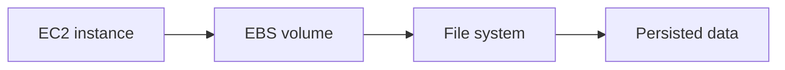
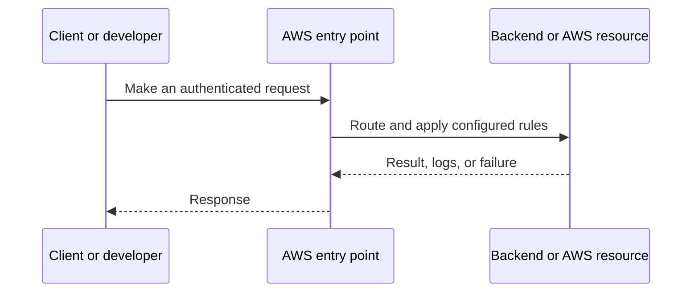
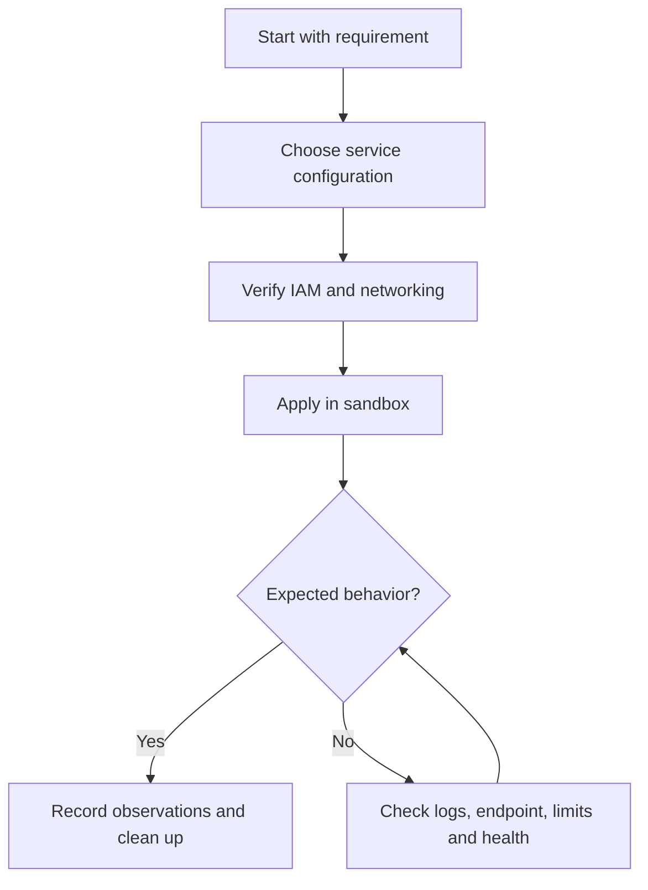
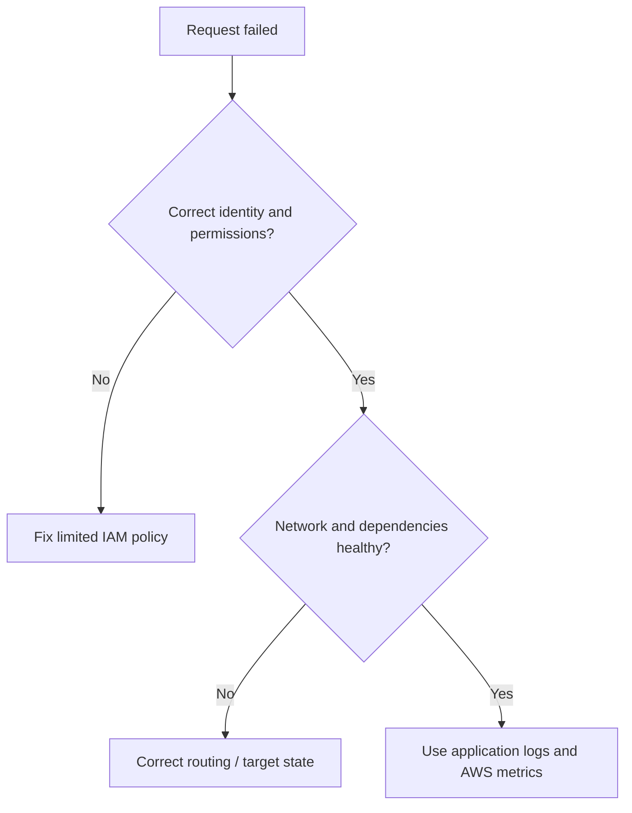

# Lesson 17: AWS: Elastic Block Store (EBS) — Explained Simply

*AWS Education Notes · Author: Jayesh Sharma*

> **Source and scope:** Lesson 17 in [AWS from Basics to Advanced](https://www.youtube.com/playlist?list=PL6W8uoQQ2c60g3PAgzVPpi0YWwxITD43p), by Concept && Coding – by Shrayansh. The topic/order is verified but no full spoken transcript was accessible. These are **independently written educational explanations** and not an account of unseen video details. Confirm current implementation steps in [AWS documentation](https://docs.aws.amazon.com/).

## Contents
- [1. The big picture](#1-the-big-picture)
- [2. Everyday analogy](#2-everyday-analogy)
- [3. Block vs object storage](#3-block-vs-object-storage)
- [4. AZ scope](#4-az-scope)
- [5. Root and data volumes](#5-root-and-data-volumes)
- [6. gp3 and performance](#6-gp3-and-performance)
- [7. Snapshots](#7-snapshots)
- [8. Encryption](#8-encryption)
- [9. Resize and mounting](#9-resize-and-mounting)
- [10. Costs and cleanup](#10-costs-and-cleanup)
- [11. End-to-end workflow](#11-end-to-end-workflow)
- [12. Practical exercise](#12-practical-exercise)
- [13. Production pitfalls](#13-production-pitfalls)
- [14. Interview questions and quick revision](#14-interview-questions-and-quick-revision)

## 1. The big picture

This lesson explains **persistent block storage attached to EC2**. To understand it well, follow the data and request path, ask who owns each responsibility, and test how failures are handled.

## 2. Everyday analogy

An EBS volume is like an attached disk drive: the operating system sees blocks, while AWS manages the underlying storage service.

An analogy makes the concept memorable, but do not rely on it to decide security, cost or reliability properties. AWS documentation and real tests determine those.

## 3. Block vs object storage

EBS presents a block device, appropriate for file systems or databases; S3 stores objects and is accessed by object APIs.

**Why it matters:** This affects at least one of correctness, security, cost, scale, or operational recovery. Explain the trade-off before choosing a production configuration.

## 4. AZ scope

EBS volumes live in an Availability Zone and are usually attached to instances in that same AZ. Multi-Attach is a specialized feature for eligible volume types and instances.

**Why it matters:** This affects at least one of correctness, security, cost, scale, or operational recovery. Explain the trade-off before choosing a production configuration.

## 5. Root and data volumes

A root volume holds the OS. A separate data volume can hold databases or application files and has its own lifecycle settings.

**Why it matters:** This affects at least one of correctness, security, cost, scale, or operational recovery. Explain the trade-off before choosing a production configuration.

## 6. gp3 and performance

General Purpose SSD gp3 offers independently configurable storage size, IOPS and throughput within service limits. Select volumes by workload rather than largest size alone.

**Why it matters:** This affects at least one of correctness, security, cost, scale, or operational recovery. Explain the trade-off before choosing a production configuration.

## 7. Snapshots

EBS snapshots capture point-in-time volume state and are stored/managed by AWS. Snapshot recovery and consistency need planning for actively written databases.

**Why it matters:** This affects at least one of correctness, security, cost, scale, or operational recovery. Explain the trade-off before choosing a production configuration.

## 8. Encryption

Enable encryption with AWS KMS keys, manage key permissions and understand copy/restore rules.

**Why it matters:** This affects at least one of correctness, security, cost, scale, or operational recovery. Explain the trade-off before choosing a production configuration.

## 9. Resize and mounting

Resize volumes then grow the partition and file system as necessary. Mounting, fstab and filesystem integrity remain operating-system responsibilities.

**Why it matters:** This affects at least one of correctness, security, cost, scale, or operational recovery. Explain the trade-off before choosing a production configuration.

## 10. Costs and cleanup

Provisioned volumes and snapshots incur charges even when no EC2 instance is running; inspect detached volumes after labs.

**Why it matters:** This affects at least one of correctness, security, cost, scale, or operational recovery. Explain the trade-off before choosing a production configuration.

## 11. End-to-end workflow

Try this simple reasoning pattern: identify the caller, locate the resource, check permissions and networking, execute the operation, then verify the result.

**Example scenario:** A small Spring Boot API serves users through an AWS-managed component. What happens if credentials expire, a backend becomes unhealthy, or the network route is absent? Investigate one failure at a time rather than granting AdministratorAccess or opening every port.

## 12. Practical exercise

1. Draw the architecture of this lesson without reading the diagram above.
2. Locate the corresponding AWS service in the console and note its Region and required IAM permissions.
3. Predict one successful and one denied request before experimenting.
4. Use the smallest safe test environment and record service-level logs.
5. If any paid resources are created, delete them—including attached storage, gateways and unused addresses—and check billing.

**Cost warning:** Even brief EC2, EBS, NAT gateway, ALB, S3 request and transfer labs may incur charges depending on account eligibility, Region and configuration.

## 13. Production pitfalls

| Failure | Investigation or mitigation |
|---|---|
| Access denied | Check identity, trust, action, resource scope and explicit denies |
| Resource cannot be reached | Verify bind address, DNS, route, target health and firewall rules |
| Intermittent outage | Review AZ coverage, retry behavior, health checks and capacity |
| Wrong region or resource | Verify identifiers, ARN, Region and account |
| Unsafe permissions | Replace broad access with least privilege |
| Unexpected cost | Inspect running, detached and leftover resources; set alerts |

## 14. Interview questions and quick revision

1. Explain **Block vs object storage** to a beginner with one real use case.
2. Explain **AZ scope** to a beginner with one real use case.
3. Explain **Root and data volumes** to a beginner with one real use case.
4. Explain **gp3 and performance** to a beginner with one real use case.
5. Explain **Snapshots** to a beginner with one real use case.
6. Explain **Encryption** to a beginner with one real use case.
7. Explain **Resize and mounting** to a beginner with one real use case.
8. Explain **Costs and cleanup** to a beginner with one real use case.
9. What would break when traffic increases dramatically?
10. Which assumptions are specific to one AZ or Region?
11. What would your monitoring and rollback plan look like?

### Key terms
- **Block vs object storage:** EBS presents a block device, appropriate for file systems or databases; S3 stores objects and is accessed by object APIs.
- **AZ scope:** EBS volumes live in an Availability Zone and are usually attached to instances in that same AZ.
- **Root and data volumes:** A root volume holds the OS.
- **gp3 and performance:** General Purpose SSD gp3 offers independently configurable storage size, IOPS and throughput within service limits.
- **Snapshots:** EBS snapshots capture point-in-time volume state and are stored/managed by AWS.
- **Encryption:** Enable encryption with AWS KMS keys, manage key permissions and understand copy/restore rules.
- **Resize and mounting:** Resize volumes then grow the partition and file system as necessary.
- **Costs and cleanup:** Provisioned volumes and snapshots incur charges even when no EC2 instance is running; inspect detached volumes after labs.

### One-minute answer

**AWS: Elastic Block Store (EBS):** Explain the major components, the request and data flow, failure boundaries, least-privilege access, and the simplest test that proves your design works.

### References

- [Course playlist](https://www.youtube.com/playlist?list=PL6W8uoQQ2c60g3PAgzVPpi0YWwxITD43p)
- [Official AWS documentation](https://docs.aws.amazon.com/)
- [AWS Well-Architected](https://docs.aws.amazon.com/wellarchitected/latest/framework/welcome.html)
