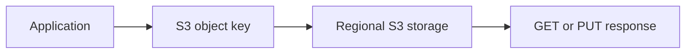
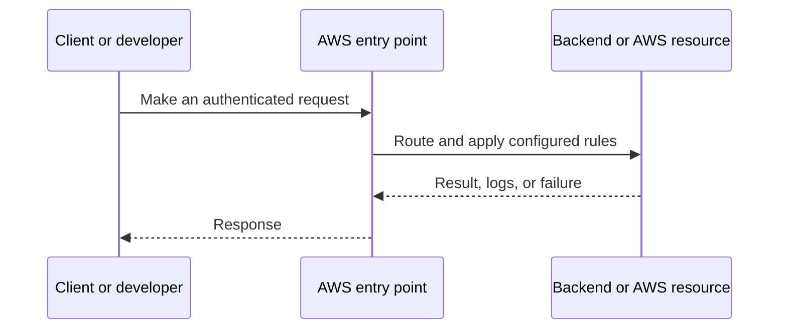
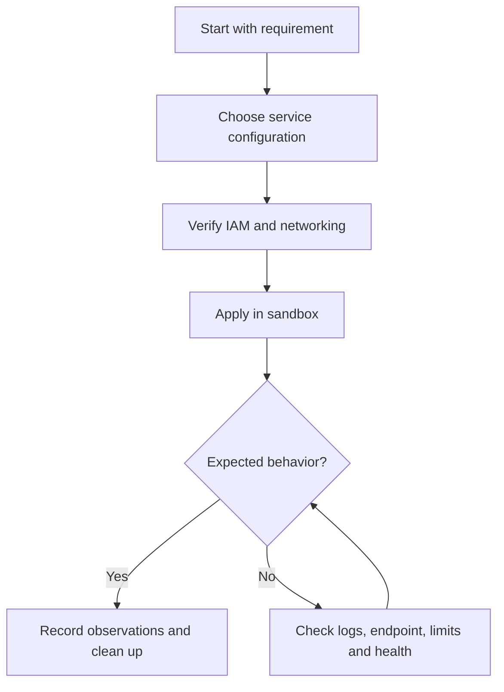
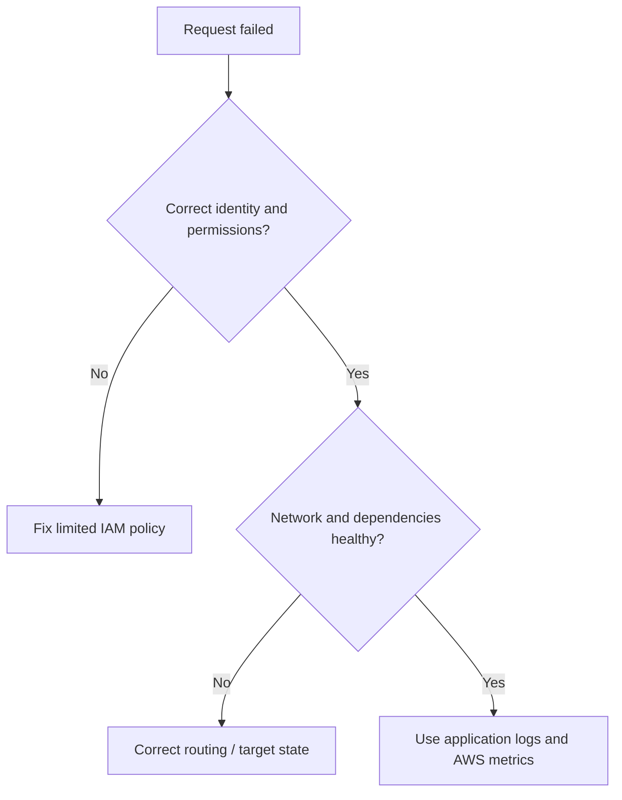

# Lesson 18: AWS S3(Simple Storage Service) Part1 - Architecture — Explained Simply

*AWS Education Notes · Author: Jayesh Sharma*

> **Source and scope:** Lesson 18 in [AWS from Basics to Advanced](https://www.youtube.com/playlist?list=PL6W8uoQQ2c60g3PAgzVPpi0YWwxITD43p), by Concept && Coding – by Shrayansh. The topic/order is verified but no full spoken transcript was accessible. These are **independently written educational explanations** and not an account of unseen video details. Confirm current implementation steps in [AWS documentation](https://docs.aws.amazon.com/).

## Contents
- [1. The big picture](#1-the-big-picture)
- [2. Everyday analogy](#2-everyday-analogy)
- [3. Bucket, key and object](#3-bucket-key-and-object)
- [4. S3 durability and availability](#4-s3-durability-and-availability)
- [5. Object vs filesystem](#5-object-vs-filesystem)
- [6. Access control](#6-access-control)
- [7. Versioning](#7-versioning)
- [8. Storage classes](#8-storage-classes)
- [9. Consistency](#9-consistency)
- [10. Performance and request patterns](#10-performance-and-request-patterns)
- [11. End-to-end workflow](#11-end-to-end-workflow)
- [12. Practical exercise](#12-practical-exercise)
- [13. Production pitfalls](#13-production-pitfalls)
- [14. Interview questions and quick revision](#14-interview-questions-and-quick-revision)

## 1. The big picture

This lesson explains **Amazon S3 object storage and architecture**. To understand it well, follow the data and request path, ask who owns each responsibility, and test how failures are handled.

## 2. Everyday analogy

S3 is a large warehouse for named objects; you request an object by bucket and key instead of mounting a normal disk.

An analogy makes the concept memorable, but do not rely on it to decide security, cost or reliability properties. AWS documentation and real tests determine those.

## 3. Bucket, key and object

A bucket is a container in a selected AWS Region. An object is data plus metadata, addressed by a key within its bucket.

**Why it matters:** This affects at least one of correctness, security, cost, scale, or operational recovery. Explain the trade-off before choosing a production configuration.

## 4. S3 durability and availability

S3 Standard stores data redundantly across multiple AZs in a Region. Durability and availability are different concepts; choose the correct storage class for the workload.

**Why it matters:** This affects at least one of correctness, security, cost, scale, or operational recovery. Explain the trade-off before choosing a production configuration.

## 5. Object vs filesystem

S3 has object APIs such as PUT, GET and LIST. It is not inherently a POSIX file system and does not behave exactly like an attached disk.

**Why it matters:** This affects at least one of correctness, security, cost, scale, or operational recovery. Explain the trade-off before choosing a production configuration.

## 6. Access control

Keep Block Public Access enabled unless there is a reviewed reason to expose content. Use bucket/access-point/IAM policies appropriately.

**Why it matters:** This affects at least one of correctness, security, cost, scale, or operational recovery. Explain the trade-off before choosing a production configuration.

## 7. Versioning

Versioning stores multiple versions of a key and helps recovery from accidental overwrites/deletions, but increases storage costs and isn't a substitute for every backup requirement.

**Why it matters:** This affects at least one of correctness, security, cost, scale, or operational recovery. Explain the trade-off before choosing a production configuration.

## 8. Storage classes

Standard, Intelligent-Tiering, Standard-IA, One Zone-IA, Glacier classes and others differ in availability, retrieval time and minimum-duration charges.

**Why it matters:** This affects at least one of correctness, security, cost, scale, or operational recovery. Explain the trade-off before choosing a production configuration.

## 9. Consistency

Amazon S3 provides strong read-after-write consistency for object PUT/DELETE and list operations in supported usage; this does not imply multi-object transactions.

**Why it matters:** This affects at least one of correctness, security, cost, scale, or operational recovery. Explain the trade-off before choosing a production configuration.

## 10. Performance and request patterns

Consider object key design, request rates, multipart upload, transfer acceleration where appropriate, and request/data transfer charges.

**Why it matters:** This affects at least one of correctness, security, cost, scale, or operational recovery. Explain the trade-off before choosing a production configuration.

## 11. End-to-end workflow

Try this simple reasoning pattern: identify the caller, locate the resource, check permissions and networking, execute the operation, then verify the result.

**Example scenario:** A small Spring Boot API serves users through an AWS-managed component. What happens if credentials expire, a backend becomes unhealthy, or the network route is absent? Investigate one failure at a time rather than granting AdministratorAccess or opening every port.

## 12. Practical exercise

1. Draw the architecture of this lesson without reading the diagram above.
2. Locate the corresponding AWS service in the console and note its Region and required IAM permissions.
3. Predict one successful and one denied request before experimenting.
4. Use the smallest safe test environment and record service-level logs.
5. If any paid resources are created, delete them—including attached storage, gateways and unused addresses—and check billing.

**Cost warning:** Even brief EC2, EBS, NAT gateway, ALB, S3 request and transfer labs may incur charges depending on account eligibility, Region and configuration.

## 13. Production pitfalls

| Failure | Investigation or mitigation |
|---|---|
| Access denied | Check identity, trust, action, resource scope and explicit denies |
| Resource cannot be reached | Verify bind address, DNS, route, target health and firewall rules |
| Intermittent outage | Review AZ coverage, retry behavior, health checks and capacity |
| Wrong region or resource | Verify identifiers, ARN, Region and account |
| Unsafe permissions | Replace broad access with least privilege |
| Unexpected cost | Inspect running, detached and leftover resources; set alerts |

## 14. Interview questions and quick revision

1. Explain **Bucket, key and object** to a beginner with one real use case.
2. Explain **S3 durability and availability** to a beginner with one real use case.
3. Explain **Object vs filesystem** to a beginner with one real use case.
4. Explain **Access control** to a beginner with one real use case.
5. Explain **Versioning** to a beginner with one real use case.
6. Explain **Storage classes** to a beginner with one real use case.
7. Explain **Consistency** to a beginner with one real use case.
8. Explain **Performance and request patterns** to a beginner with one real use case.
9. What would break when traffic increases dramatically?
10. Which assumptions are specific to one AZ or Region?
11. What would your monitoring and rollback plan look like?

### Key terms
- **Bucket, key and object:** A bucket is a container in a selected AWS Region.
- **S3 durability and availability:** S3 Standard stores data redundantly across multiple AZs in a Region.
- **Object vs filesystem:** S3 has object APIs such as PUT, GET and LIST.
- **Access control:** Keep Block Public Access enabled unless there is a reviewed reason to expose content.
- **Versioning:** Versioning stores multiple versions of a key and helps recovery from accidental overwrites/deletions, but increases storage costs and isn't a substitute for every backup requirement.
- **Storage classes:** Standard, Intelligent-Tiering, Standard-IA, One Zone-IA, Glacier classes and others differ in availability, retrieval time and minimum-duration charges.
- **Consistency:** Amazon S3 provides strong read-after-write consistency for object PUT/DELETE and list operations in supported usage; this does not imply multi-object transactions.
- **Performance and request patterns:** Consider object key design, request rates, multipart upload, transfer acceleration where appropriate, and request/data transfer charges.

### One-minute answer

**AWS S3(Simple Storage Service) Part1 - Architecture:** Explain the major components, the request and data flow, failure boundaries, least-privilege access, and the simplest test that proves your design works.

### References

- [Course playlist](https://www.youtube.com/playlist?list=PL6W8uoQQ2c60g3PAgzVPpi0YWwxITD43p)
- [Official AWS documentation](https://docs.aws.amazon.com/)
- [AWS Well-Architected](https://docs.aws.amazon.com/wellarchitected/latest/framework/welcome.html)
