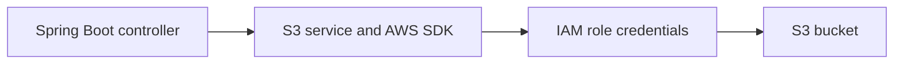
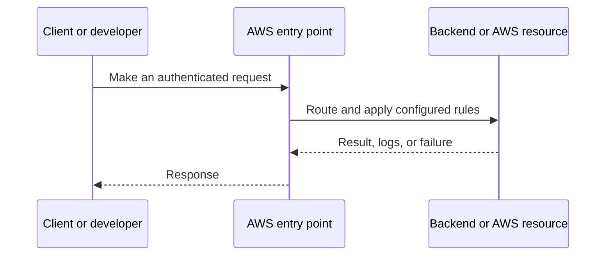
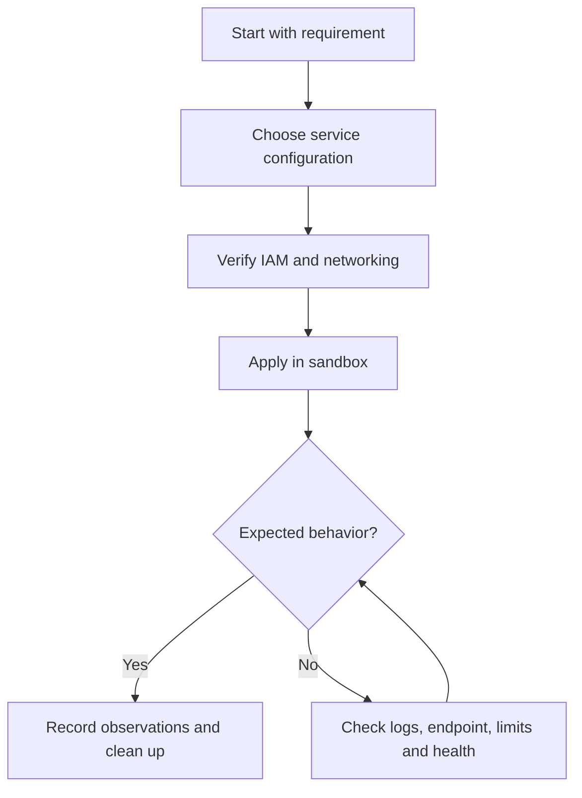
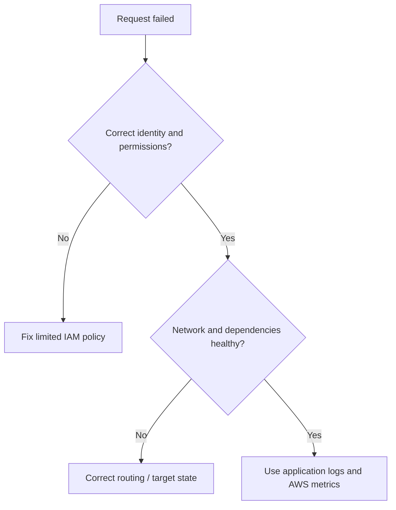

# Lesson 19: AWS S3 Part2: Spring Boot Integration | AWS S3 Authentication Flow Explained — Explained Simply

*AWS Education Notes · Author: Jayesh Sharma*

> **Source and scope:** Lesson 19 in [AWS from Basics to Advanced](https://www.youtube.com/playlist?list=PL6W8uoQQ2c60g3PAgzVPpi0YWwxITD43p), by Concept && Coding – by Shrayansh. The topic/order is verified but no full spoken transcript was accessible. These are **independently written educational explanations** and not an account of unseen video details. Confirm current implementation steps in [AWS documentation](https://docs.aws.amazon.com/).

## Contents
- [1. The big picture](#1-the-big-picture)
- [2. Everyday analogy](#2-everyday-analogy)
- [3. AWS SDK for Java v2](#3-aws-sdk-for-java-v2)
- [4. Default credentials provider chain](#4-default-credentials-provider-chain)
- [5. Signature Version 4](#5-signature-version-4)
- [6. IAM role and least privilege](#6-iam-role-and-least-privilege)
- [7. Spring Boot service separation](#7-spring-boot-service-separation)
- [8. Region and bucket location](#8-region-and-bucket-location)
- [9. Upload object example](#9-upload-object-example)
- [10. Error and secret handling](#10-error-and-secret-handling)
- [11. End-to-end workflow](#11-end-to-end-workflow)
- [12. Practical exercise](#12-practical-exercise)
- [13. Production pitfalls](#13-production-pitfalls)
- [14. Interview questions and quick revision](#14-interview-questions-and-quick-revision)

## 1. The big picture

This lesson explains **connecting Java apps to S3 with secure credentials**. To understand it well, follow the data and request path, ask who owns each responsibility, and test how failures are handled.

## 2. Everyday analogy

Your app is a delivery clerk and S3 is a warehouse; the clerk proves authorization without taking the warehouse owner's master key.

An analogy makes the concept memorable, but do not rely on it to decide security, cost or reliability properties. AWS documentation and real tests determine those.

## 3. AWS SDK for Java v2

Use S3Client or S3AsyncClient with a configured Region and SDK dependency. Let AWS SDK handle request signing and retries as appropriate.

**Why it matters:** This affects at least one of correctness, security, cost, scale, or operational recovery. Explain the trade-off before choosing a production configuration.

## 4. Default credentials provider chain

The SDK can find credentials from environment, profiles, instance role and other supported sources. Production workloads should prefer temporary role credentials.

**Why it matters:** This affects at least one of correctness, security, cost, scale, or operational recovery. Explain the trade-off before choosing a production configuration.

## 5. Signature Version 4

An AWS request is cryptographically signed using credentials and request details. S3 verifies that the request is authentic and authorized.

**Why it matters:** This affects at least one of correctness, security, cost, scale, or operational recovery. Explain the trade-off before choosing a production configuration.

## 6. IAM role and least privilege

Grant only s3:GetObject, s3:PutObject or other needed actions on the correct bucket/object ARN scope.

**Why it matters:** This affects at least one of correctness, security, cost, scale, or operational recovery. Explain the trade-off before choosing a production configuration.

## 7. Spring Boot service separation

Controller receives request; service validates inputs and calls S3; error handling maps AWS exceptions to appropriate HTTP responses.

**Why it matters:** This affects at least one of correctness, security, cost, scale, or operational recovery. Explain the trade-off before choosing a production configuration.

## 8. Region and bucket location

Use a client configuration compatible with your bucket's Region. Incorrect Region or permissions can cause redirects or signature/auth failures.

**Why it matters:** This affects at least one of correctness, security, cost, scale, or operational recovery. Explain the trade-off before choosing a production configuration.

## 9. Upload object example

Call PutObject with bucket, key, request body and appropriate content type; validate file size and untrusted filenames.

**Why it matters:** This affects at least one of correctness, security, cost, scale, or operational recovery. Explain the trade-off before choosing a production configuration.

## 10. Error and secret handling

Never hardcode keys in Java source. Log request IDs and failure categories without logging access credentials or sensitive object content.

**Why it matters:** This affects at least one of correctness, security, cost, scale, or operational recovery. Explain the trade-off before choosing a production configuration.

## 11. End-to-end workflow

Try this simple reasoning pattern: identify the caller, locate the resource, check permissions and networking, execute the operation, then verify the result.

**Example scenario:** A small Spring Boot API serves users through an AWS-managed component. What happens if credentials expire, a backend becomes unhealthy, or the network route is absent? Investigate one failure at a time rather than granting AdministratorAccess or opening every port.

## 12. Practical exercise

1. Draw the architecture of this lesson without reading the diagram above.
2. Locate the corresponding AWS service in the console and note its Region and required IAM permissions.
3. Predict one successful and one denied request before experimenting.
4. Use the smallest safe test environment and record service-level logs.
5. If any paid resources are created, delete them—including attached storage, gateways and unused addresses—and check billing.

**Cost warning:** Even brief EC2, EBS, NAT gateway, ALB, S3 request and transfer labs may incur charges depending on account eligibility, Region and configuration.

## 13. Production pitfalls

| Failure | Investigation or mitigation |
|---|---|
| Access denied | Check identity, trust, action, resource scope and explicit denies |
| Resource cannot be reached | Verify bind address, DNS, route, target health and firewall rules |
| Intermittent outage | Review AZ coverage, retry behavior, health checks and capacity |
| Wrong region or resource | Verify identifiers, ARN, Region and account |
| Unsafe permissions | Replace broad access with least privilege |
| Unexpected cost | Inspect running, detached and leftover resources; set alerts |

## 14. Interview questions and quick revision

1. Explain **AWS SDK for Java v2** to a beginner with one real use case.
2. Explain **Default credentials provider chain** to a beginner with one real use case.
3. Explain **Signature Version 4** to a beginner with one real use case.
4. Explain **IAM role and least privilege** to a beginner with one real use case.
5. Explain **Spring Boot service separation** to a beginner with one real use case.
6. Explain **Region and bucket location** to a beginner with one real use case.
7. Explain **Upload object example** to a beginner with one real use case.
8. Explain **Error and secret handling** to a beginner with one real use case.
9. What would break when traffic increases dramatically?
10. Which assumptions are specific to one AZ or Region?
11. What would your monitoring and rollback plan look like?

### Key terms
- **AWS SDK for Java v2:** Use S3Client or S3AsyncClient with a configured Region and SDK dependency.
- **Default credentials provider chain:** The SDK can find credentials from environment, profiles, instance role and other supported sources.
- **Signature Version 4:** An AWS request is cryptographically signed using credentials and request details.
- **IAM role and least privilege:** Grant only s3:GetObject, s3:PutObject or other needed actions on the correct bucket/object ARN scope.
- **Spring Boot service separation:** Controller receives request; service validates inputs and calls S3; error handling maps AWS exceptions to appropriate HTTP responses.
- **Region and bucket location:** Use a client configuration compatible with your bucket's Region.
- **Upload object example:** Call PutObject with bucket, key, request body and appropriate content type; validate file size and untrusted filenames.
- **Error and secret handling:** Never hardcode keys in Java source.

### One-minute answer

**AWS S3 Part2: Spring Boot Integration | AWS S3 Authentication Flow Explained:** Explain the major components, the request and data flow, failure boundaries, least-privilege access, and the simplest test that proves your design works.

### References

- [Course playlist](https://www.youtube.com/playlist?list=PL6W8uoQQ2c60g3PAgzVPpi0YWwxITD43p)
- [Official AWS documentation](https://docs.aws.amazon.com/)
- [AWS Well-Architected](https://docs.aws.amazon.com/wellarchitected/latest/framework/welcome.html)
