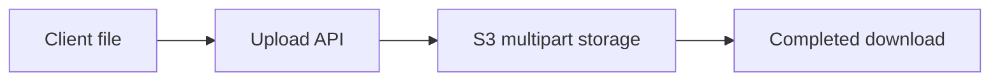
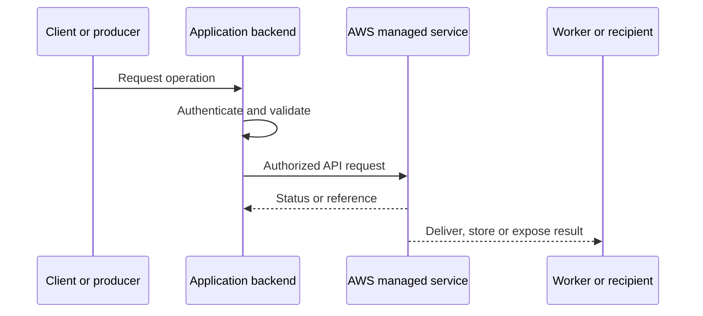
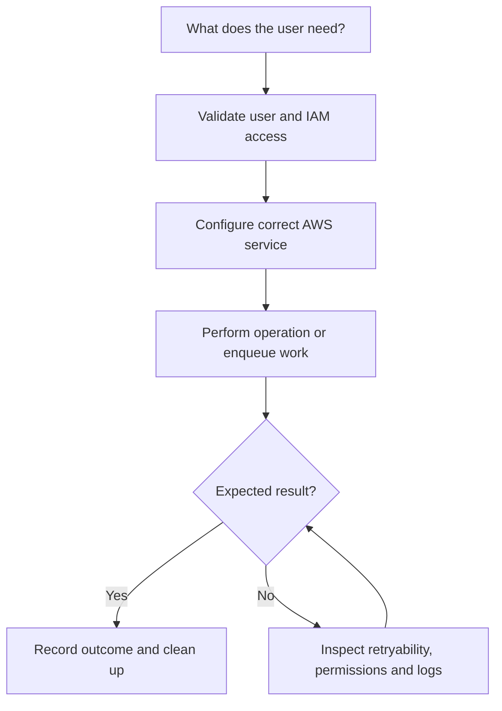
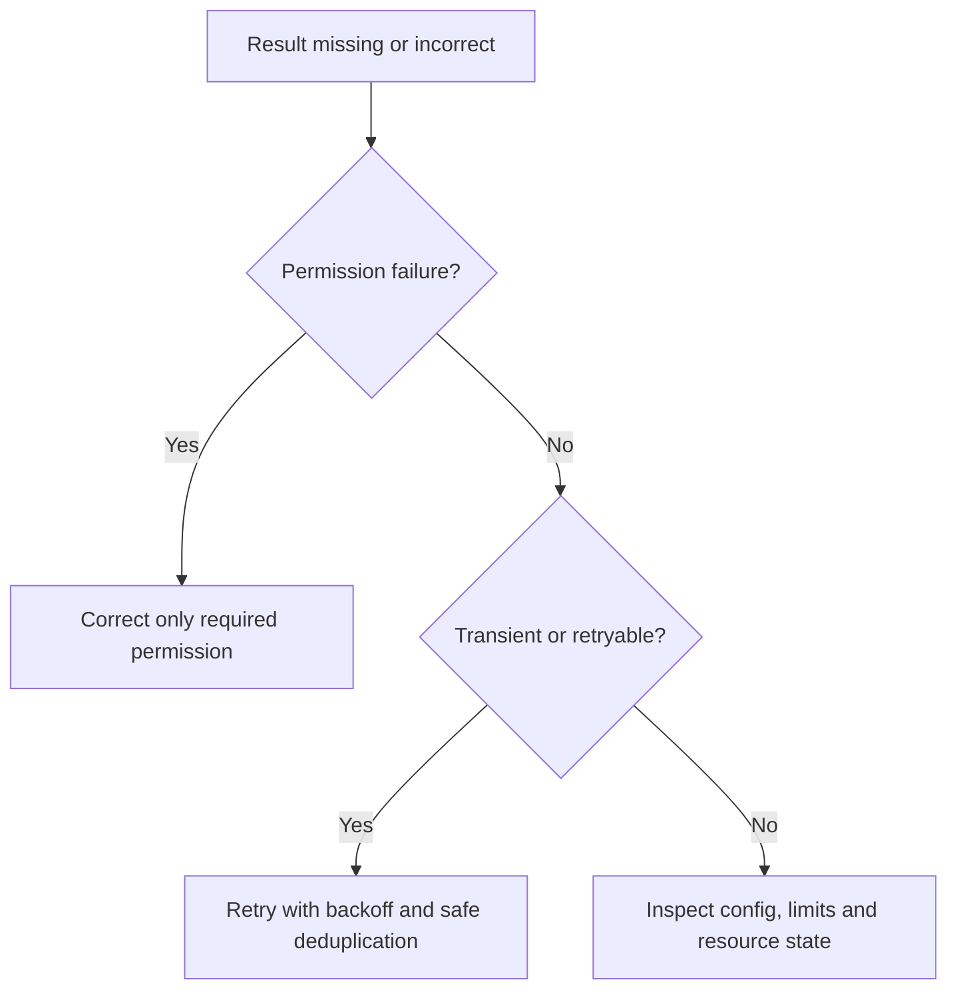

# Lesson 20: AWS S3 Part3: Upload, MultiPartUpload, Download APIs — Explained Simply

*AWS Education Notes · Author: Jayesh Sharma*

> **Source and scope:** Lesson 20 in [AWS from Basics to Advanced](https://www.youtube.com/playlist?list=PL6W8uoQQ2c60g3PAgzVPpi0YWwxITD43p), Concept && Coding – by Shrayansh. The lesson title/order are confirmed, but its full spoken transcript was not accessible. This original guide is a **topic-based learning companion**, not an attributed summary of unseen dialogue.

## Contents
- [1. Why it matters](#1-why-it-matters)
- [2. A simple analogy](#2-a-simple-analogy)
- [3. PutObject basics](#3-putobject-basics)
- [4. Multipart upload lifecycle](#4-multipart-upload-lifecycle)
- [5. Multipart sizing](#5-multipart-sizing)
- [6. Retries and part integrity](#6-retries-and-part-integrity)
- [7. Streaming downloads](#7-streaming-downloads)
- [8. Range requests](#8-range-requests)
- [9. Metadata and permissions](#9-metadata-and-permissions)
- [10. Clean up incomplete uploads](#10-clean-up-incomplete-uploads)
- [11. End-to-end architecture](#11-end-to-end-architecture)
- [12. Hands-on learning steps](#12-hands-on-learning-steps)
- [13. Failure and security checklist](#13-failure-and-security-checklist)
- [14. Interview preparation](#14-interview-preparation)

## 1. Why it matters

This lesson is about **uploading and downloading large objects reliably**. AWS services are easiest to understand when you follow an actual request from the client through permissions, service components, storage or processing, and finally the result.

## 2. A simple analogy

Moving a huge sofa is easier in manageable pieces than trying to carry it all in one trip.

The analogy helps explain the purpose. The details below define how a real system should behave.

## 3. PutObject basics

A single PutObject operation sends an object body to an S3 bucket and key. Set content type and sensible metadata, and limit uploads based on application policy.

**When designing:** Identify the required IAM action, who initiates the request, whether data remains durable, and what happens if a request is repeated or interrupted.

## 4. Multipart upload lifecycle

Create a multipart upload, upload numbered parts, and complete it with the part identifiers. Abort failed or abandoned uploads to reduce storage charges.

**When designing:** Identify the required IAM action, who initiates the request, whether data remains durable, and what happens if a request is repeated or interrupted.

## 5. Multipart sizing

S3 multipart upload is usually suitable for larger files, with constraints on number of parts and their sizes. Use AWS SDK transfer managers instead of manual loops when appropriate.

**When designing:** Identify the required IAM action, who initiates the request, whether data remains durable, and what happens if a request is repeated or interrupted.

## 6. Retries and part integrity

Individual parts can be retried. Track upload ID, part numbers and checksums; do not assume a network timeout means a part was never accepted.

**When designing:** Identify the required IAM action, who initiates the request, whether data remains durable, and what happens if a request is repeated or interrupted.

## 7. Streaming downloads

Use GetObject and stream the response to the client rather than copying giant files into heap memory. Support backpressure and connection failures.

**When designing:** Identify the required IAM action, who initiates the request, whether data remains durable, and what happens if a request is repeated or interrupted.

## 8. Range requests

A GET with Range can fetch part of an object, useful for resumable downloads and media access. Align with authorization and caching.

**When designing:** Identify the required IAM action, who initiates the request, whether data remains durable, and what happens if a request is repeated or interrupted.

## 9. Metadata and permissions

The application needs the right object permissions, ownership setup and region configuration. Keep buckets private unless public access is explicitly justified.

**When designing:** Identify the required IAM action, who initiates the request, whether data remains durable, and what happens if a request is repeated or interrupted.

## 10. Clean up incomplete uploads

Lifecycle rules can abort incomplete multipart uploads. Monitor leftovers; incomplete uploaded parts may still incur charges.

**When designing:** Identify the required IAM action, who initiates the request, whether data remains durable, and what happens if a request is repeated or interrupted.

## 11. End-to-end architecture

**Design discussion:** Should an API wait for the entire operation or return early and process asynchronously? The answer depends on latency, payload size, throughput, retries and product experience.

## 12. Hands-on learning steps

1. Read the relevant official AWS documentation before using the console.
2. Draw the objects, permission boundaries and request/response arrows.
3. Identify service pricing, storage requests and data-transfer costs in your selected Region.
4. In a sandbox, start with the smallest permitted safe operation and inspect the resulting logs and metrics.
5. Test a denied operation, an interrupted/retried operation and a normal successful operation.
6. Remove test resources, unused subscriptions, uploads, queue messages or distributions as relevant, and monitor any continuing charges.

**Do not use root credentials or hardcode long-lived AWS keys.** Prefer temporary role credentials and carefully scoped permissions.

## 13. Failure and security checklist

| Situation | What to check |
|---|---|
| Access denied | Identity, policies, trust, Region, bucket/topic/queue/resource policy |
| Timeout or slow response | Network, service limits, data volume, retry and processing duration |
| Repeated request | Idempotency keys, duplicate handling and status tracking |
| Exposure risk | Public access settings, presigned capability expiry, private data boundaries |
| Unexpected bill | Request count, transfer charges, stored data and incomplete cleanup |
| Missing event or file | Log trail, failed requests, DLQ where supported, recovery mechanism |

## 14. Interview preparation

1. What is **PutObject basics**, and when would you use it?
2. What is **Multipart upload lifecycle**, and when would you use it?
3. What is **Multipart sizing**, and when would you use it?
4. What is **Retries and part integrity**, and when would you use it?
5. What is **Streaming downloads**, and when would you use it?
6. What is **Range requests**, and when would you use it?
7. What is **Metadata and permissions**, and when would you use it?
8. What is **Clean up incomplete uploads**, and when would you use it?
9. What is the main security boundary in this design?
10. What happens on a duplicate, failed or delayed request?
11. How would you test the design with low cost?

### One-minute revision
- **PutObject basics:** A single PutObject operation sends an object body to an S3 bucket and key.
- **Multipart upload lifecycle:** Create a multipart upload, upload numbered parts, and complete it with the part identifiers.
- **Multipart sizing:** S3 multipart upload is usually suitable for larger files, with constraints on number of parts and their sizes.
- **Retries and part integrity:** Individual parts can be retried.
- **Streaming downloads:** Use GetObject and stream the response to the client rather than copying giant files into heap memory.
- **Range requests:** A GET with Range can fetch part of an object, useful for resumable downloads and media access.
- **Metadata and permissions:** The application needs the right object permissions, ownership setup and region configuration.
- **Clean up incomplete uploads:** Lifecycle rules can abort incomplete multipart uploads.

**Takeaway:** AWS S3 Part3: Upload, MultiPartUpload, Download APIs is about uploading and downloading large objects reliably. Explain the flow, error handling, permissions, scale limitations and operating costs before choosing deployment settings.

### References

- [AWS course playlist](https://www.youtube.com/playlist?list=PL6W8uoQQ2c60g3PAgzVPpi0YWwxITD43p)
- [Official AWS documentation](https://docs.aws.amazon.com/)
- [AWS security best practices](https://docs.aws.amazon.com/wellarchitected/latest/security-pillar/welcome.html)
