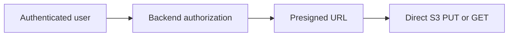
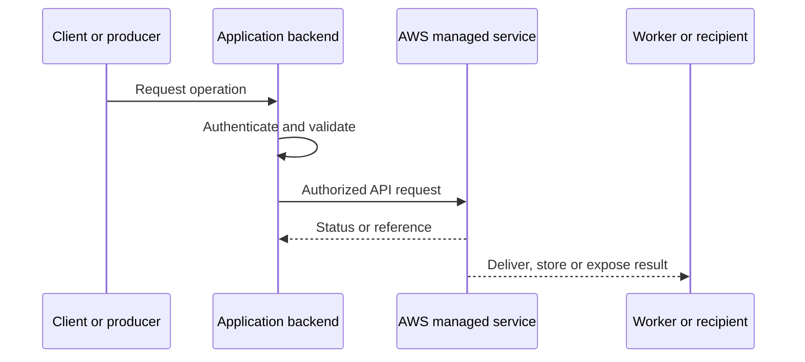
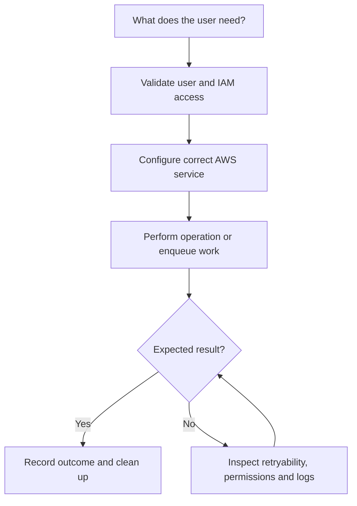
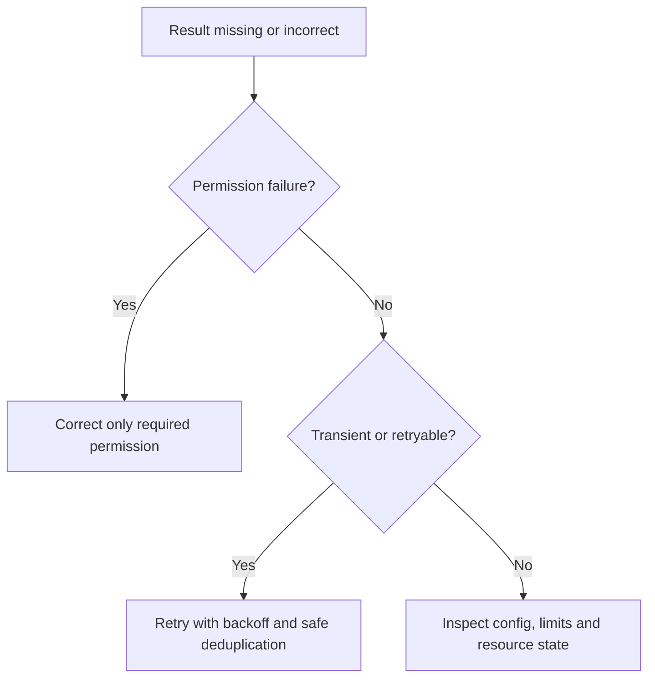

# Lesson 21: AWS S3 Part4: Presigned URLs Explained | Secure Upload & Download — Explained Simply

*AWS Education Notes · Author: Jayesh Sharma*

> **Source and scope:** Lesson 21 in [AWS from Basics to Advanced](https://www.youtube.com/playlist?list=PL6W8uoQQ2c60g3PAgzVPpi0YWwxITD43p), Concept && Coding – by Shrayansh. The lesson title/order are confirmed, but its full spoken transcript was not accessible. This original guide is a **topic-based learning companion**, not an attributed summary of unseen dialogue.

## Contents
- [1. Why it matters](#1-why-it-matters)
- [2. A simple analogy](#2-a-simple-analogy)
- [3. What is a presigned URL?](#3-what-is-a-presigned-url)
- [4. Upload flow](#4-upload-flow)
- [5. Download flow](#5-download-flow)
- [6. Method and signed headers](#6-method-and-signed-headers)
- [7. Expiration and leakage](#7-expiration-and-leakage)
- [8. Security boundaries](#8-security-boundaries)
- [9. CORS for browser uploads](#9-cors-for-browser-uploads)
- [10. Multipart presigning](#10-multipart-presigning)
- [11. End-to-end architecture](#11-end-to-end-architecture)
- [12. Hands-on learning steps](#12-hands-on-learning-steps)
- [13. Failure and security checklist](#13-failure-and-security-checklist)
- [14. Interview preparation](#14-interview-preparation)

## 1. Why it matters

This lesson is about **temporary signed direct uploads and downloads**. AWS services are easiest to understand when you follow an actual request from the client through permissions, service components, storage or processing, and finally the result.

## 2. A simple analogy

A presigned URL is like a limited-time delivery pass: it permits one approved kind of access without giving the recipient your permanent keys.

The analogy helps explain the purpose. The details below define how a real system should behave.

## 3. What is a presigned URL?

A signed URL lets a client perform an allowed S3 request using the signing identity's authority within a configured expiry, without sending AWS secret keys to the client.

**When designing:** Identify the required IAM action, who initiates the request, whether data remains durable, and what happens if a request is repeated or interrupted.

## 4. Upload flow

Backend authenticates the user, validates file constraints, chooses a controlled key and signs a PUT request. The browser sends bytes directly to S3.

**When designing:** Identify the required IAM action, who initiates the request, whether data remains durable, and what happens if a request is repeated or interrupted.

## 5. Download flow

Backend authorizes file access and generates a GET URL. The client downloads from S3 until the URL expires or another control invalidates it.

**When designing:** Identify the required IAM action, who initiates the request, whether data remains durable, and what happens if a request is repeated or interrupted.

## 6. Method and signed headers

Signatures bind important request details; required headers such as Content-Type or checksums must match the generated signature.

**When designing:** Identify the required IAM action, who initiates the request, whether data remains durable, and what happens if a request is repeated or interrupted.

## 7. Expiration and leakage

Presigned URLs are bearer capabilities. Treat them as sensitive, use short lifetimes, avoid logs/referrer leaks and do not assume immediate revocation in every scenario.

**When designing:** Identify the required IAM action, who initiates the request, whether data remains durable, and what happens if a request is repeated or interrupted.

## 8. Security boundaries

Use narrowly scoped IAM role credentials, controlled object paths, maximum size checks and post-upload validation. A signed upload URL is not malware or content validation.

**When designing:** Identify the required IAM action, who initiates the request, whether data remains durable, and what happens if a request is repeated or interrupted.

## 9. CORS for browser uploads

S3 CORS must allow the relevant browser origin, methods and headers. CORS is a browser security mechanism, not a replacement for IAM or access checks.

**When designing:** Identify the required IAM action, who initiates the request, whether data remains durable, and what happens if a request is repeated or interrupted.

## 10. Multipart presigning

Large uploads may require per-part presigned URLs and a backend-controlled complete/abort lifecycle.

**When designing:** Identify the required IAM action, who initiates the request, whether data remains durable, and what happens if a request is repeated or interrupted.

## 11. End-to-end architecture

**Design discussion:** Should an API wait for the entire operation or return early and process asynchronously? The answer depends on latency, payload size, throughput, retries and product experience.

## 12. Hands-on learning steps

1. Read the relevant official AWS documentation before using the console.
2. Draw the objects, permission boundaries and request/response arrows.
3. Identify service pricing, storage requests and data-transfer costs in your selected Region.
4. In a sandbox, start with the smallest permitted safe operation and inspect the resulting logs and metrics.
5. Test a denied operation, an interrupted/retried operation and a normal successful operation.
6. Remove test resources, unused subscriptions, uploads, queue messages or distributions as relevant, and monitor any continuing charges.

**Do not use root credentials or hardcode long-lived AWS keys.** Prefer temporary role credentials and carefully scoped permissions.

## 13. Failure and security checklist

| Situation | What to check |
|---|---|
| Access denied | Identity, policies, trust, Region, bucket/topic/queue/resource policy |
| Timeout or slow response | Network, service limits, data volume, retry and processing duration |
| Repeated request | Idempotency keys, duplicate handling and status tracking |
| Exposure risk | Public access settings, presigned capability expiry, private data boundaries |
| Unexpected bill | Request count, transfer charges, stored data and incomplete cleanup |
| Missing event or file | Log trail, failed requests, DLQ where supported, recovery mechanism |

## 14. Interview preparation

1. What is **What is a presigned URL?**, and when would you use it?
2. What is **Upload flow**, and when would you use it?
3. What is **Download flow**, and when would you use it?
4. What is **Method and signed headers**, and when would you use it?
5. What is **Expiration and leakage**, and when would you use it?
6. What is **Security boundaries**, and when would you use it?
7. What is **CORS for browser uploads**, and when would you use it?
8. What is **Multipart presigning**, and when would you use it?
9. What is the main security boundary in this design?
10. What happens on a duplicate, failed or delayed request?
11. How would you test the design with low cost?

### One-minute revision
- **What is a presigned URL?:** A signed URL lets a client perform an allowed S3 request using the signing identity's authority within a configured expiry, without sending AWS secret keys to the client.
- **Upload flow:** Backend authenticates the user, validates file constraints, chooses a controlled key and signs a PUT request.
- **Download flow:** Backend authorizes file access and generates a GET URL.
- **Method and signed headers:** Signatures bind important request details; required headers such as Content-Type or checksums must match the generated signature.
- **Expiration and leakage:** Presigned URLs are bearer capabilities.
- **Security boundaries:** Use narrowly scoped IAM role credentials, controlled object paths, maximum size checks and post-upload validation.
- **CORS for browser uploads:** S3 CORS must allow the relevant browser origin, methods and headers.
- **Multipart presigning:** Large uploads may require per-part presigned URLs and a backend-controlled complete/abort lifecycle.

**Takeaway:** AWS S3 Part4: Presigned URLs Explained | Secure Upload & Download is about temporary signed direct uploads and downloads. Explain the flow, error handling, permissions, scale limitations and operating costs before choosing deployment settings.

### References

- [AWS course playlist](https://www.youtube.com/playlist?list=PL6W8uoQQ2c60g3PAgzVPpi0YWwxITD43p)
- [Official AWS documentation](https://docs.aws.amazon.com/)
- [AWS security best practices](https://docs.aws.amazon.com/wellarchitected/latest/security-pillar/welcome.html)
