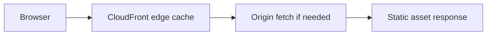
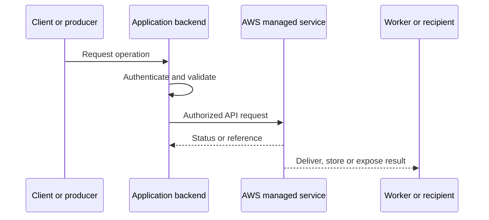
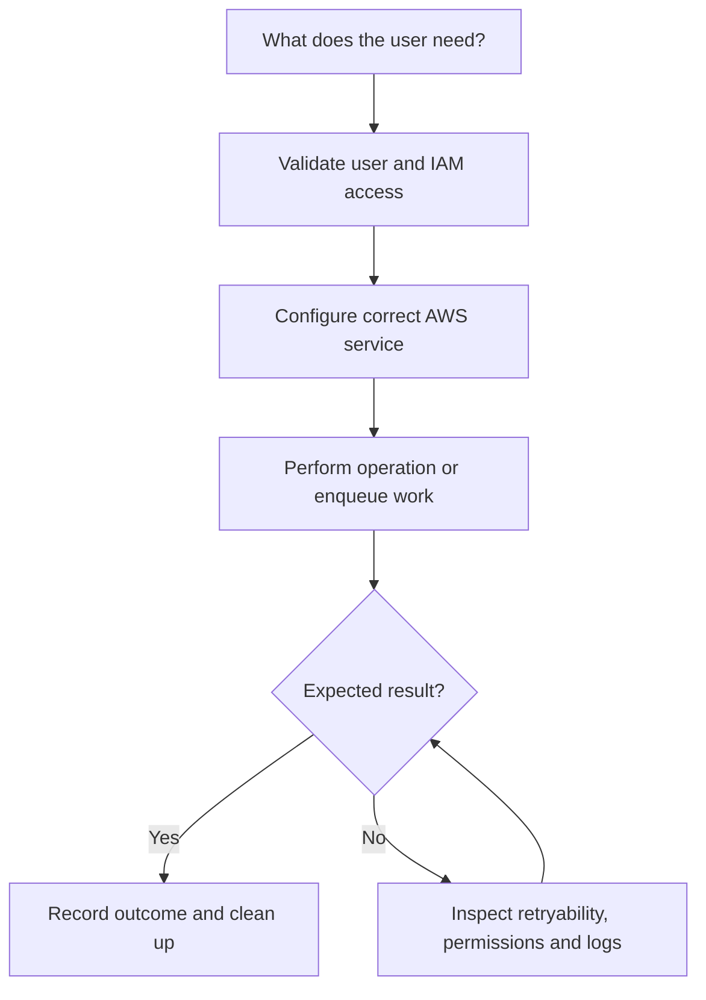
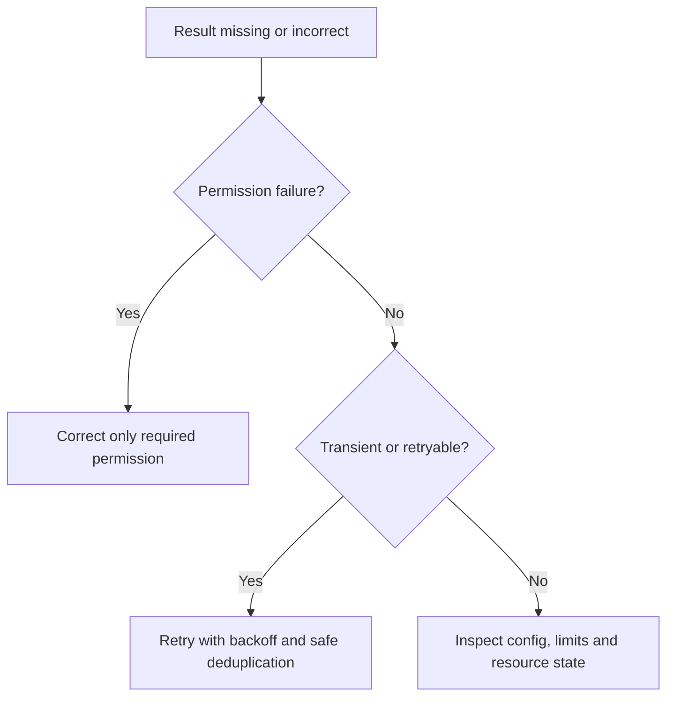

# Lesson 22: AWS CDN (CloudFront) Setup - Part1 — Explained Simply

*AWS Education Notes · Author: Jayesh Sharma*

> **Source and scope:** Lesson 22 in [AWS from Basics to Advanced](https://www.youtube.com/playlist?list=PL6W8uoQQ2c60g3PAgzVPpi0YWwxITD43p), Concept && Coding – by Shrayansh. The lesson title/order are confirmed, but its full spoken transcript was not accessible. This original guide is a **topic-based learning companion**, not an attributed summary of unseen dialogue.

## Contents
- [1. Why it matters](#1-why-it-matters)
- [2. A simple analogy](#2-a-simple-analogy)
- [3. What is a CDN?](#3-what-is-a-cdn)
- [4. Distribution and origin](#4-distribution-and-origin)
- [5. Cache behavior](#5-cache-behavior)
- [6. Cache key](#6-cache-key)
- [7. Origin Access Control](#7-origin-access-control)
- [8. HTTPS and certificates](#8-https-and-certificates)
- [9. TTL and invalidation](#9-ttl-and-invalidation)
- [10. Cost and observability](#10-cost-and-observability)
- [11. End-to-end architecture](#11-end-to-end-architecture)
- [12. Hands-on learning steps](#12-hands-on-learning-steps)
- [13. Failure and security checklist](#13-failure-and-security-checklist)
- [14. Interview preparation](#14-interview-preparation)

## 1. Why it matters

This lesson is about **serving static web content close to users**. AWS services are easiest to understand when you follow an actual request from the client through permissions, service components, storage or processing, and finally the result.

## 2. A simple analogy

Instead of every customer visiting one distant warehouse, popular products are stocked at nearby distribution centers.

The analogy helps explain the purpose. The details below define how a real system should behave.

## 3. What is a CDN?

A content delivery network caches or delivers content from points of presence closer to viewers, reducing origin requests and often improving latency.

**When designing:** Identify the required IAM action, who initiates the request, whether data remains durable, and what happens if a request is repeated or interrupted.

## 4. Distribution and origin

A CloudFront distribution defines how traffic is served. An origin might be S3, an ALB or another HTTP server.

**When designing:** Identify the required IAM action, who initiates the request, whether data remains durable, and what happens if a request is repeated or interrupted.

## 5. Cache behavior

Cache behaviors choose origin and policies by path pattern and configure allowed methods, viewer protocol and cache handling.

**When designing:** Identify the required IAM action, who initiates the request, whether data remains durable, and what happens if a request is repeated or interrupted.

## 6. Cache key

Query strings, cookies and headers can change the cache key depending on policies. Forward only what is needed to prevent low hit rate or accidental cross-user data mixing.

**When designing:** Identify the required IAM action, who initiates the request, whether data remains durable, and what happens if a request is repeated or interrupted.

## 7. Origin Access Control

OAC can let CloudFront fetch private S3 objects while preventing direct public S3 reads through correctly configured bucket policy.

**When designing:** Identify the required IAM action, who initiates the request, whether data remains durable, and what happens if a request is repeated or interrupted.

## 8. HTTPS and certificates

Use HTTPS for viewer connections. Custom domain HTTPS needs a compatible ACM certificate, typically in us-east-1 for CloudFront viewer certificates.

**When designing:** Identify the required IAM action, who initiates the request, whether data remains durable, and what happens if a request is repeated or interrupted.

## 9. TTL and invalidation

Objects may remain cached until TTL expiry. Invalidation can remove cached variants but can incur charges; versioned asset names are often preferable.

**When designing:** Identify the required IAM action, who initiates the request, whether data remains durable, and what happens if a request is repeated or interrupted.

## 10. Cost and observability

Inspect data transfer, request costs, cache hit ratio, 4xx/5xx errors and logs. An open distribution can create traffic costs.

**When designing:** Identify the required IAM action, who initiates the request, whether data remains durable, and what happens if a request is repeated or interrupted.

## 11. End-to-end architecture

**Design discussion:** Should an API wait for the entire operation or return early and process asynchronously? The answer depends on latency, payload size, throughput, retries and product experience.

## 12. Hands-on learning steps

1. Read the relevant official AWS documentation before using the console.
2. Draw the objects, permission boundaries and request/response arrows.
3. Identify service pricing, storage requests and data-transfer costs in your selected Region.
4. In a sandbox, start with the smallest permitted safe operation and inspect the resulting logs and metrics.
5. Test a denied operation, an interrupted/retried operation and a normal successful operation.
6. Remove test resources, unused subscriptions, uploads, queue messages or distributions as relevant, and monitor any continuing charges.

**Do not use root credentials or hardcode long-lived AWS keys.** Prefer temporary role credentials and carefully scoped permissions.

## 13. Failure and security checklist

| Situation | What to check |
|---|---|
| Access denied | Identity, policies, trust, Region, bucket/topic/queue/resource policy |
| Timeout or slow response | Network, service limits, data volume, retry and processing duration |
| Repeated request | Idempotency keys, duplicate handling and status tracking |
| Exposure risk | Public access settings, presigned capability expiry, private data boundaries |
| Unexpected bill | Request count, transfer charges, stored data and incomplete cleanup |
| Missing event or file | Log trail, failed requests, DLQ where supported, recovery mechanism |

## 14. Interview preparation

1. What is **What is a CDN?**, and when would you use it?
2. What is **Distribution and origin**, and when would you use it?
3. What is **Cache behavior**, and when would you use it?
4. What is **Cache key**, and when would you use it?
5. What is **Origin Access Control**, and when would you use it?
6. What is **HTTPS and certificates**, and when would you use it?
7. What is **TTL and invalidation**, and when would you use it?
8. What is **Cost and observability**, and when would you use it?
9. What is the main security boundary in this design?
10. What happens on a duplicate, failed or delayed request?
11. How would you test the design with low cost?

### One-minute revision
- **What is a CDN?:** A content delivery network caches or delivers content from points of presence closer to viewers, reducing origin requests and often improving latency.
- **Distribution and origin:** A CloudFront distribution defines how traffic is served.
- **Cache behavior:** Cache behaviors choose origin and policies by path pattern and configure allowed methods, viewer protocol and cache handling.
- **Cache key:** Query strings, cookies and headers can change the cache key depending on policies.
- **Origin Access Control:** OAC can let CloudFront fetch private S3 objects while preventing direct public S3 reads through correctly configured bucket policy.
- **HTTPS and certificates:** Use HTTPS for viewer connections.
- **TTL and invalidation:** Objects may remain cached until TTL expiry.
- **Cost and observability:** Inspect data transfer, request costs, cache hit ratio, 4xx/5xx errors and logs.

**Takeaway:** AWS CDN (CloudFront) Setup - Part1 is about serving static web content close to users. Explain the flow, error handling, permissions, scale limitations and operating costs before choosing deployment settings.

### References

- [AWS course playlist](https://www.youtube.com/playlist?list=PL6W8uoQQ2c60g3PAgzVPpi0YWwxITD43p)
- [Official AWS documentation](https://docs.aws.amazon.com/)
- [AWS security best practices](https://docs.aws.amazon.com/wellarchitected/latest/security-pillar/welcome.html)
