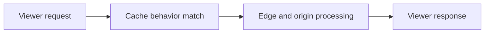
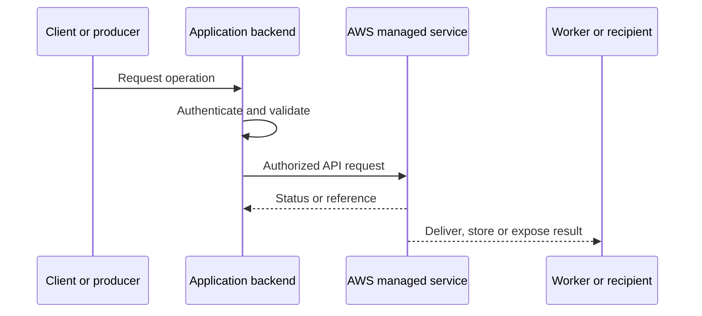
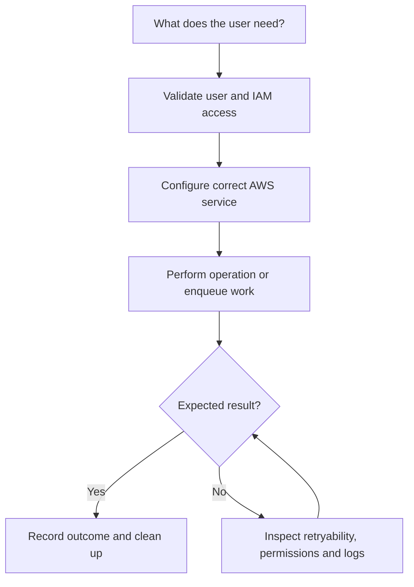
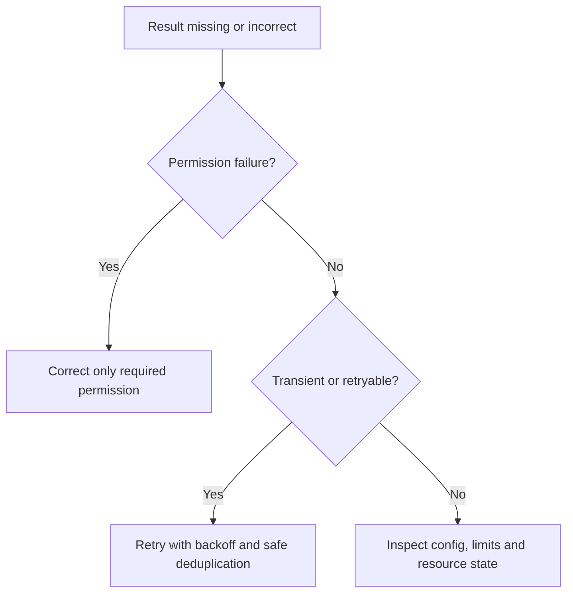

# Lesson 23: AWS CDN (CloudFront) Setup - Part2 — Explained Simply

*AWS Education Notes · Author: Jayesh Sharma*

> **Source and scope:** Lesson 23 in [AWS from Basics to Advanced](https://www.youtube.com/playlist?list=PL6W8uoQQ2c60g3PAgzVPpi0YWwxITD43p), Concept && Coding – by Shrayansh. The lesson title/order are confirmed, but its full spoken transcript was not accessible. This original guide is a **topic-based learning companion**, not an attributed summary of unseen dialogue.

## Contents
- [1. Why it matters](#1-why-it-matters)
- [2. A simple analogy](#2-a-simple-analogy)
- [3. Caching static and dynamic content](#3-caching-static-and-dynamic-content)
- [4. Origin request policies](#4-origin-request-policies)
- [5. Multiple origins](#5-multiple-origins)
- [6. Custom error responses](#6-custom-error-responses)
- [7. CloudFront Functions vs Lambda@Edge](#7-cloudfront-functions-vs-lambdaedge)
- [8. Response headers and security](#8-response-headers-and-security)
- [9. Signed URLs and cookies](#9-signed-urls-and-cookies)
- [10. Invalidation and troubleshooting](#10-invalidation-and-troubleshooting)
- [11. End-to-end architecture](#11-end-to-end-architecture)
- [12. Hands-on learning steps](#12-hands-on-learning-steps)
- [13. Failure and security checklist](#13-failure-and-security-checklist)
- [14. Interview preparation](#14-interview-preparation)

## 1. Why it matters

This lesson is about **secure caching and routing beyond the basics**. AWS services are easiest to understand when you follow an actual request from the client through permissions, service components, storage or processing, and finally the result.

## 2. A simple analogy

A good delivery network decides what can be reused, what is private, and how to recover when the main warehouse slows down.

The analogy helps explain the purpose. The details below define how a real system should behave.

## 3. Caching static and dynamic content

Cache static hashed assets aggressively. Treat dynamic or personalized API responses carefully; cache keys and policies must protect user isolation.

**When designing:** Identify the required IAM action, who initiates the request, whether data remains durable, and what happens if a request is repeated or interrupted.

## 4. Origin request policies

Distinguish cache policies (what affects cache identity) from origin request policies (what is forwarded to the origin).

**When designing:** Identify the required IAM action, who initiates the request, whether data remains durable, and what happens if a request is repeated or interrupted.

## 5. Multiple origins

A distribution can route paths to different origins, such as images in S3 and API requests to an ALB, using cache behavior ordering.

**When designing:** Identify the required IAM action, who initiates the request, whether data remains durable, and what happens if a request is repeated or interrupted.

## 6. Custom error responses

You can configure error response behavior, but avoid hiding genuine backend failures behind successful-looking status codes.

**When designing:** Identify the required IAM action, who initiates the request, whether data remains durable, and what happens if a request is repeated or interrupted.

## 7. CloudFront Functions vs Lambda@Edge

CloudFront Functions run lightweight viewer-request/response logic. Lambda@Edge supports a broader set of edge triggers and has deployment and runtime constraints.

**When designing:** Identify the required IAM action, who initiates the request, whether data remains durable, and what happens if a request is repeated or interrupted.

## 8. Response headers and security

Use response headers policies for items such as HSTS and selected CORS headers, and combine with AWS WAF where appropriate.

**When designing:** Identify the required IAM action, who initiates the request, whether data remains durable, and what happens if a request is repeated or interrupted.

## 9. Signed URLs and cookies

Restrict private content using CloudFront signed URLs or signed cookies, which differ from S3 presigned URLs and use CloudFront-specific trust.

**When designing:** Identify the required IAM action, who initiates the request, whether data remains durable, and what happens if a request is repeated or interrupted.

## 10. Invalidation and troubleshooting

A low cache hit ratio can be caused by over-forwarded headers/cookies, tiny TTLs, frequent object changes or overly variable URLs.

**When designing:** Identify the required IAM action, who initiates the request, whether data remains durable, and what happens if a request is repeated or interrupted.

## 11. End-to-end architecture

**Design discussion:** Should an API wait for the entire operation or return early and process asynchronously? The answer depends on latency, payload size, throughput, retries and product experience.

## 12. Hands-on learning steps

1. Read the relevant official AWS documentation before using the console.
2. Draw the objects, permission boundaries and request/response arrows.
3. Identify service pricing, storage requests and data-transfer costs in your selected Region.
4. In a sandbox, start with the smallest permitted safe operation and inspect the resulting logs and metrics.
5. Test a denied operation, an interrupted/retried operation and a normal successful operation.
6. Remove test resources, unused subscriptions, uploads, queue messages or distributions as relevant, and monitor any continuing charges.

**Do not use root credentials or hardcode long-lived AWS keys.** Prefer temporary role credentials and carefully scoped permissions.

## 13. Failure and security checklist

| Situation | What to check |
|---|---|
| Access denied | Identity, policies, trust, Region, bucket/topic/queue/resource policy |
| Timeout or slow response | Network, service limits, data volume, retry and processing duration |
| Repeated request | Idempotency keys, duplicate handling and status tracking |
| Exposure risk | Public access settings, presigned capability expiry, private data boundaries |
| Unexpected bill | Request count, transfer charges, stored data and incomplete cleanup |
| Missing event or file | Log trail, failed requests, DLQ where supported, recovery mechanism |

## 14. Interview preparation

1. What is **Caching static and dynamic content**, and when would you use it?
2. What is **Origin request policies**, and when would you use it?
3. What is **Multiple origins**, and when would you use it?
4. What is **Custom error responses**, and when would you use it?
5. What is **CloudFront Functions vs Lambda@Edge**, and when would you use it?
6. What is **Response headers and security**, and when would you use it?
7. What is **Signed URLs and cookies**, and when would you use it?
8. What is **Invalidation and troubleshooting**, and when would you use it?
9. What is the main security boundary in this design?
10. What happens on a duplicate, failed or delayed request?
11. How would you test the design with low cost?

### One-minute revision
- **Caching static and dynamic content:** Cache static hashed assets aggressively.
- **Origin request policies:** Distinguish cache policies (what affects cache identity) from origin request policies (what is forwarded to the origin).
- **Multiple origins:** A distribution can route paths to different origins, such as images in S3 and API requests to an ALB, using cache behavior ordering.
- **Custom error responses:** You can configure error response behavior, but avoid hiding genuine backend failures behind successful-looking status codes.
- **CloudFront Functions vs Lambda@Edge:** CloudFront Functions run lightweight viewer-request/response logic.
- **Response headers and security:** Use response headers policies for items such as HSTS and selected CORS headers, and combine with AWS WAF where appropriate.
- **Signed URLs and cookies:** Restrict private content using CloudFront signed URLs or signed cookies, which differ from S3 presigned URLs and use CloudFront-specific trust.
- **Invalidation and troubleshooting:** A low cache hit ratio can be caused by over-forwarded headers/cookies, tiny TTLs, frequent object changes or overly variable URLs.

**Takeaway:** AWS CDN (CloudFront) Setup - Part2 is about secure caching and routing beyond the basics. Explain the flow, error handling, permissions, scale limitations and operating costs before choosing deployment settings.

### References

- [AWS course playlist](https://www.youtube.com/playlist?list=PL6W8uoQQ2c60g3PAgzVPpi0YWwxITD43p)
- [Official AWS documentation](https://docs.aws.amazon.com/)
- [AWS security best practices](https://docs.aws.amazon.com/wellarchitected/latest/security-pillar/welcome.html)
