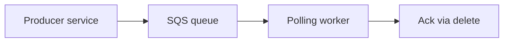
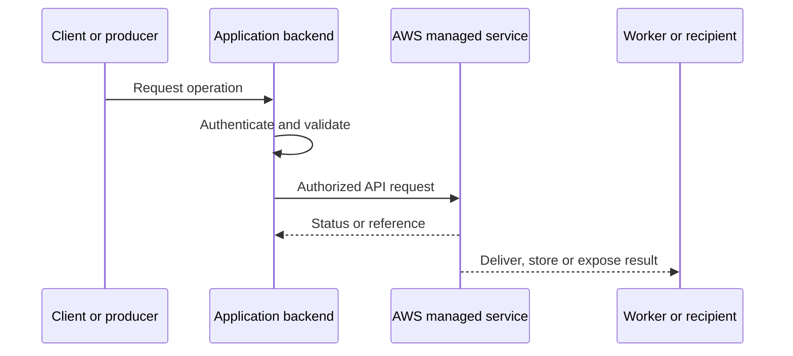
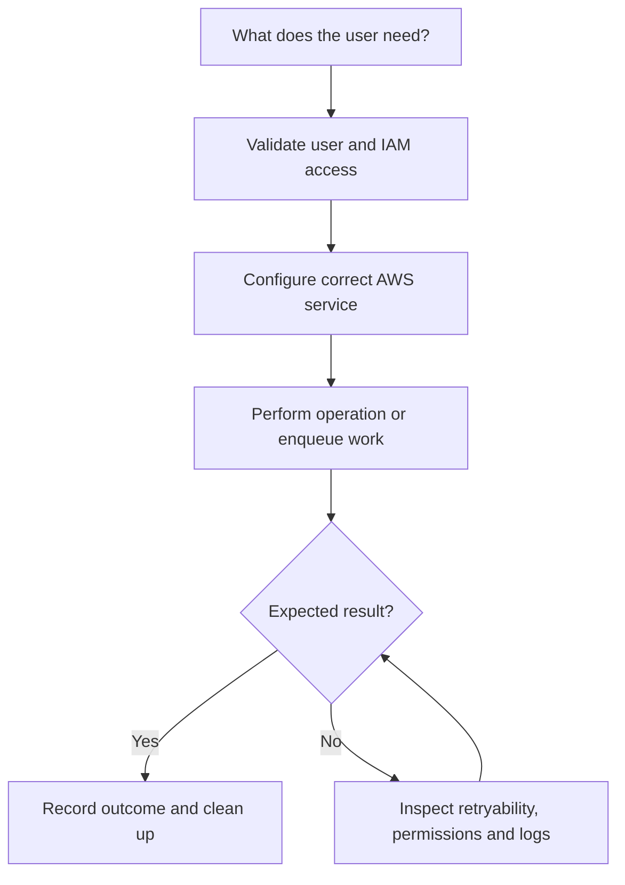
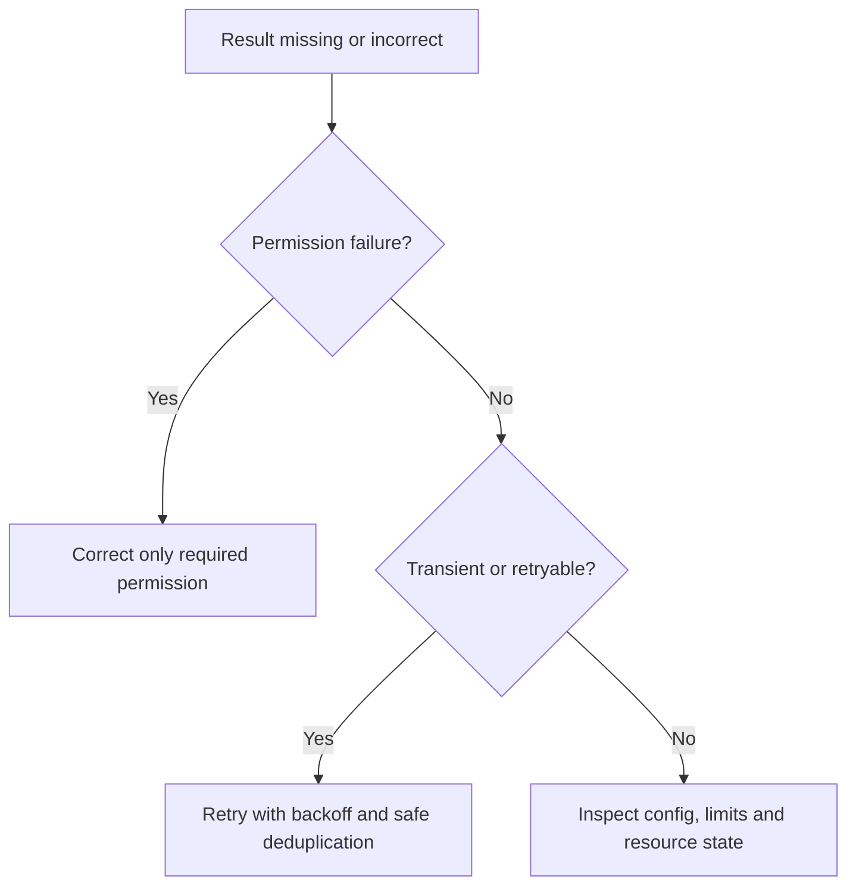

# Lesson 24: AWS SQS (Simple Queue Service) — Explained Simply

*AWS Education Notes · Author: Jayesh Sharma*

> **Source and scope:** Lesson 24 in [AWS from Basics to Advanced](https://www.youtube.com/playlist?list=PL6W8uoQQ2c60g3PAgzVPpi0YWwxITD43p), Concept && Coding – by Shrayansh. The lesson title/order are confirmed, but its full spoken transcript was not accessible. This original guide is a **topic-based learning companion**, not an attributed summary of unseen dialogue.

## Contents
- [1. Why it matters](#1-why-it-matters)
- [2. A simple analogy](#2-a-simple-analogy)
- [3. Queue decoupling](#3-queue-decoupling)
- [4. Standard vs FIFO](#4-standard-vs-fifo)
- [5. Visibility timeout](#5-visibility-timeout)
- [6. Dead-letter queue](#6-dead-letter-queue)
- [7. Long polling](#7-long-polling)
- [8. Idempotent consumers](#8-idempotent-consumers)
- [9. Retention and delay](#9-retention-and-delay)
- [10. Scaling and monitoring](#10-scaling-and-monitoring)
- [11. End-to-end architecture](#11-end-to-end-architecture)
- [12. Hands-on learning steps](#12-hands-on-learning-steps)
- [13. Failure and security checklist](#13-failure-and-security-checklist)
- [14. Interview preparation](#14-interview-preparation)

## 1. Why it matters

This lesson is about **buffering and processing asynchronous jobs**. AWS services are easiest to understand when you follow an actual request from the client through permissions, service components, storage or processing, and finally the result.

## 2. A simple analogy

A restaurant order board lets the cashier accept orders even if chefs are busy; chefs process orders later.

The analogy helps explain the purpose. The details below define how a real system should behave.

## 3. Queue decoupling

Producers send messages to SQS without waiting for workers to complete the task. Consumers poll messages and process them independently.

**When designing:** Identify the required IAM action, who initiates the request, whether data remains durable, and what happens if a request is repeated or interrupted.

## 4. Standard vs FIFO

Standard queues offer best-effort ordering and at-least-once delivery; FIFO queues support ordering within message groups and deduplication features with throughput trade-offs.

**When designing:** Identify the required IAM action, who initiates the request, whether data remains durable, and what happens if a request is repeated or interrupted.

## 5. Visibility timeout

After a consumer receives a message, it becomes temporarily invisible. If processing succeeds, delete it; otherwise it may reappear for another attempt.

**When designing:** Identify the required IAM action, who initiates the request, whether data remains durable, and what happens if a request is repeated or interrupted.

## 6. Dead-letter queue

A DLQ captures repeatedly failing messages after a configured receive count so they can be inspected and handled separately.

**When designing:** Identify the required IAM action, who initiates the request, whether data remains durable, and what happens if a request is repeated or interrupted.

## 7. Long polling

Long polling waits for messages rather than continuously making empty requests. It lowers empty receives and can reduce cost.

**When designing:** Identify the required IAM action, who initiates the request, whether data remains durable, and what happens if a request is repeated or interrupted.

## 8. Idempotent consumers

Redelivery is possible. Use stable business IDs and safe processing so a repeated message does not charge customers twice.

**When designing:** Identify the required IAM action, who initiates the request, whether data remains durable, and what happens if a request is repeated or interrupted.

## 9. Retention and delay

SQS retention and delayed delivery are configurable within service limits. These are not indefinite archival guarantees.

**When designing:** Identify the required IAM action, who initiates the request, whether data remains durable, and what happens if a request is repeated or interrupted.

## 10. Scaling and monitoring

Scale consumers based on queue depth and age of oldest message. Monitor errors, duplicates and DLQ growth.

**When designing:** Identify the required IAM action, who initiates the request, whether data remains durable, and what happens if a request is repeated or interrupted.

## 11. End-to-end architecture

**Design discussion:** Should an API wait for the entire operation or return early and process asynchronously? The answer depends on latency, payload size, throughput, retries and product experience.

## 12. Hands-on learning steps

1. Read the relevant official AWS documentation before using the console.
2. Draw the objects, permission boundaries and request/response arrows.
3. Identify service pricing, storage requests and data-transfer costs in your selected Region.
4. In a sandbox, start with the smallest permitted safe operation and inspect the resulting logs and metrics.
5. Test a denied operation, an interrupted/retried operation and a normal successful operation.
6. Remove test resources, unused subscriptions, uploads, queue messages or distributions as relevant, and monitor any continuing charges.

**Do not use root credentials or hardcode long-lived AWS keys.** Prefer temporary role credentials and carefully scoped permissions.

## 13. Failure and security checklist

| Situation | What to check |
|---|---|
| Access denied | Identity, policies, trust, Region, bucket/topic/queue/resource policy |
| Timeout or slow response | Network, service limits, data volume, retry and processing duration |
| Repeated request | Idempotency keys, duplicate handling and status tracking |
| Exposure risk | Public access settings, presigned capability expiry, private data boundaries |
| Unexpected bill | Request count, transfer charges, stored data and incomplete cleanup |
| Missing event or file | Log trail, failed requests, DLQ where supported, recovery mechanism |

## 14. Interview preparation

1. What is **Queue decoupling**, and when would you use it?
2. What is **Standard vs FIFO**, and when would you use it?
3. What is **Visibility timeout**, and when would you use it?
4. What is **Dead-letter queue**, and when would you use it?
5. What is **Long polling**, and when would you use it?
6. What is **Idempotent consumers**, and when would you use it?
7. What is **Retention and delay**, and when would you use it?
8. What is **Scaling and monitoring**, and when would you use it?
9. What is the main security boundary in this design?
10. What happens on a duplicate, failed or delayed request?
11. How would you test the design with low cost?

### One-minute revision
- **Queue decoupling:** Producers send messages to SQS without waiting for workers to complete the task.
- **Standard vs FIFO:** Standard queues offer best-effort ordering and at-least-once delivery; FIFO queues support ordering within message groups and deduplication features with throughput trade-offs.
- **Visibility timeout:** After a consumer receives a message, it becomes temporarily invisible.
- **Dead-letter queue:** A DLQ captures repeatedly failing messages after a configured receive count so they can be inspected and handled separately.
- **Long polling:** Long polling waits for messages rather than continuously making empty requests.
- **Idempotent consumers:** Redelivery is possible.
- **Retention and delay:** SQS retention and delayed delivery are configurable within service limits.
- **Scaling and monitoring:** Scale consumers based on queue depth and age of oldest message.

**Takeaway:** AWS SQS (Simple Queue Service) is about buffering and processing asynchronous jobs. Explain the flow, error handling, permissions, scale limitations and operating costs before choosing deployment settings.

### References

- [AWS course playlist](https://www.youtube.com/playlist?list=PL6W8uoQQ2c60g3PAgzVPpi0YWwxITD43p)
- [Official AWS documentation](https://docs.aws.amazon.com/)
- [AWS security best practices](https://docs.aws.amazon.com/wellarchitected/latest/security-pillar/welcome.html)
