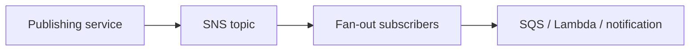
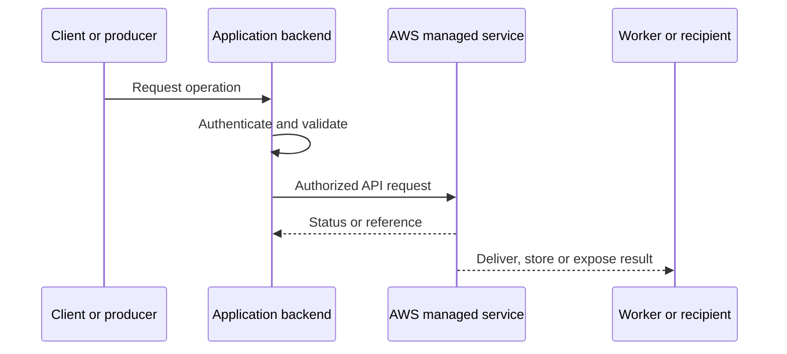
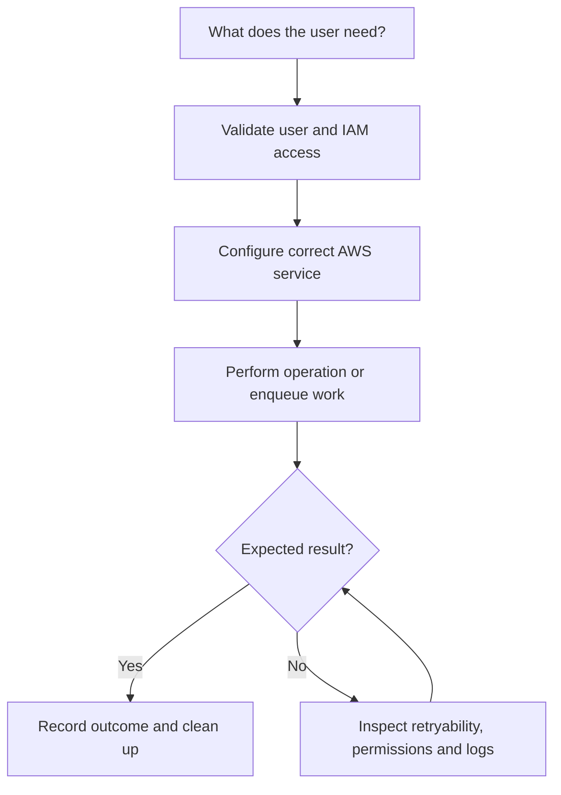
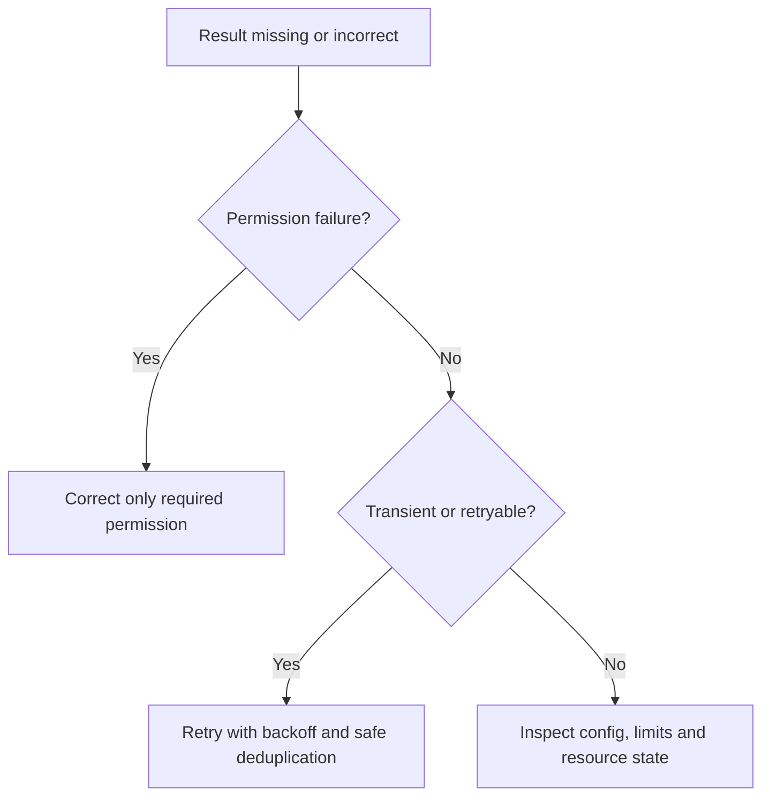

# Lesson 25: AWS SNS (Simple Notification Service) — Explained Simply

*AWS Education Notes · Author: Jayesh Sharma*

> **Source and scope:** Lesson 25 in [AWS from Basics to Advanced](https://www.youtube.com/playlist?list=PL6W8uoQQ2c60g3PAgzVPpi0YWwxITD43p), Concept && Coding – by Shrayansh. The lesson title/order are confirmed, but its full spoken transcript was not accessible. This original guide is a **topic-based learning companion**, not an attributed summary of unseen dialogue.

## Contents
- [1. Why it matters](#1-why-it-matters)
- [2. A simple analogy](#2-a-simple-analogy)
- [3. Topic and publish](#3-topic-and-publish)
- [4. Pub/sub fan-out](#4-pubsub-fan-out)
- [5. SNS versus SQS](#5-sns-versus-sqs)
- [6. SNS to SQS pattern](#6-sns-to-sqs-pattern)
- [7. Message filtering](#7-message-filtering)
- [8. Retry and DLQ](#8-retry-and-dlq)
- [9. Security and permissions](#9-security-and-permissions)
- [10. Idempotency and ordering](#10-idempotency-and-ordering)
- [11. End-to-end architecture](#11-end-to-end-architecture)
- [12. Hands-on learning steps](#12-hands-on-learning-steps)
- [13. Failure and security checklist](#13-failure-and-security-checklist)
- [14. Interview preparation](#14-interview-preparation)

## 1. Why it matters

This lesson is about **fan-out events to multiple subscribers**. AWS services are easiest to understand when you follow an actual request from the client through permissions, service components, storage or processing, and finally the result.

## 2. A simple analogy

A radio announcement reaches many listeners, unlike a queue where workers generally compete to handle messages.

The analogy helps explain the purpose. The details below define how a real system should behave.

## 3. Topic and publish

Producers publish a message to an SNS topic. SNS delivers copies to matching subscribers such as SQS queues, Lambda functions or supported endpoints.

**When designing:** Identify the required IAM action, who initiates the request, whether data remains durable, and what happens if a request is repeated or interrupted.

## 4. Pub/sub fan-out

One event can trigger independent workflows: billing, email and analytics. Subscribers fail or scale independently when paired with queues.

**When designing:** Identify the required IAM action, who initiates the request, whether data remains durable, and what happens if a request is repeated or interrupted.

## 5. SNS versus SQS

SNS is a publish/subscribe delivery service; SQS stores work for consumers to poll. They are commonly combined, not treated as replacements.

**When designing:** Identify the required IAM action, who initiates the request, whether data remains durable, and what happens if a request is repeated or interrupted.

## 6. SNS to SQS pattern

Subscribe several SQS queues to an SNS topic so each service has its own durable buffer and retry behavior.

**When designing:** Identify the required IAM action, who initiates the request, whether data remains durable, and what happens if a request is repeated or interrupted.

## 7. Message filtering

Subscription filter policies let consumers receive only events matching selected message attributes or body fields.

**When designing:** Identify the required IAM action, who initiates the request, whether data remains durable, and what happens if a request is repeated or interrupted.

## 8. Retry and DLQ

Delivery retry semantics vary by subscriber type. Configure retry behavior and dead-letter queues as supported to avoid silent loss.

**When designing:** Identify the required IAM action, who initiates the request, whether data remains durable, and what happens if a request is repeated or interrupted.

## 9. Security and permissions

Topic policies and queue policies must authorize SNS delivery. Use least privilege, HTTPS, encryption and sensible exposure constraints.

**When designing:** Identify the required IAM action, who initiates the request, whether data remains durable, and what happens if a request is repeated or interrupted.

## 10. Idempotency and ordering

SNS Standard and SNS FIFO have different delivery/ordering capabilities and integration rules. Downstream consumers should still design for repeated events.

**When designing:** Identify the required IAM action, who initiates the request, whether data remains durable, and what happens if a request is repeated or interrupted.

## 11. End-to-end architecture

**Design discussion:** Should an API wait for the entire operation or return early and process asynchronously? The answer depends on latency, payload size, throughput, retries and product experience.

## 12. Hands-on learning steps

1. Read the relevant official AWS documentation before using the console.
2. Draw the objects, permission boundaries and request/response arrows.
3. Identify service pricing, storage requests and data-transfer costs in your selected Region.
4. In a sandbox, start with the smallest permitted safe operation and inspect the resulting logs and metrics.
5. Test a denied operation, an interrupted/retried operation and a normal successful operation.
6. Remove test resources, unused subscriptions, uploads, queue messages or distributions as relevant, and monitor any continuing charges.

**Do not use root credentials or hardcode long-lived AWS keys.** Prefer temporary role credentials and carefully scoped permissions.

## 13. Failure and security checklist

| Situation | What to check |
|---|---|
| Access denied | Identity, policies, trust, Region, bucket/topic/queue/resource policy |
| Timeout or slow response | Network, service limits, data volume, retry and processing duration |
| Repeated request | Idempotency keys, duplicate handling and status tracking |
| Exposure risk | Public access settings, presigned capability expiry, private data boundaries |
| Unexpected bill | Request count, transfer charges, stored data and incomplete cleanup |
| Missing event or file | Log trail, failed requests, DLQ where supported, recovery mechanism |

## 14. Interview preparation

1. What is **Topic and publish**, and when would you use it?
2. What is **Pub/sub fan-out**, and when would you use it?
3. What is **SNS versus SQS**, and when would you use it?
4. What is **SNS to SQS pattern**, and when would you use it?
5. What is **Message filtering**, and when would you use it?
6. What is **Retry and DLQ**, and when would you use it?
7. What is **Security and permissions**, and when would you use it?
8. What is **Idempotency and ordering**, and when would you use it?
9. What is the main security boundary in this design?
10. What happens on a duplicate, failed or delayed request?
11. How would you test the design with low cost?

### One-minute revision
- **Topic and publish:** Producers publish a message to an SNS topic.
- **Pub/sub fan-out:** One event can trigger independent workflows: billing, email and analytics.
- **SNS versus SQS:** SNS is a publish/subscribe delivery service; SQS stores work for consumers to poll.
- **SNS to SQS pattern:** Subscribe several SQS queues to an SNS topic so each service has its own durable buffer and retry behavior.
- **Message filtering:** Subscription filter policies let consumers receive only events matching selected message attributes or body fields.
- **Retry and DLQ:** Delivery retry semantics vary by subscriber type.
- **Security and permissions:** Topic policies and queue policies must authorize SNS delivery.
- **Idempotency and ordering:** SNS Standard and SNS FIFO have different delivery/ordering capabilities and integration rules.

**Takeaway:** AWS SNS (Simple Notification Service) is about fan-out events to multiple subscribers. Explain the flow, error handling, permissions, scale limitations and operating costs before choosing deployment settings.

### References

- [AWS course playlist](https://www.youtube.com/playlist?list=PL6W8uoQQ2c60g3PAgzVPpi0YWwxITD43p)
- [Official AWS documentation](https://docs.aws.amazon.com/)
- [AWS security best practices](https://docs.aws.amazon.com/wellarchitected/latest/security-pillar/welcome.html)
