# AWS Account Setup & Cloud Computing Models — Explained Simply

*AWS Education Notes · Author: Jayesh Sharma*

> Beginner-friendly, original study notes. Reviewed against AWS documentation in November 2026. Account sign-up screens, Free Tier conditions and pricing may change, so check the linked official pages before enabling billable services.

## Table of Contents

1. [What is cloud computing?](#1-what-is-cloud-computing)
2. [Why use AWS?](#2-why-use-aws)
3. [Create your AWS account](#3-create-your-aws-account)
4. [Secure the account before experimenting](#4-secure-the-account-before-experimenting)
5. [Understand Regions and Availability Zones](#5-understand-regions-and-availability-zones)
6. [What does shared responsibility mean?](#6-what-does-shared-responsibility-mean)
7. [IaaS — Infrastructure as a Service](#7-iaas--infrastructure-as-a-service)
8. [PaaS — Platform as a Service](#8-paas--platform-as-a-service)
9. [CaaS — Containers as a Service](#9-caas--containers-as-a-service)
10. [FaaS — Function as a Service](#10-faas--function-as-a-service)
11. [SaaS — Software as a Service](#11-saas--software-as-a-service)
12. [Compare all five models](#12-compare-all-five-models)
13. [Design one application five different ways](#13-design-one-application-five-different-ways)
14. [AWS service selection exercise](#14-aws-service-selection-exercise)
15. [Costs, mistakes and cleanup checklist](#15-costs-mistakes-and-cleanup-checklist)
16. [Interview questions and quick revision](#16-interview-questions-and-quick-revision)
17. [Official references](#17-official-references)

---

## 1. What is cloud computing?

Imagine you want to host a website. Traditionally, you might **buy a physical computer**, connect it to the internet, maintain its operating system, replace faulty parts and pay for electricity even when nobody visits the website.

With **cloud computing**, you rent computing resources—such as servers, databases and storage—over the internet. You can start small, add capacity when traffic rises and remove it when no longer needed.

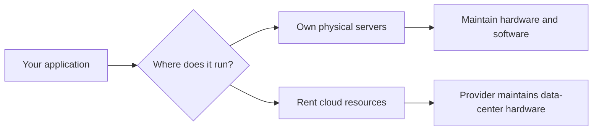

**Simple example:** Instead of buying a generator for occasional power needs, you pay an electricity provider for the energy you consume. Cloud computing is similar, although cloud prices vary by service, region, usage and plan.

### Five useful characteristics

- **On-demand:** Create computing resources when needed.
- **Elasticity:** Add or remove capacity as demand changes.
- **Measured usage:** Many services bill for the resources consumed.
- **Remote access:** Manage resources through APIs, a console or command-line tools.
- **Managed infrastructure:** AWS operates the underlying data centers and hardware.

---

## 2. Why use AWS?

**Amazon Web Services (AWS)** offers cloud resources that you can combine to build applications. A developer might use Amazon EC2 for virtual machines, Amazon S3 for files, and Amazon RDS for a managed relational database.

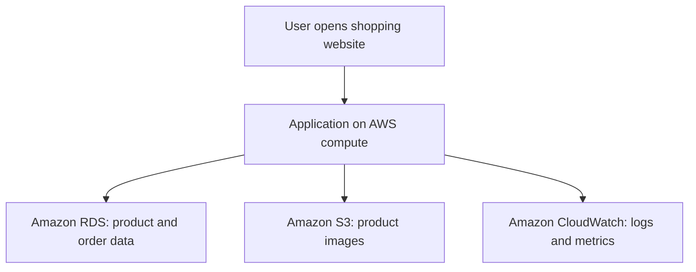

**Key idea:** AWS is not one product. It is a catalog of infrastructure and managed services that solve different problems.

---

## 3. Create your AWS account

### Before you begin

Have access to an email address, a telephone number and the information required by your selected sign-up route. Some routes request a payment method and identity verification. **Do not paste passwords, card numbers or verification codes into notes or source repositories.**

AWS currently documents two sign-up experiences:

- **New sign-up experience:** A simplified experience based on AWS Builder ID and projects, with a Free or Paid account plan depending on eligibility.
- **Advanced sign-up experience:** Traditional account configuration, including root-user credentials and more account controls. Advanced account setup is appropriate when you need those features.

**The interface and available options depend on the sign-up path.** Follow the screens you actually see; not every new user receives an identical form.

### Step-by-step account creation

1. Visit **[AWS sign-up](https://aws.amazon.com/free/)** or the AWS console's Create account option.
2. Choose the sign-up route and plan that meet your requirements; review the differences before continuing.
3. Enter and verify the email or sign-in identity requested by AWS.
4. Supply contact details, account/project name and payment information if the chosen route requires them.
5. Complete any requested identity verification.
6. Sign in to the AWS Management Console and locate **Billing / AWS Settings** for your account type.
7. Confirm which services and regions your account can use before starting experiments.

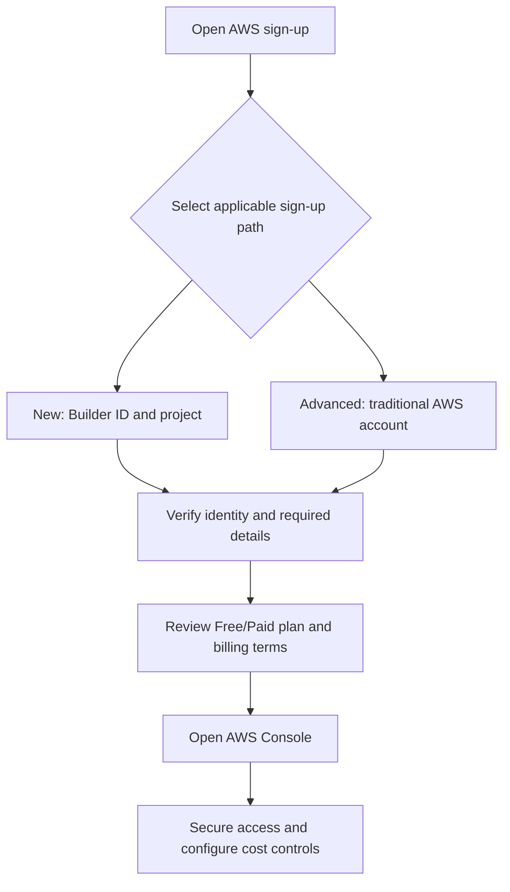

### What does *Free Tier* mean?

**Free Tier does not mean everything on AWS is free.** Availability, allowances, trial terms and credits depend on your account type and service. A free account plan and a paid plan can have different features and charging rules.

Before using a service, check its current **pricing page**, your **Free Tier eligibility**, and your account's **billing/spend-limit controls**. A verification authorization on a payment card is not necessarily a usage charge.

Useful official guides: [Compare AWS sign-up options](https://docs.aws.amazon.com/accounts/latest/reference/sign-up-for-aws.html), [Sign up for AWS (new)](https://docs.aws.amazon.com/accounts/latest/reference/sign-in-new.html), [Sign up for AWS (advanced)](https://docs.aws.amazon.com/accounts/latest/reference/getting-started.html), [AWS Free Tier](https://docs.aws.amazon.com/us_en/awsaccountbilling/latest/aboutv2/free-tier.html).

---

## 4. Secure the account before experimenting

An AWS account can create real billable resources. Secure it **before** launching test infrastructure.

1. **Enable multi-factor authentication (MFA)** on the account sign-in identity or root user, according to your account type.
2. For advanced accounts, **do not use the root user for day-to-day work**. Prefer IAM Identity Center and short-lived access credentials.
3. **Create cost controls**: billing notifications and budgets or spend limits as supported by your plan. Alerts are not the same as guaranteed hard spending caps.
4. Use **least-privilege permissions** when experimenting.
5. **Never commit secrets** such as AWS access keys to GitHub.
6. Set a reminder to review and delete unused resources after labs.

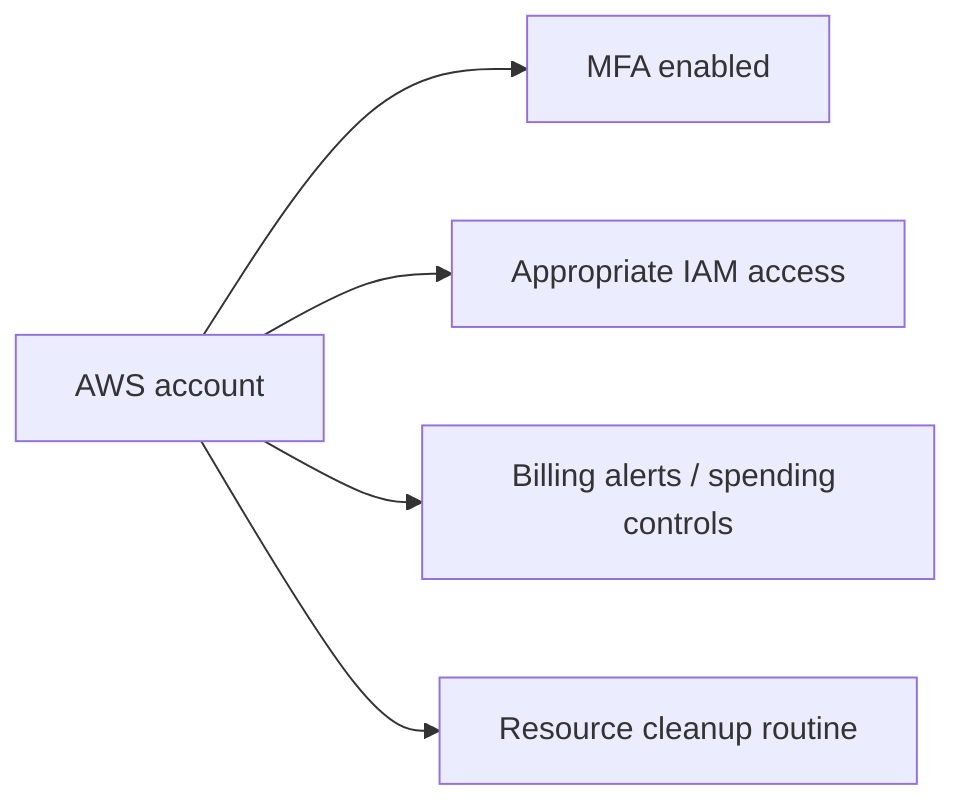

> **Important:** AWS advises against using the traditional root user for ordinary tasks. The new sign-up experience differs: project accounts are owned through AWS Builder ID, and root sign-in is not used in the same way. See the official guidance for the selected path.

---

## 5. Understand Regions and Availability Zones

A **Region** is a geographic area where AWS operates services. An **Availability Zone (AZ)** is a physically separated location group within a region, designed to support resilience.

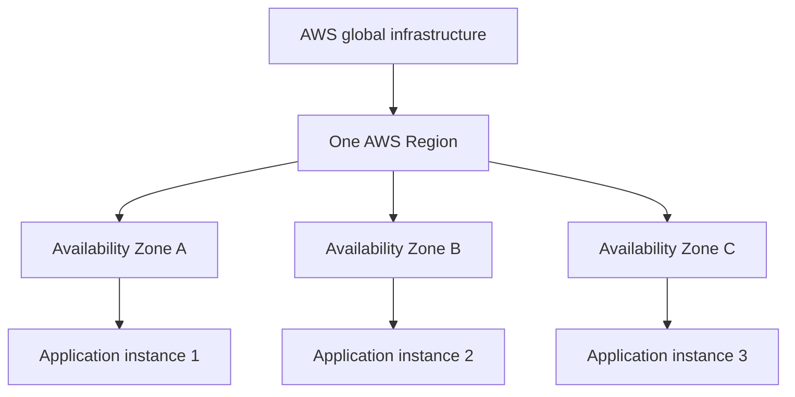

**Example:** A service can run application instances in two AZs so a problem in one AZ does not automatically stop all application traffic. Running in two AZs does not, by itself, guarantee high availability: the load balancer, database and networking must also be designed appropriately.

**Remember:** **Region = geographic scope. AZ = failure-isolation building block within a region.** Data residency, latency and cost affect region choice.

---

## 6. What does shared responsibility mean?

Cloud providers manage important parts of the infrastructure, but **you still have responsibilities**.

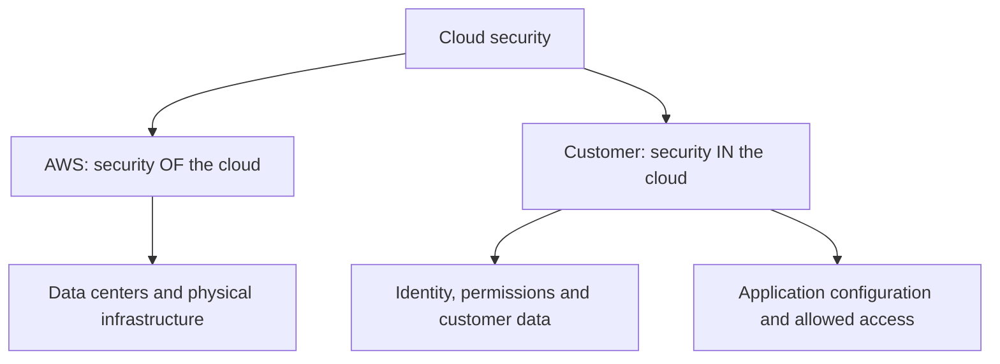

What you manage depends on the service model. With an EC2 virtual machine, you generally manage much of its operating system and software. With Lambda, AWS manages more of the runtime infrastructure, but you still manage your code, permissions, dependencies and data.

A managed service **reduces operational work**, not responsibility for security.

---

## 7. IaaS — Infrastructure as a Service

**IaaS means renting the basic building blocks of IT: servers, storage and networking.**

### Everyday example

You rent an **empty apartment**. The building owner maintains the building, but you arrange furniture and decide how to use the rooms.

### In technology

AWS provides the physical infrastructure and virtual hardware. You install and maintain the application stack inside the virtual machine.

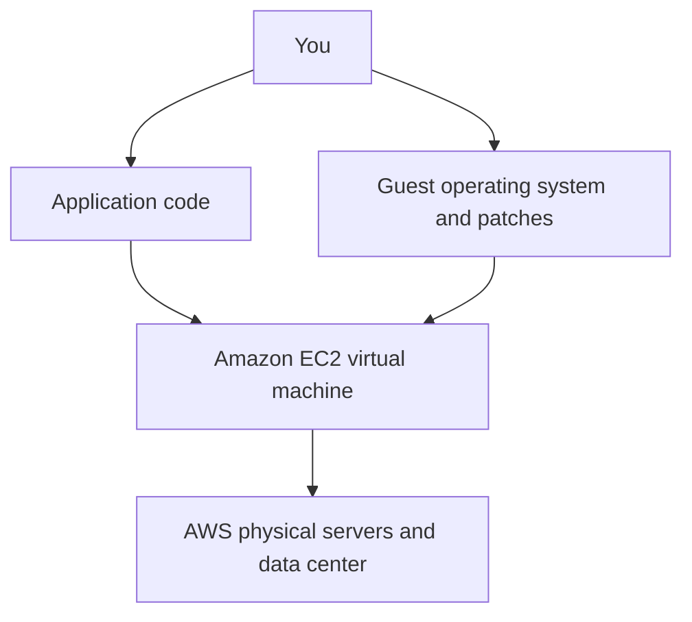

**AWS example:** **Amazon EC2**, with Amazon EBS for block storage and Amazon VPC for networking.

**Best when:** You need control over the operating system, runtime, installed packages or specialized server configuration.

**Trade-off:** More control means more responsibility for upgrades, patching, scaling and monitoring.

---

## 8. PaaS — Platform as a Service

**PaaS gives developers a managed application platform**. You focus mainly on your application, while the platform handles much of the infrastructure setup and deployment environment.

### Everyday example

You rent a **furnished apartment**. The landlord has already arranged much of what you need, so you can focus on living there.

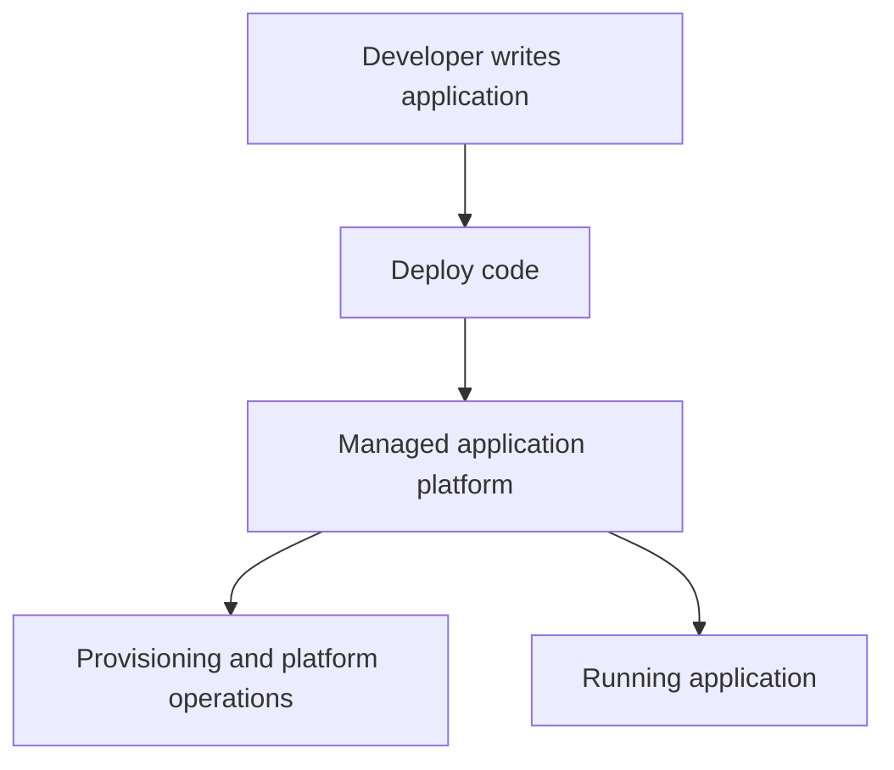

**AWS example:** **AWS Elastic Beanstalk** is a useful *PaaS-like* example: it helps deploy and manage web applications on AWS infrastructure. You still have decisions about application configuration, access, scaling and underlying service charges.

**Best when:** You want to deploy conventional web applications without manually assembling all the infrastructure.

**Trade-off:** Less infrastructure control and some platform-specific constraints.

---

## 9. CaaS — Containers as a Service

**CaaS lets you run applications packaged as containers**, with a managed service helping schedule, deploy or operate those containers.

### What is a container?

A container bundles an application and many of its dependencies so it behaves consistently across environments. It shares the host operating-system kernel rather than being a full virtual machine.

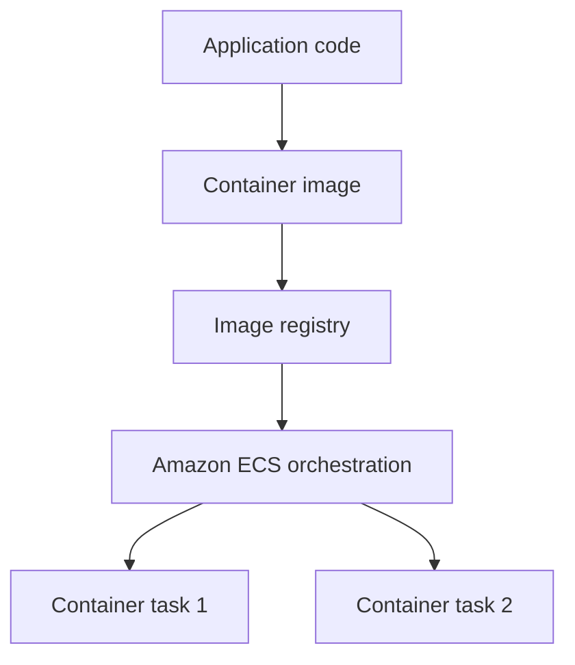

**AWS examples:** **Amazon ECS** or **Amazon EKS** orchestrate containers; **AWS Fargate** provides serverless compute capacity for supported container tasks/pods, reducing server management.

**Best when:** You have microservices, containerized APIs, or workloads requiring consistent packaging and scaling.

**Trade-off:** You still manage images, dependencies, runtime configuration, networking, security and container behavior. ECS/EKS and Fargate have different operational boundaries.

**Memory trick:** **CaaS = “I bring a container; the platform helps run it.”**

---

## 10. FaaS — Function as a Service

**FaaS runs code in response to events**, without requiring you to administer a continuously running application server for that function.

### Everyday example

Instead of renting a full kitchen, you **hire someone for one cooking task when needed**.

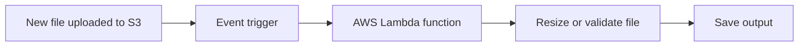

**AWS example:** **AWS Lambda**. You provide function code and configuration. AWS manages much of the underlying compute scaling and execution environment.

**Best when:** Work is event-driven, short-lived or bursty, such as image processing, scheduled cleanup, or webhook handling.

**Trade-off:** Execution time limits, cold starts, concurrency controls, event retry behavior, and external-state management can matter. Lambda is not a good choice for every continuously running or very long task.

---

## 11. SaaS — Software as a Service

**SaaS means using a complete application delivered over the internet**. You normally do not build or operate the application's underlying infrastructure.

### Everyday example

You stay in a **hotel**. The room, furniture and maintenance are provided. You simply use the service.

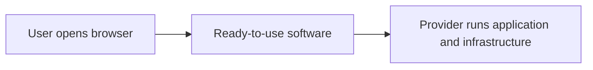

**Examples:** Microsoft 365, Google Workspace or Salesforce are familiar SaaS products. **Amazon QuickSight** is an AWS-hosted managed analytics service that offers a SaaS-style end-user experience, although categorization depends on the exact offering.

**Best when:** You want business functionality without building the application yourself.

**Trade-off:** Less customization and direct control over internal implementation; vendor contracts, data access and integration matter.

**Remember:** **SaaS = “Use the finished software.”**

---

## 12. Compare all five models

| Model | Full name | What you primarily manage | Simple example | AWS-related example |
|---|---|---|---|---|
| **IaaS** | Infrastructure as a Service | OS, middleware, application and data | Empty apartment | EC2 |
| **PaaS** | Platform as a Service | Application and data, plus configuration | Furnished apartment | Elastic Beanstalk (PaaS-like) |
| **CaaS** | Containers as a Service | Container images, app and deployment configuration | Bring your packaged furniture | ECS / EKS, optionally Fargate |
| **FaaS** | Function as a Service | Function code, triggers, dependencies and permissions | Hire help for one task | Lambda |
| **SaaS** | Software as a Service | Usage, users, settings and business data | Hotel service | QuickSight-style managed analytics / third-party SaaS |

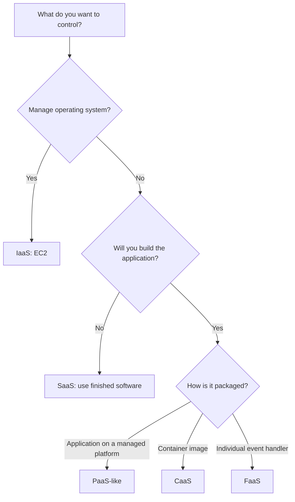

**Important:** These labels are teaching models, **not strict mutually exclusive AWS product categories**. A service can combine characteristics of several models; for example, containers can be deployed on serverless compute.

---

## 13. Design one application five different ways

Suppose you want a simple **photo-upload website**.

**IaaS:** Launch an EC2 server, install the OS packages and web server, deploy your app, configure HTTPS and patch the machine.

**PaaS-like:** Deploy your application to Elastic Beanstalk; let the platform help provision and manage its web environment.

**CaaS:** Package the website into a Docker image and run it using ECS/Fargate.

**FaaS:** Put a simple HTTP interface in front of Lambda functions and use S3 for uploaded files. This suits appropriately sized event-driven operations, subject to service limits.

**SaaS:** Use an existing online photo-sharing product. No custom photo website needs to be built.

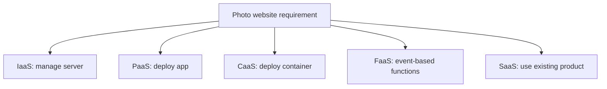

### What changes?

The **business goal stays the same**. What changes is how much infrastructure you operate and how the software is packaged and delivered.

---

## 14. AWS service selection exercise

Choose a reasonable starting service for each requirement:

| Requirement | Candidate | Why? |
|---|---|---|
| Need full control over Linux server | **EC2** | VM and OS-level flexibility |
| Deploy a conventional web application quickly | **Elastic Beanstalk** | Application-platform automation |
| Run packaged microservices | **ECS with Fargate** | Container orchestration without owning the worker servers |
| Resize a photo after upload | **Lambda** | Event-driven processing |
| Store uploaded images | **S3** | Durable object storage; not itself one of the five whole-app delivery models |
| Use an email/calendar product | **SaaS** | Ready-made application |

**Interview tip:** Do not answer “Lambda is always cheaper” or “EKS is always more scalable.” Evaluate request pattern, operational skill, required customization, latency, service limits and cost.

---

## 15. Costs, mistakes and cleanup checklist

A major beginner mistake is launching a service and forgetting to stop or delete it. Even if an EC2 instance is stopped, **associated storage, snapshots or other resources may still incur charges**.

### Before starting a practice lab

- [ ] Confirm the current account plan and Free Tier eligibility.
- [ ] Configure billing alerts or available spend limits.
- [ ] Choose an AWS Region deliberately.
- [ ] Avoid publicly exposing databases or storage.
- [ ] Do not store passwords or access keys in code or GitHub.
- [ ] Note which resources you created.

### After finishing

- [ ] Delete unused EC2 instances, load balancers, databases and test resources.
- [ ] Review attached storage, snapshots, public IP resources and other chargeable dependencies.
- [ ] Check the AWS Billing dashboard for actual cost and remaining resources.
- [ ] Revoke test credentials and remove unneeded access permissions.

**Safety reminder:** A budget alert is informative, but does **not necessarily stop usage or charges**. Some AWS account plans offer spend-limit controls; understand their specific restrictions.

---

## 16. Interview questions and quick revision

### Beginner interview questions

1. What is cloud computing? How is it different from hosting servers yourself?
2. What do AWS Regions and Availability Zones mean?
3. What does shared responsibility mean?
4. Why should you enable MFA?
5. Why should you avoid daily root-user access on traditional AWS accounts?
6. What is IaaS? Give an EC2 example.
7. What is PaaS, and when would you use Elastic Beanstalk?
8. What is the difference between a container and a virtual machine?
9. What do ECS, EKS and Fargate do?
10. What is FaaS? Explain an S3 → Lambda workflow.
11. What is SaaS? Why is it different from PaaS?
12. Is AWS Free Tier completely free for every service and account?
13. When would you prefer ECS/Fargate over Lambda?
14. What must you delete after a test to avoid unexpected charges?

### One-minute cheat sheet

| Term | Remember |
|---|---|
| Cloud | Rent IT resources on demand |
| Region | Geographic AWS deployment area |
| Availability Zone | Separate resilience location within a Region |
| MFA | Extra protection for sign-in |
| IaaS | You manage more; rent infrastructure |
| PaaS | Deploy an app on a managed platform |
| CaaS | Deploy and operate containers using managed orchestration |
| FaaS | Run functions when events occur |
| SaaS | Use a finished application |
| EC2 | Virtual servers |
| Elastic Beanstalk | Managed app deployment environment |
| ECS / EKS | Container orchestration |
| Fargate | Serverless compute for containers |
| Lambda | Event-driven functions |
| S3 | Object storage |

**Final takeaway:** **IaaS gives you infrastructure; PaaS provides an application platform; CaaS runs containers; FaaS runs event-driven functions; SaaS provides ready-to-use software.** The more the provider manages, the less infrastructure you typically manage yourself—but your responsibilities never disappear completely.

---

## 17. Official references

Use these links to verify steps and changing AWS policies:

- [AWS account sign-up options](https://docs.aws.amazon.com/accounts/latest/reference/sign-up-for-aws.html)
- [AWS sign-up (new experience)](https://docs.aws.amazon.com/accounts/latest/reference/sign-in-new.html)
- [AWS sign-up (advanced)](https://docs.aws.amazon.com/accounts/latest/reference/getting-started.html)
- [AWS accounts in India](https://docs.aws.amazon.com/accounts/latest/reference/managing-accounts-india.html)
- [AWS root-user best practices](https://docs.aws.amazon.com/accounts/latest/reference/root-user.html)
- [AWS Free Tier](https://docs.aws.amazon.com/us_en/awsaccountbilling/latest/aboutv2/free-tier.html)
- [AWS explanation of IaaS and other service models](https://aws.amazon.com/what-is/iaas/)
- [AWS shared responsibility model](https://aws.amazon.com/compliance/shared-responsibility-model/)
- [Amazon EC2](https://aws.amazon.com/ec2/)
- [AWS Elastic Beanstalk](https://aws.amazon.com/elasticbeanstalk/)
- [Amazon ECS](https://aws.amazon.com/ecs/)
- [AWS Fargate](https://aws.amazon.com/fargate/)
- [AWS Lambda](https://aws.amazon.com/lambda/)