# AWS Global Infrastructure (Part 1) — Regions, Availability Zones, Local Zones and Edge Locations

*AWS Education Notes · Author: Jayesh Sharma*

**Lesson 3 · AWS from Basics to Advanced** | A beginner-friendly guide with practical analogies, architecture diagrams, cost-conscious exercises and interview questions.

> Original study notes inspired by the public topic and verified against official AWS documentation (November 2026). The full spoken transcript was not available; these notes are not claimed to be a verbatim summary of the instructor's video.

## Contents

- [1. What is AWS Global Infrastructure?](#1-what-is-aws-global-infrastructure)
- [2. Region: the main geographic location](#2-region-the-main-geographic-location)
- [3. How to choose the right Region](#3-how-to-choose-the-right-region)
- [4. Availability Zone: separate failure domain inside a Region](#4-availability-zone-separate-failure-domain-inside-a-region)
- [5. Region versus Availability Zone](#5-region-versus-availability-zone)
- [6. What does multi-AZ architecture look like?](#6-what-does-multi-az-architecture-look-like)
- [7. What happens when one AZ goes down?](#7-what-happens-when-one-az-goes-down)
- [8. Regional versus zonal resources](#8-regional-versus-zonal-resources)
- [9. What is an AWS Local Zone?](#9-what-is-an-aws-local-zone)
- [10. When should you use Local Zones?](#10-when-should-you-use-local-zones)
- [11. What is an edge location?](#11-what-is-an-edge-location)
- [12. Cache hit versus cache miss](#12-cache-hit-versus-cache-miss)
- [13. Local Zone versus edge location](#13-local-zone-versus-edge-location)
- [14. Wavelength Zones and AWS Outposts: related concepts](#14-wavelength-zones-and-aws-outposts-related-concepts)
- [15. How Region, AZ, Local Zone and CloudFront work together](#15-how-region-az-local-zone-and-cloudfront-work-together)
- [16. Regions and disaster recovery: what is not automatic](#16-regions-and-disaster-recovery-what-is-not-automatic)
- [17. Practice: AWS Console and CLI without expensive deployments](#17-practice-aws-console-and-cli-without-expensive-deployments)
- [18. Common mistakes and interview traps](#18-common-mistakes-and-interview-traps)
- [19. System design interview answer](#19-system-design-interview-answer)
- [20. Quick revision and official sources](#20-quick-revision-and-official-sources)

---

## 1. What is AWS Global Infrastructure?

When an application serves people in India, Europe, and the USA, **where the servers physically run** matters. It affects response time, failures, costs, and legal requirements.

AWS has several kinds of infrastructure locations. Think of them as different ways to place **computing power** and **deliver data** near users.

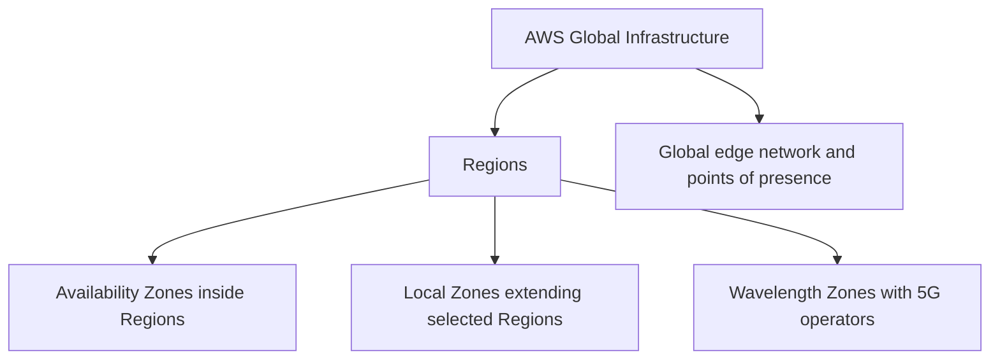

**Simple distinction:** A **Region** is where you choose a broad geographic home for an application. **Availability Zones** help the application survive local failures. **Local Zones** put selected workloads closer to certain cities. **Edge locations** help deliver content and networking services close to users.

> This is an independently written study companion for lesson 3 of the AWS course, not a word-for-word video transcript. AWS-specific facts were checked against the official documentation linked at the end.

---

## 2. Region: the main geographic location

An AWS **Region** is a separate geographic area containing AWS infrastructure. Examples:

| Region name | Region code |
|---|---|
| Asia Pacific (Mumbai) | `ap-south-1` |
| Asia Pacific (Hyderabad) | `ap-south-2` |
| US East (N. Virginia) | `us-east-1` |
| Europe (Ireland) | `eu-west-1` |

Imagine you are opening a physical company office: first, you decide **which city or geography** it belongs to. Choosing an AWS Region is similar.

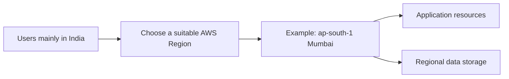

**Important:** Regions are isolated from one another by design. Creating a database in Mumbai **does not automatically create a copy** in Hyderabad, Singapore, or Virginia. You must configure cross-Region replication or failover where required.

Region selection is service-specific: not every AWS service or instance type is available in every Region.

---

## 3. How to choose the right Region

Choosing the closest Region is a good first thought, but not the whole decision.

Ask:

1. **Latency:** Where are the users? Can the app respond quickly?
2. **Data residency:** Must data remain in a particular geography?
3. **Availability:** Does the Region offer the required service and capacity?
4. **Cost:** Pricing and data-transfer charges can differ by Region.
5. **Business continuity:** Would a second Region be needed for disasters?

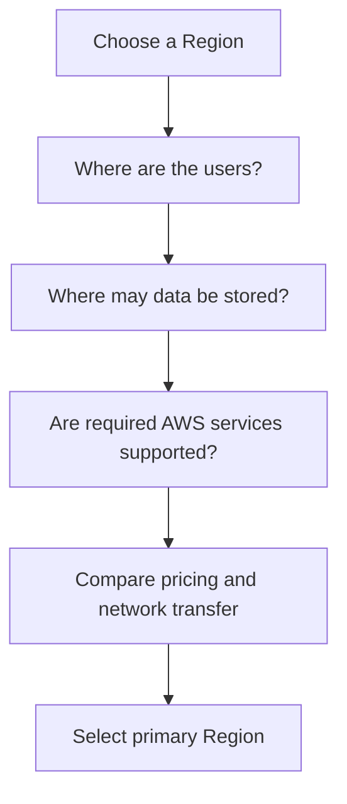

**Example:** For users mostly in India, Mumbai or Hyderabad might be sensible candidates. Benchmark actual latency and verify your data and regulatory requirements rather than assuming either is always best.

**Note:** Regulatory compliance is not guaranteed merely by selecting a Region. Your data flows, backups, logs and third-party integrations matter too.

---

## 4. Availability Zone: separate failure domain inside a Region

A **Region contains multiple Availability Zones (AZs)**. Each AZ comprises one or more data centers with separate power, networking and connectivity.

Think of one city with **separate office buildings**. If one building loses power, another building can continue operating—but only if your application has resources in both.

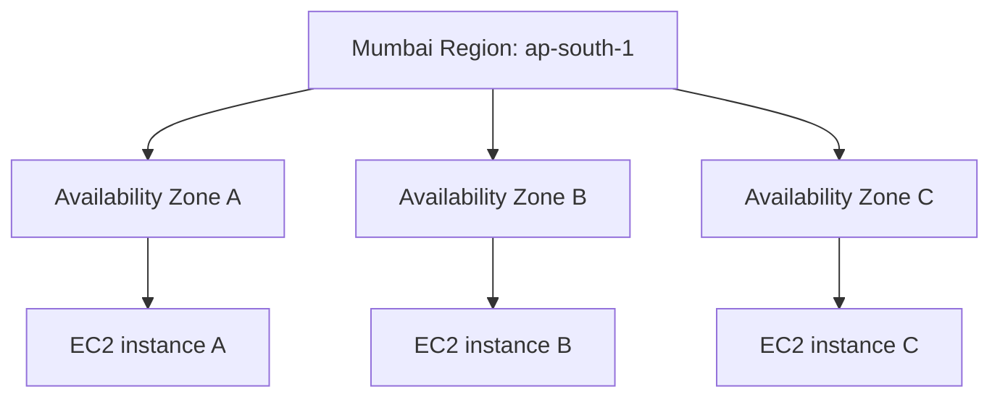

AZs in a Region are connected using high-bandwidth, low-latency, redundant networks. **High availability** means your application can continue serving requests when some components fail. AWS provides the facilities; **you must deploy your architecture across AZs** to benefit.

**Caution:** One EC2 instance in one AZ does not become multi-AZ automatically.

---

## 5. Region versus Availability Zone

| Question | Region | Availability Zone |
|---|---|---|
| What is it? | Separate geographic area | Isolated infrastructure location inside a Region |
| Contains | Multiple AZs and regional services | One or more data centers |
| Example code | `ap-south-1` | `ap-south-1a` |
| Protects mainly against | Geographic or Region-scale events when you use multiple Regions | Failure of one AZ when you deploy across AZs |
| Network relationship | Inter-Region links and transfer policies | Low-latency networking within a Region |
| Common architecture | Primary Region plus DR Region | Two or more application AZs |

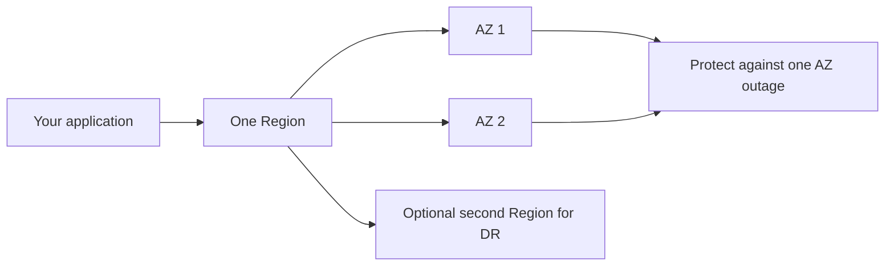

**Memory trick:** A Region is like a **city**. AZs are like **independent office campuses inside the city**.

One thing to remember: names such as `us-east-1a` historically could map differently between older AWS accounts in certain Regions. Use **AZ IDs** for cross-account physical-zone coordination when relevant.

---

## 6. What does multi-AZ architecture look like?

A simple web application can run in at least two AZs behind an **Application Load Balancer (ALB)**.

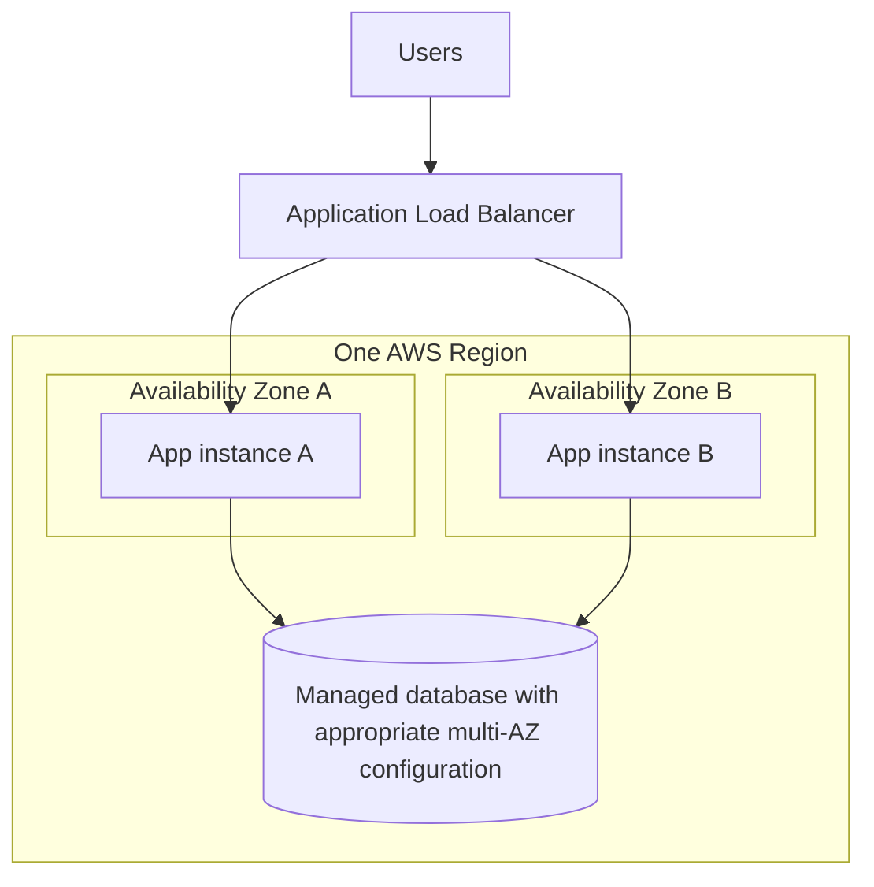

If instance A or its AZ fails, the load balancer can route eligible traffic to instance B **if** health checks, routing, enough spare capacity, and application dependencies are correctly configured.

**Important:** Multi-AZ app servers do not help if your single database, storage, NAT gateway or another dependency is a single point of failure.

For a beginner lab, understand the drawing first; creating ALBs, NAT gateways and managed databases can incur costs.

---

## 7. What happens when one AZ goes down?

Suppose an application runs on two servers, each in a different AZ.

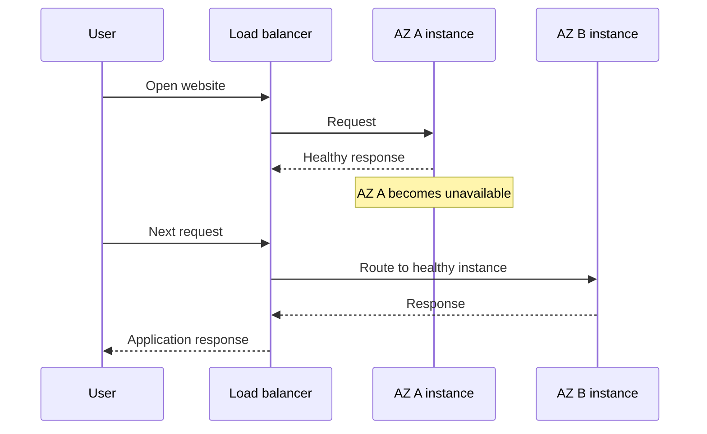

AWS networking helps, but your application must be designed for failover. The remaining AZ needs sufficient capacity, data must be accessible, sessions should not be tied to one instance, and health checks must detect failures.

**Interview phrase:** “Multi-AZ improves availability for AZ-level failures; it does not automatically protect from a full Region outage.”

---

## 8. Regional versus zonal resources

Not every AWS resource lives at the same scope.

- **Zonal resources:** An EC2 instance or EBS volume belongs to a particular AZ.
- **Regional resources:** A VPC spans a Region; individual subnets are tied to one AZ. An S3 bucket is created in a Region and S3 Standard stores data redundantly across multiple AZs in that Region.
- **Global services or configurations:** Some services, including IAM and Route 53, have global characteristics. Always check the service's specific behavior.

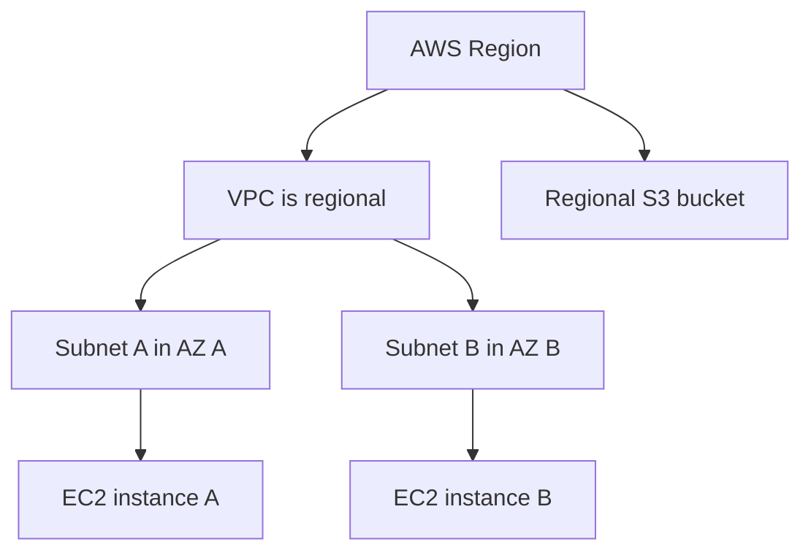

**Common misunderstanding:** You cannot place **one subnet** across multiple AZs. To use two AZs, create suitable subnets in each.

Not all storage classes or services use identical replication behavior, so avoid treating every regional resource as automatically multi-AZ.

---

## 9. What is an AWS Local Zone?

A **Local Zone** is an extension of a parent AWS Region that places **selected compute and storage resources closer to users** in particular metropolitan areas.

Example: AWS lists Local Zones associated with the Mumbai Region for **Delhi** and **Kolkata**. Availability, service support and opt-in requirements should be verified for your account.

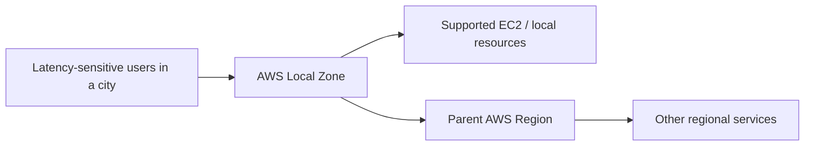

**Example use cases:** Real-time gaming, interactive graphics, virtual workstations or local data processing.

**Key point:** A Local Zone is **not a full new Region**. It is associated with a parent Region, and it supports a **subset of AWS services**. Always check supported instance types, network options and prices.

A Local Zone differs from an ordinary AZ because its purpose includes **geographic proximity to an end-user metro area**, not merely adding another failure domain inside the main regional footprint.

---

## 10. When should you use Local Zones?

Imagine a cloud-rendered desktop application used in Delhi. Users need fast response to every mouse movement. A Local Zone may reduce latency by running supported compute closer to them.

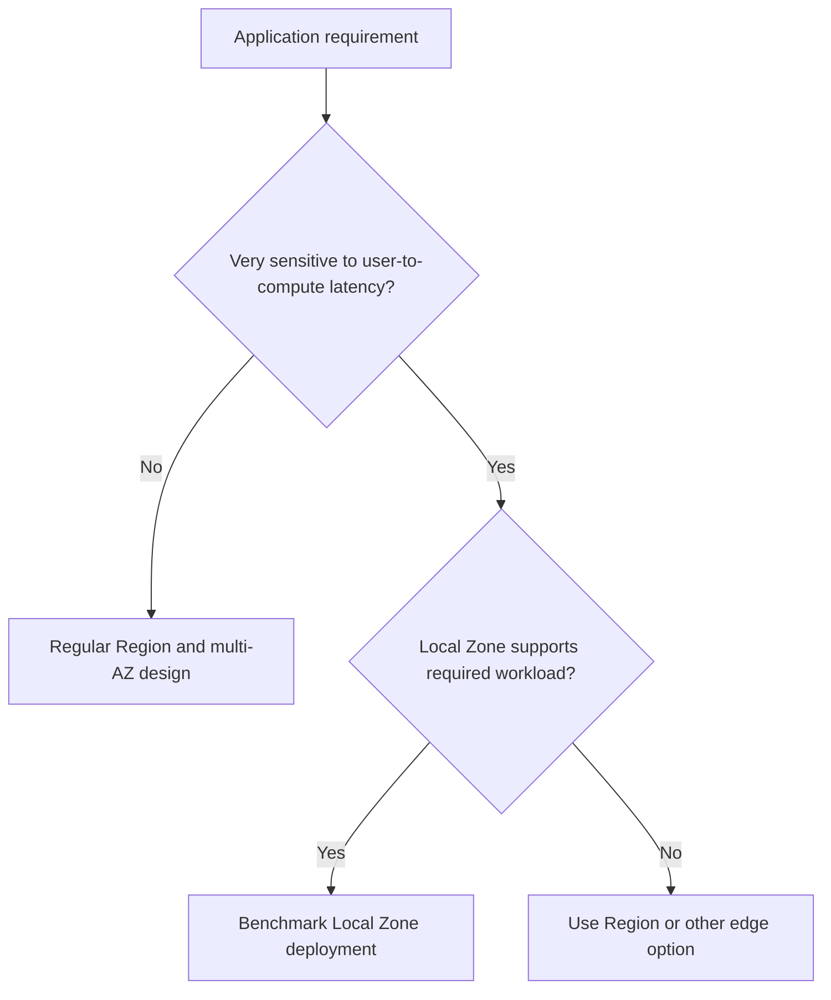

A Local Zone does not necessarily make **all** end-to-end operations faster. If the application's database remains in a distant parent Region and every request needs that database, the Region round trip can dominate.

Measure **full transaction latency**, not just the ping to the closest compute instance.

---

## 11. What is an edge location?

An AWS **edge location** is a point of presence in the global edge network. Services such as **Amazon CloudFront** use these locations to deliver cached content close to viewers.

Think of a movie service:

- The original video file lives at the origin, such as Amazon S3.
- Many viewers request it from different cities.
- A nearby edge location can return a cached copy without making every viewer fetch it from the origin.

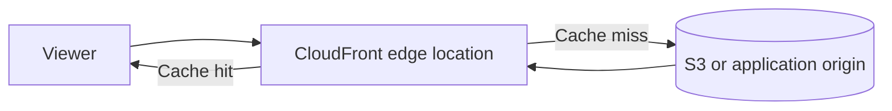

**Remember:** An edge location is usually **not** a replacement for an AZ, Region or a complete general-purpose compute deployment.

CloudFront also supports edge-function options (CloudFront Functions and Lambda@Edge) for specific request-processing use cases, but that is different from freely running an entire EC2 application at every edge POP.

---

## 12. Cache hit versus cache miss

CloudFront often speeds up static content because repeated requests can be answered near users.

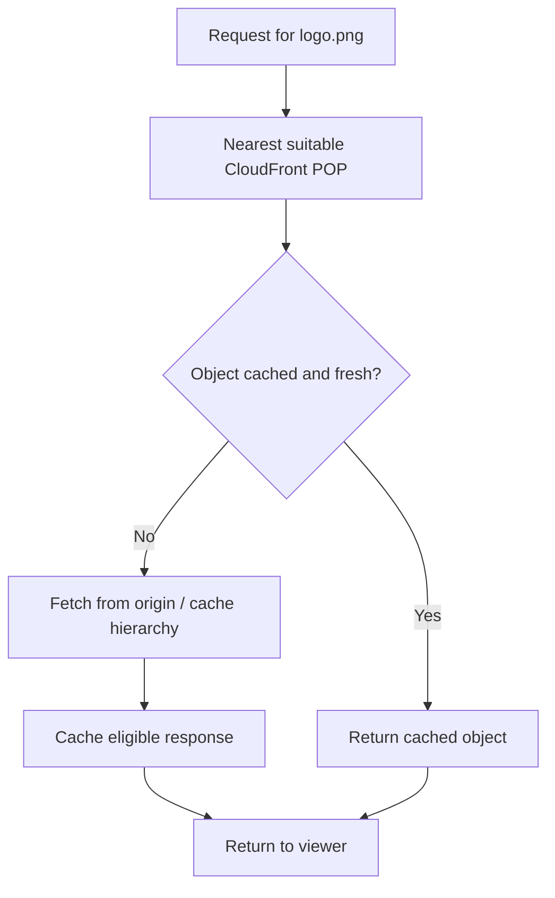

**Cache hit:** Object is already available in cache, so the viewer gets it without an origin fetch.

**Cache miss:** CloudFront forwards the request through its configured cache/origin path; the returned eligible content can be cached for subsequent requests.

**Nuance:** Dynamic responses, cookies, headers, TTLs and cache policies affect whether a response is cacheable. “CloudFront makes every API request fast” is not correct.

**Related concept:** CloudFront may also use **regional edge caches** between POPs and origins.

---

## 13. Local Zone versus edge location

These terms both mean “closer to the user,” but they solve different problems.

| Aspect | Local Zone | Edge location (for CloudFront) |
|---|---|---|
| Main goal | Run selected workloads near users | Deliver/cache content near users |
| Typical resource | Supported EC2 compute and related services | CloudFront cache and edge request processing |
| Relationship | Extension of a parent Region | Part of AWS global edge network |
| Good example | Interactive remote desktop | Website images, videos, CSS, JS |
| Stores primary database? | Only if supported and architecturally appropriate | Not a general-purpose regional database location |
| Choose when | Compute latency dominates | Content delivery latency dominates |

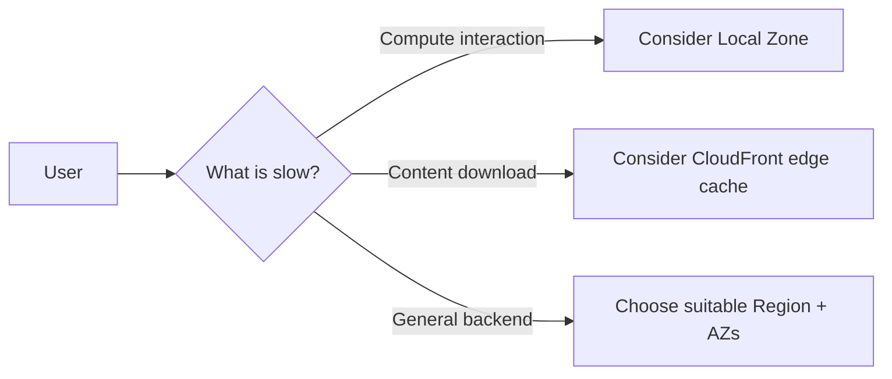

**Memory trick:** **Local Zone brings some compute closer. Edge location brings content closer.**

---

## 14. Wavelength Zones and AWS Outposts: related concepts

AWS has other placement choices worth recognizing, though they are beyond the main lesson title.

- **Wavelength Zones:** Put selected AWS compute/storage into telecom carriers' **5G networks** for latency-sensitive mobile applications.
- **AWS Outposts:** Bring supported AWS infrastructure, services and operations into a **customer's on-premises data center or colocation site**.

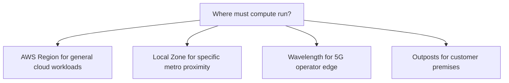

Do not confuse **CloudFront edge locations**, **Local Zones**, **Wavelength Zones**, and **Outposts** simply because all are associated with infrastructure outside a standard regional data-center footprint.

Each has different supported services, pricing and ownership/network requirements.

---

## 15. How Region, AZ, Local Zone and CloudFront work together

Imagine an e-commerce site serving customers across India.

- Host the main API in a Region such as Mumbai, across at least two AZs.
- Keep database/storage in an appropriate regional architecture.
- Use CloudFront to cache product images and static JavaScript near customers.
- Consider a Local Zone **only if** a measured latency-sensitive feature benefits from compute closer to a supported city.

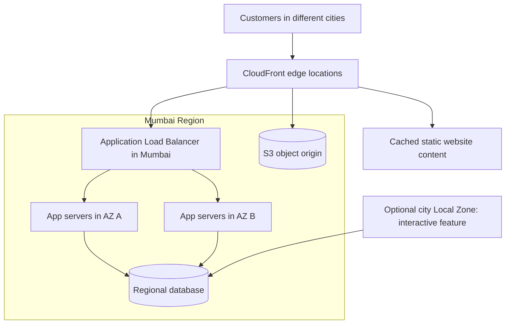

This diagram is **conceptual**. A real design requires proper origin configuration, VPC routing, database failover, security groups, DNS, authentication and cost review.

It shows that these infrastructure components are complementary—not competing choices.

---

## 16. Regions and disaster recovery: what is not automatic

Multi-AZ can tolerate the failure of an AZ **if you have deployed redundantly**. But it is not equivalent to multi-Region disaster recovery.

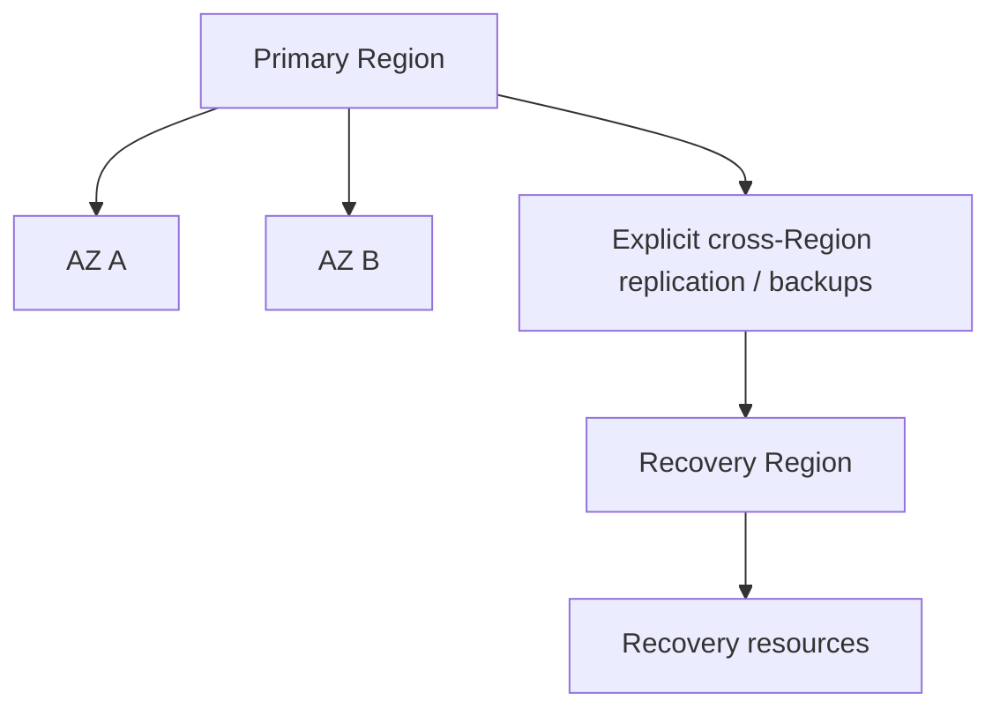

You must decide how to recover if the entire Region or a shared regional service becomes unavailable.

Two important measures:

- **RTO (Recovery Time Objective):** How quickly must the service return?
- **RPO (Recovery Point Objective):** How much recent data can be lost?

A separate course video covers disaster recovery strategies in more depth. This section is a short introduction so you don't incorrectly assume that “three AZs means global disaster recovery.”

---

## 17. Practice: AWS Console and CLI without expensive deployments

You can learn much of Global Infrastructure without creating EC2, load balancers or databases.

**Console exercise:**
1. Sign into AWS with an appropriately protected account.
2. Use the **Region selector** to view available Regions.
3. Open EC2 in an enabled Region and inspect **Availability Zones** under the Regions and Zones view.
4. Observe that some Regions may require explicit opt-in.
5. Inspect AWS Local Zones documentation and your account's zone availability.
6. Return to your chosen home Region to avoid accidental resource placement.

**Optional read-only AWS CLI practice** (requires configured AWS credentials and permission):

```bash
aws ec2 describe-regions --region ap-south-1   --query 'Regions[].{Code:RegionName,Endpoint:Endpoint}' --output table

aws ec2 describe-availability-zones --region ap-south-1   --filters Name=zone-type,Values=availability-zone   --query 'AvailabilityZones[].{Zone:ZoneName,ID:ZoneId,State:State}' --output table
```

These are read operations, but API costs/limits and account configuration are service-dependent. Don't create paid resources for this lesson unless you specifically plan and budget for them.

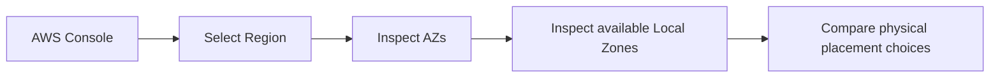

---

## 18. Common mistakes and interview traps

| Misunderstanding | Correct explanation |
|---|---|
| “An AZ is one data center” | An AZ contains **one or more** separate data centers |
| “All resources are global” | Many are regional or zonal; scope varies |
| “One EC2 instance is highly available because AWS is reliable” | Design redundancy across AZs |
| “Switching Region copies my resources” | Regional resources generally remain in their own Region |
| “A subnet can span two AZs” | A subnet is tied to a single AZ |
| “CloudFront is another Region” | It uses the global edge network |
| “Local Zone is the same as CloudFront edge” | Local Zone provides selected nearby compute; CloudFront primarily handles delivery |
| “Multi-AZ means zero downtime guaranteed” | Failure detection and dependencies still matter |
| “Three AZs mean multi-Region DR” | A separate Region requires explicit design |
| “Nearest Region is always cheapest/best” | Price, services, residency and measured latency also matter |

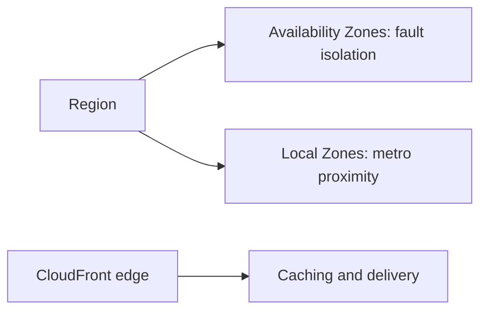

Always identify **which failure you are protecting against** and **which latency you are reducing**.

---

## 19. System design interview answer

When asked about **AWS Global Infrastructure**, explain the concepts in a practical order:

1. Region: primary geographic home of regional resources.
2. Availability Zones: independent failure domains inside a Region.
3. Multi-AZ: distribute application components for availability.
4. Regional versus zonal scope: resources such as VPC, subnet, EC2 and EBS.
5. Local Zone: selected compute closer to end users.
6. Edge location: CloudFront content delivery near viewers.
7. Wavelength and Outposts: 5G network edge and on-premises extension.
8. Design choice: latency, residency, availability, costs, and DR.

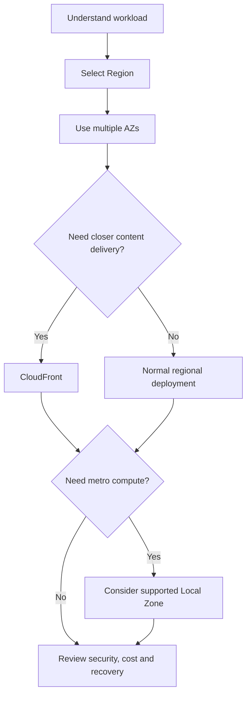

**Interview-ready explanation:**

“An AWS Region is a separate geographic area containing multiple Availability Zones. I choose the Region based on users, data rules, required services and cost. To tolerate an AZ failure, I deploy stateless application servers across multiple AZs and remove single points of failure. If users need faster static content, I use CloudFront edge locations. If a supported latency-sensitive workload needs compute close to a particular metro, I evaluate Local Zones. Regional disaster recovery is a separate decision.”

---

## 20. Quick revision and official sources

### Practice questions

1. What is an AWS Region?
2. How is an Availability Zone different from a Region?
3. Can one AZ contain multiple data centers?
4. How many AZs should a basic highly available app use, and why?
5. Is a VPC regional or zonal? What about a subnet?
6. Can an EC2 instance belong to two AZs?
7. How do you handle a single AZ outage?
8. Is CloudFront the same as an AWS Local Zone?
9. What happens when CloudFront has a cache miss?
10. Does creating a resource in Mumbai replicate it into Hyderabad automatically?
11. What do RTO and RPO mean?
12. When might a Local Zone be worthwhile?
13. What is a Wavelength Zone?
14. How is AWS Outposts different?
15. Why must a system measure end-to-end latency?

### One-minute cheat sheet

| Term | Remember |
|---|---|
| Region | Geographic area containing multiple AZs |
| AZ | Isolated infrastructure location within Region |
| Data center | Physical facility; an AZ may contain one or more |
| Multi-AZ | Deploy redundant application components across AZs |
| VPC | Regional network |
| Subnet | One-AZ segment of a VPC |
| Local Zone | Extension of Region closer to certain users |
| Edge location | CloudFront point of presence for caching/delivery |
| Regional edge cache | Larger cache tier between edge POP and origin |
| Wavelength Zone | AWS workloads near 5G telecom users |
| Outposts | AWS-managed infrastructure at customer premises |
| Multi-Region | Explicitly use more than one Region |
| RTO | Time objective for recovering service |
| RPO | Data-loss tolerance objective |

**Final takeaway:** A **Region** determines geographic placement, **Availability Zones** improve resilience, **Local Zones** bring selected compute closer to people, and **CloudFront edge locations** speed up content delivery. Know which problem each one solves.

### References

- Lesson 3 in [AWS from Basics to Advanced playlist](https://www.youtube.com/playlist?list=PL6W8uoQQ2c60g3PAgzVPpi0YWwxITD43p)
- [AWS Global Infrastructure: Regions and AZs](https://docs.aws.amazon.com/global-infrastructure/latest/regions/aws-regions-availability-zones.html)
- [AWS Regions](https://docs.aws.amazon.com/global-infrastructure/latest/regions/aws-regions.html)
- [AWS Availability Zones](https://docs.aws.amazon.com/global-infrastructure/latest/regions/aws-availability-zones.html)
- [Amazon EC2: Regions and Zones](https://docs.aws.amazon.com/AWSEC2/latest/UserGuide/using-regions-availability-zones.html)
- [Available AWS Local Zones](https://docs.aws.amazon.com/local-zones/latest/ug/available-local-zones.html)
- [How CloudFront delivers content](https://docs.aws.amazon.com/AmazonCloudFront/latest/DeveloperGuide/HowCloudFrontWorks.html)

---
