# AWS Global Infrastructure (Part 2) — Disaster Recovery Strategies Explained Simply

*AWS Education Notes · Author: Jayesh Sharma*

**Lesson 4 · AWS from Basics to Advanced** — Backup and Restore, Pilot Light, Warm Standby, Multi-Site Active/Active, RTO, RPO, failure recovery, and interview examples.

## Contents

- [1. What is Disaster Recovery (DR)?](#1-what-is-disaster-recovery-dr)
- [2. Disaster Recovery versus High Availability](#2-disaster-recovery-versus-high-availability)
- [3. RTO: How long can the application be unavailable?](#3-rto-how-long-can-the-application-be-unavailable)
- [4. RPO: How much recent data loss can be tolerated?](#4-rpo-how-much-recent-data-loss-can-be-tolerated)
- [5. Why RTO and RPO change architecture and cost](#5-why-rto-and-rpo-change-architecture-and-cost)
- [6. Four main AWS disaster recovery strategies](#6-four-main-aws-disaster-recovery-strategies)
- [7. Strategy 1 — Backup and Restore](#7-strategy-1-backup-and-restore)
- [8. Strategy 2 — Pilot Light](#8-strategy-2-pilot-light)
- [9. Strategy 3 — Warm Standby](#9-strategy-3-warm-standby)
- [10. Strategy 4 — Multi-Site Active/Active](#10-strategy-4-multi-site-activeactive)
- [11. Compare the four strategies side by side](#11-compare-the-four-strategies-side-by-side)
- [12. Multi-AZ vs Multi-Region: where recovery happens](#12-multi-az-vs-multi-region-where-recovery-happens)
- [13. Data replication versus backups](#13-data-replication-versus-backups)
- [14. Failover and failback: moving traffic safely](#14-failover-and-failback-moving-traffic-safely)
- [15. Split brain and data conflicts in two Regions](#15-split-brain-and-data-conflicts-in-two-regions)
- [16. Which AWS services help with DR?](#16-which-aws-services-help-with-dr)
- [17. Worked example: online store across two Regions](#17-worked-example-online-store-across-two-regions)
- [18. Practical DR runbook and test checklist](#18-practical-dr-runbook-and-test-checklist)
- [19. Interview framework: explain DR in a few minutes](#19-interview-framework-explain-dr-in-a-few-minutes)
- [20. Quick revision, questions and references](#20-quick-revision-questions-and-references)

---

## 1. What is Disaster Recovery (DR)?

Imagine a food-ordering website hosted in one AWS Region. Everything works until a major infrastructure incident or accidental deletion prevents customers from placing orders. **Disaster recovery** means having a tested way to restore the service and its data.

**Everyday analogy:** You keep a spare house key, copies of important documents, and an alternative place to work. You may never need them, but you prepare **before** losing access to your normal place.

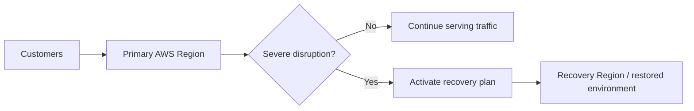

**Remember:** AWS resilience and backup features are building blocks. A reliable recovery plan also needs people, procedures, automation, permissions and rehearsal.

---

## 2. Disaster Recovery versus High Availability

**High availability (HA)** tries to keep the application running during ordinary component failures. **DR** addresses larger events that require restoring or shifting the workload.

| Question | High availability | Disaster recovery |
|---|---|---|
| Main goal | Keep serving while parts fail | Recover after a disruptive event |
| Typical response | Restart instance or redirect across AZs | Restore data or activate recovery environment |
| Example | One app server fails | Whole Region is unavailable or data is corrupted |
| Main design | Multiple healthy instances and AZs | Backups, replication, secondary resources and runbooks |

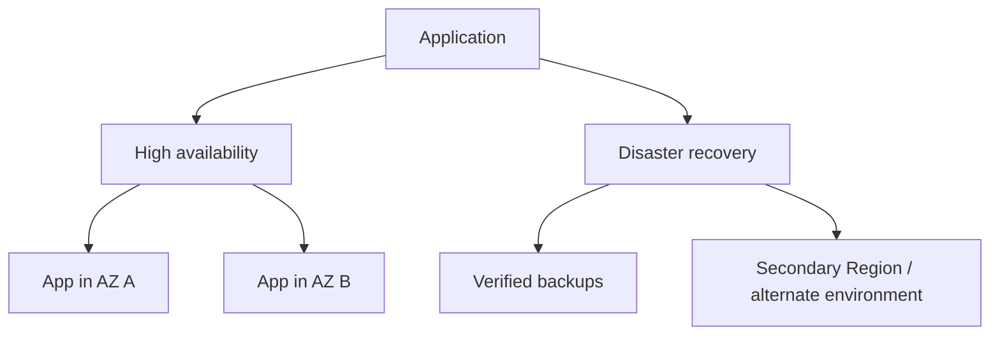

A multi-AZ database can survive some AZ incidents but is not automatically an answer to every Region-level or data-corruption disaster. The definition of a disaster should be driven by the business.

---

## 3. RTO: How long can the application be unavailable?

**Recovery Time Objective (RTO)** is the **maximum acceptable elapsed time to restore service** after a disruption.

Suppose a shopping website stops at 2:00 PM. The business sets an RTO of **30 minutes**. The aim is to restore acceptable service by 2:30 PM.

RTO is a **business target**, not a promise that AWS will automatically recover within the target.

How much time is spent detecting the incident, making the failover decision, recovering services, switching traffic, and verifying health? All of it can affect the actual recovery time.

**Simple mnemonic:** RTO = **Time** until service returns.

---

## 4. RPO: How much recent data loss can be tolerated?

**Recovery Point Objective (RPO)** is the **maximum acceptable amount of data loss measured in time**.

If the failure happens at **2:00 PM** and the business permits **10 minutes of data loss**, its RPO is 10 minutes. Data only recovered up to **1:50 PM** would meet that example target; data older than that would not.

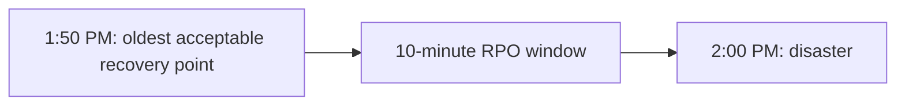

RPO is not “time to fix the application.” That is RTO.

**Memory trick:** RTO = how long the app may be **down**. RPO = how far **back** the recovered data may be.

A service might have RTO = 1 hour and RPO = 5 minutes. These are independent objectives.

---

## 5. Why RTO and RPO change architecture and cost

Shorter RTO usually requires more infrastructure ready to take over. Shorter RPO usually requires more frequent backups or continuous replication.

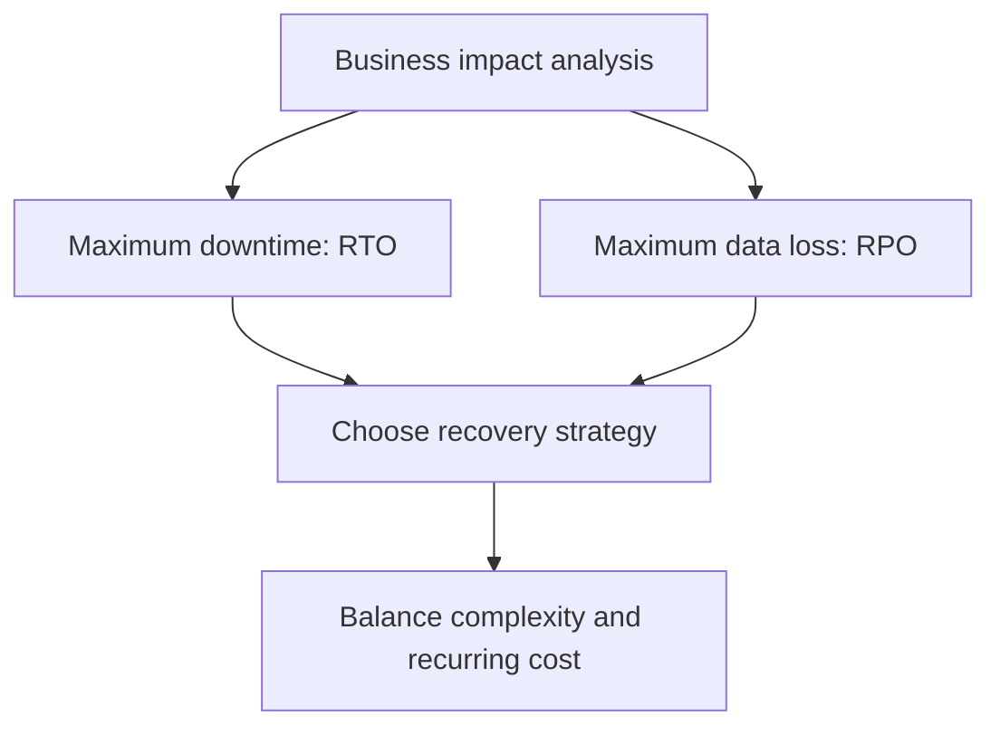

Example discussion:

| Workload | Illustrative requirements | Design direction |
|---|---|---|
| Personal blog | Many hours downtime acceptable | Backup and restore may fit |
| Internal employee portal | Moderate downtime acceptable | Pilot light or warm standby |
| Checkout/payment workflow | Very low data loss tolerance | Replication, audit records, fast recovery |
| Globally active critical service | Very short recovery objectives | Multi-site design may be justified |

**Note:** These are learning examples, not universal RTO/RPO values for those industries. Set actual targets with the business and measure whether the implementation achieves them.

---

## 6. Four main AWS disaster recovery strategies

AWS commonly describes four approaches ordered broadly from lower cost and slower recovery to more infrastructure and faster recovery:

1. **Backup and restore**
2. **Pilot light**
3. **Warm standby**
4. **Multi-site active/active**

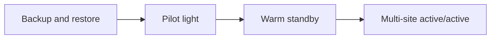

Moving right typically means **more standby resources, operational complexity and expense**, but a potentially faster recovery.

The labels are not service-level guarantees. Real performance depends on data volume, replication lag, automation, network routing, failover testing, and availability of the necessary AWS services during a disaster.

---

## 7. Strategy 1 — Backup and Restore

This is the simplest approach. Keep recoverable backups in a protected location. During a disaster, provision replacement infrastructure and restore the backup.

**Analogy:** The office is destroyed, but you have important documents in a secure locker. You still need a new office, desks and computers before everyone can work again.

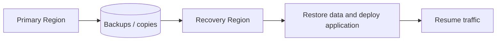

**Good for:** Lower-priority applications, development environments, and systems with longer permissible downtime.

**Benefits:** Less continuously running compute. **Costs:** Restoration can take a long time, especially for large databases, manual network changes or missing dependencies.

**AWS building blocks:** AWS Backup, Amazon S3, database snapshots, infrastructure as code, and cross-Region backup copies when required.

**Critical lesson:** Backups must be **restorable**. Test actual recovery, permissions and encryption-key availability. A backup file existing somewhere is not proof that the business can restart.

---

## 8. Strategy 2 — Pilot Light

A **pilot light** keeps essential recovery foundations ready in another Region, such as replicated data and required core infrastructure. The full application compute may be **absent or switched off** until failover.

**Analogy:** A gas stove has a small pilot flame. When needed, you can turn up the heat without rebuilding the entire stove.

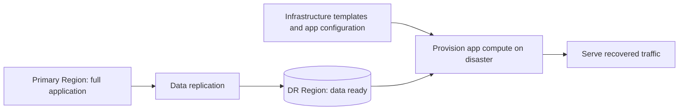

When the primary Region fails, automation starts application resources, validates data and switches requests to the recovery Region.

**Benefit:** Less standby compute than warm standby. **Trade-off:** More recovery steps and a generally longer RTO.

**Nuance:** AWS recommends designing pilot-light compute to be provisioned when needed rather than paying for a fleet of stopped instances if that is not necessary. Keep the data layer and recovery prerequisites usable.

---

## 9. Strategy 3 — Warm Standby

A **warm standby** keeps a **fully functional but smaller copy** of the application running continuously in a recovery Region.

**Analogy:** A second restaurant has its kitchen, staff and equipment operating at limited capacity. When the main restaurant closes, the second restaurant increases staff and output.

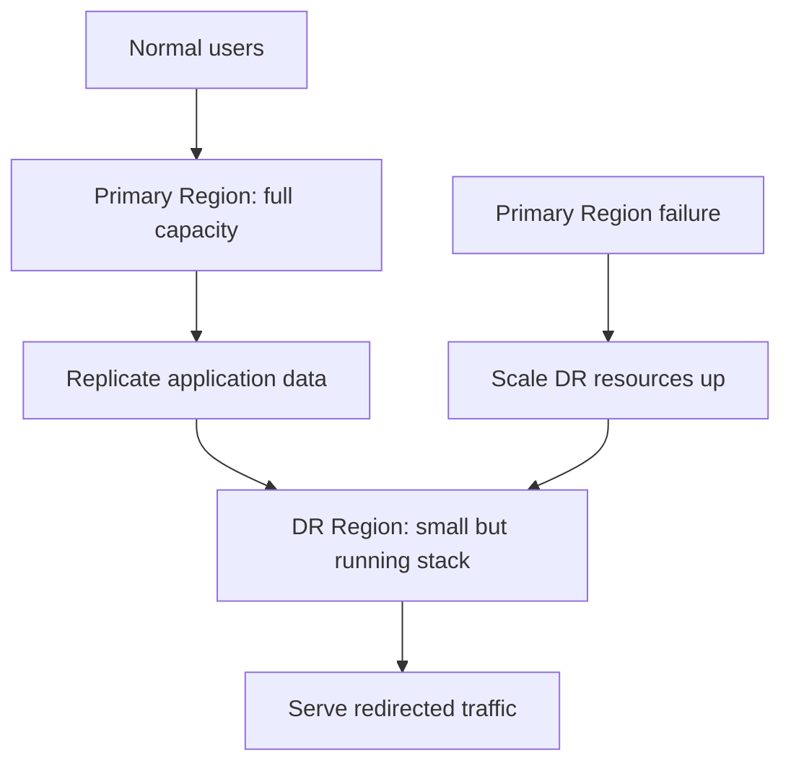

Because the secondary environment is already deployed and working, it may recover faster than pilot light. But running app servers, databases, monitoring and networking in two Regions costs more.

**Important distinction:** A warm-standby application can process requests **at reduced capacity before scale-up**. Pilot light generally needs additional deployment or start-up steps before it can process production requests.

---

## 10. Strategy 4 — Multi-Site Active/Active

With **multi-site active/active**, the application runs and serves customers from **multiple Regions at the same time**.

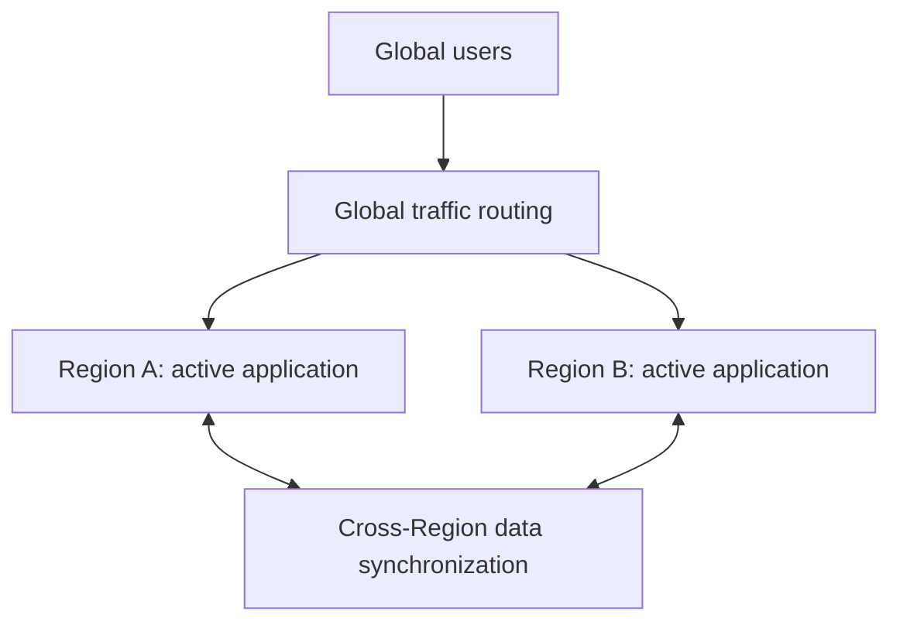

A Region failure can leave users served from the remaining Region if capacity, data availability, and routing are designed correctly.

**Benefits:** Strong availability potential and low-latency geographic serving.

**Challenges:** More infrastructure, multi-Region security, distributed state, write conflicts, replication delay and higher operating cost.

**Crucial detail:** Active/active **does not automatically guarantee zero downtime or zero data loss**. A payment record written in one Region might not yet have reached another. When both Regions accept conflicting writes, the application needs explicit conflict-handling rules.

---

## 11. Compare the four strategies side by side

| Strategy | Recovery environment | Typical recovery behavior | Relative cost |
|---|---|---|---|
| Backup and restore | Backups available, app rebuilt during incident | Restore first, then serve | Low |
| Pilot light | Core data/components ready, rest created during incident | Provision and activate app | Low–medium |
| Warm standby | Working smaller app is already running | Redirect and scale up | Medium–high |
| Multi-site active/active | Two or more Regions already serve traffic | Rebalance away from failed Region | Highest |

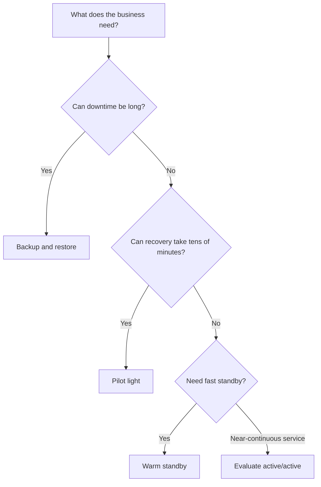

**Remember:** This decision tree is simplified. A tight RPO may rule out some backup schedules regardless of the target RTO. Always consider **both** objectives and the budget.

AWS documentation provides representative RTO/RPO ranges, but they are **illustrations**, not universal guaranteed durations.

---

## 12. Multi-AZ vs Multi-Region: where recovery happens

Multi-AZ and multi-Region solve different failure scopes.

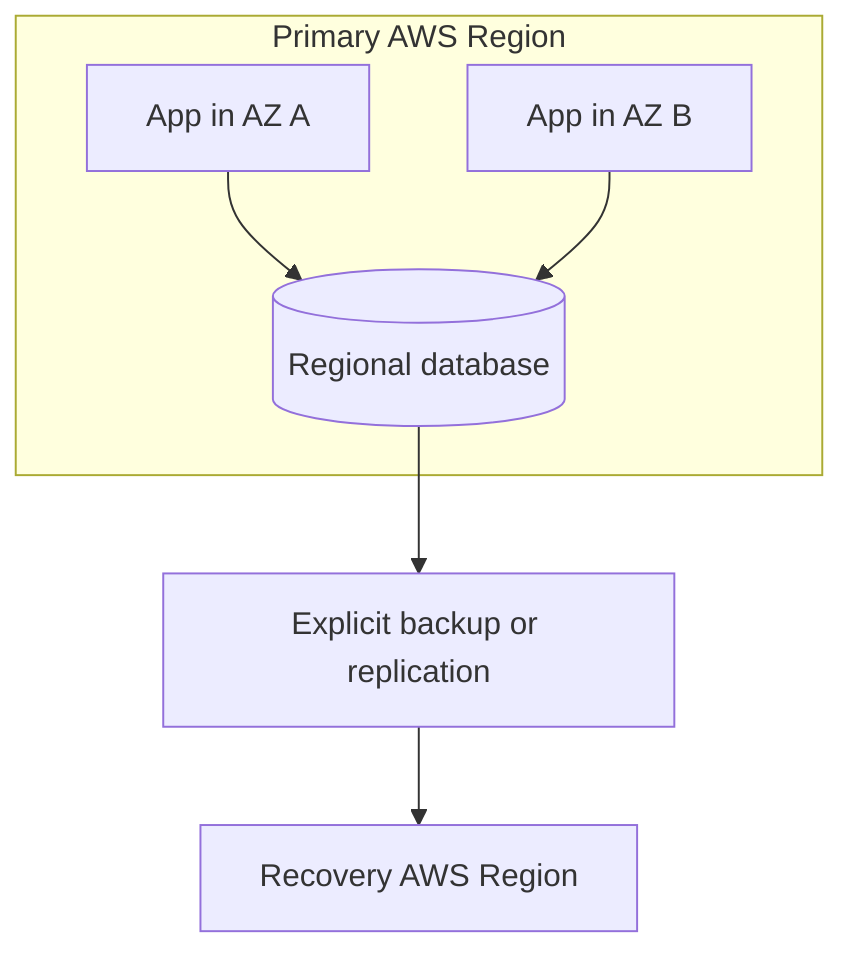

- **Multi-AZ:** Protects against some AZ-level failures, if all critical components are redundant.
- **Multi-Region:** Provides a separate regional failure domain, but only when configured and tested.

A database replicated across AZs in one Region may still be vulnerable to region-wide incidents, application bugs, accidental deletion or corrupt data replicated to every copy.

**Rule:** Replication improves availability; **point-in-time backup and restore** are still necessary to recover from logical data damage.

---

## 13. Data replication versus backups

These terms are related but not interchangeable.

**Replication:** Keep another copy of data updated continuously or frequently. This helps standby environments be relatively current.

**Backup:** Save recoverable snapshots or point-in-time history. This may let you return to a known-good version **before** corruption occurred.

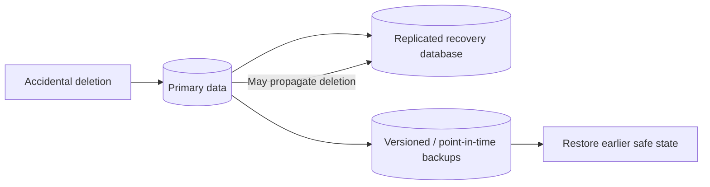

**Example:** An operator accidentally deletes 10,000 customer records. Continuous replication may copy the deletion to the second Region. Historical recovery is what makes it possible to restore the data.

**Engineering notes:** Test backup integrity, key management, retention, and time to restore. For database replication, monitor lag and understand whether writes are synchronous or asynchronous. Cross-Region replication commonly has nonzero lag.

---

## 14. Failover and failback: moving traffic safely

**Failover** means switching to the recovery environment because the primary cannot serve correctly. **Failback** means returning to the original environment when it is safe.

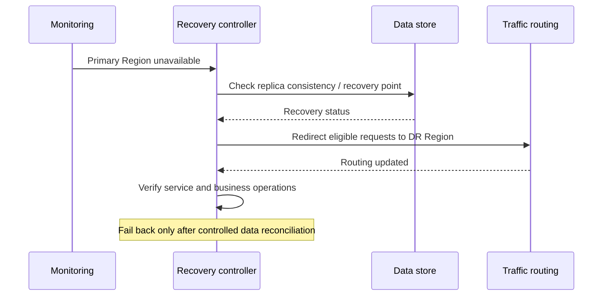

AWS routing tools include **Amazon Route 53** and **AWS Global Accelerator**, depending on the architecture.

**Caution:** DNS-based redirection is not instantaneous for every client because of caching and TTL behavior. Never let both sites accidentally accept inconsistent writes when the system is meant to be active/passive.

A DR plan must specify who triggers failover, what is checked, how writes are protected, and how to reverse the switch.

---

## 15. Split brain and data conflicts in two Regions

A **split-brain** situation occurs when both Regions believe they are the authoritative writer even though the design expects only one.

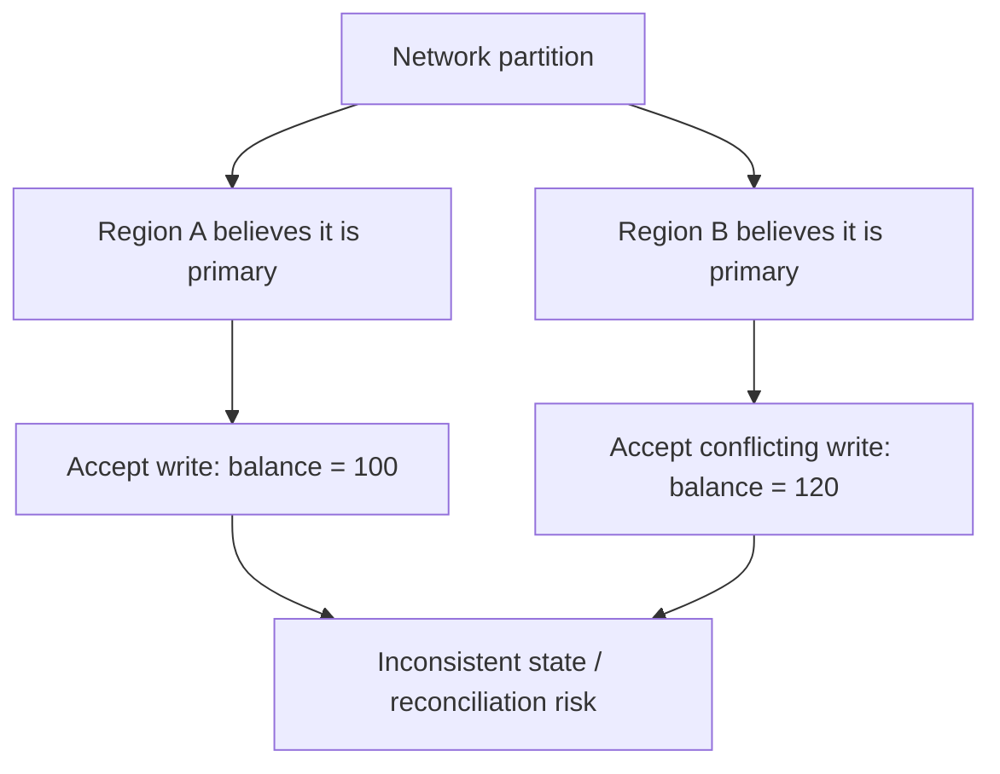

For **active/passive**, use carefully designed primary ownership, fencing and failover coordination so old writers cannot resume after authority switches.

For **active/active**, define how conflicts are resolved or avoided: per-key ownership, application-level merges, appropriate consistency models, or a service with explicit multi-Region semantics.

A simple **last-write-wins** rule can lose valid business updates. Payments and inventory often need stronger safeguards than social activity counters.

---

## 16. Which AWS services help with DR?

Many AWS services contribute different pieces; no single service automatically makes the entire workload disaster-proof.

| Need | AWS service or approach | Main responsibility |
|---|---|---|
| Backup policies | AWS Backup | Schedule and manage supported-resource backups |
| Object backup/copy | Amazon S3 and replication options | Durable objects and optional cross-Region copies |
| Database replication | Amazon RDS / Aurora features | Selected database recovery and replication patterns |
| Infrastructure recreation | AWS CloudFormation / Terraform | Reproduce compute, networks and dependencies |
| Traffic failover | Amazon Route 53 / AWS Global Accelerator | Route to eligible working endpoints |
| App scaling | EC2 Auto Scaling / ECS scaling | Increase DR-site processing capacity |
| Observation | Amazon CloudWatch | Detect symptoms and track health |
| Resilience assessments | AWS Resilience Hub | Assess recovery posture and resilience goals |

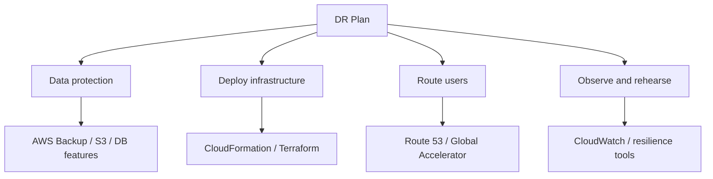

Availability and capabilities vary by Region and service. A common mistake is to buy several AWS features without testing whether they actually work together as one recoverable application.

---

## 17. Worked example: online store across two Regions

Consider an online shopping application using a web API, database and object storage. The business can tolerate **15 minutes of downtime** and **5 minutes of lost recent data** (illustrative targets).

A possible design is **warm standby**, subject to real testing:

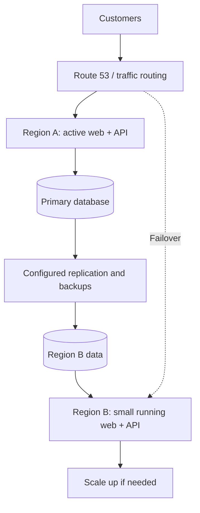

**During normal operations:** Region A serves traffic. Region B runs a smaller standby stack, receives required data and is tested regularly.

**During a disaster:** Confirm the data recovery point, stop unsafe writes, promote or activate the recovery data path, switch traffic, scale services, and validate checkout flows.

**Caveat:** A warm-standby design by itself does **not guarantee** either stated objective. Replication delay, DNS behavior, database promotion and capacity scaling must be measured. Payment-side effects also need idempotency and reconciliation.

---

## 18. Practical DR runbook and test checklist

DR only works when the team knows **exactly what to do**, not merely which AWS service was purchased.

**Runbook outline:**

1. Declare the incident and identify its scope.
2. Record the last trustworthy data recovery point.
3. Decide whether to fail over or restore in place.
4. Prevent the failed primary from accepting unsafe writes.
5. Verify backup/replica data integrity.
6. Bring required compute, secrets, networking and dependencies online.
7. Update traffic routing.
8. Run application-level smoke tests (login, orders, payments and notifications).
9. Record actual RTO/RPO achieved.
10. Plan a controlled failback and post-incident review.

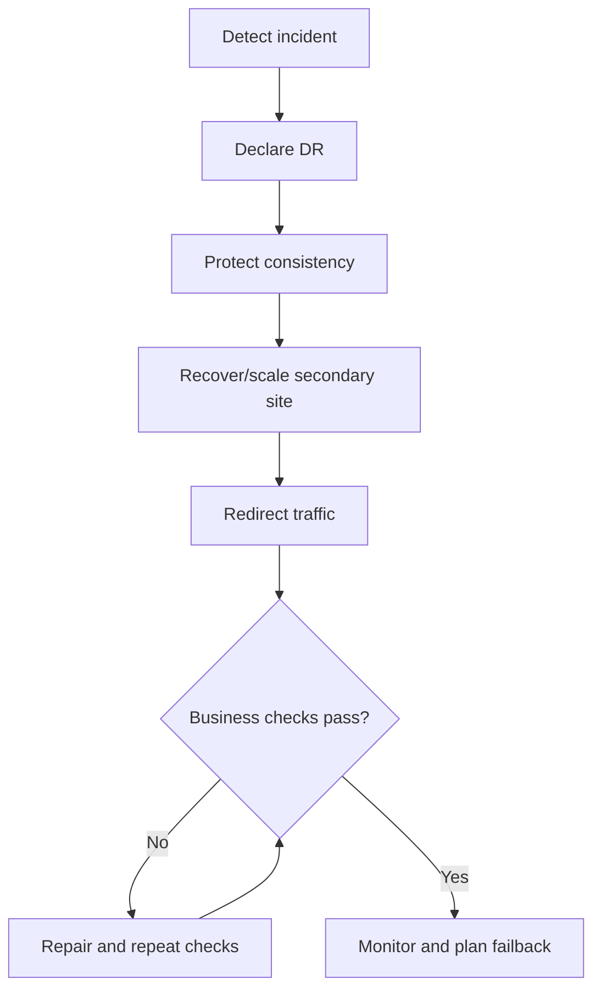

**Test the unusual failures:** Corrupt database backups, missing encryption keys, inaccessible container images, expired credentials, exhausted DR-region quotas, stale DNS, unavailable third-party dependencies and conflicting updates.

**Cost note:** Cross-Region replication, standby compute, storage copies, data transfer and monitoring may all incur charges. A “DR lab” is not necessarily covered by Free Tier.

---

## 19. Interview framework: explain DR in a few minutes

An interviewer asks: “How would you protect an application from an AWS Region outage?”

A clear answer is:

1. **Clarify:** Which failures count as disasters? Which business features are critical?
2. **Define RTO/RPO:** Maximum downtime and data-loss tolerance.
3. **Select strategy:** Backup/restore, pilot light, warm standby, or multi-site active/active.
4. **Design data recovery:** Backup plus suitable replication, with security and testing.
5. **Design routing and recovery:** How to activate the DR site and redirect clients.
6. **Handle consistency:** Prevent split brain; validate durable business transactions.
7. **Test:** Run failover drills and measure actual objectives.
8. **Control cost:** Choose the simplest solution that reliably meets the target.

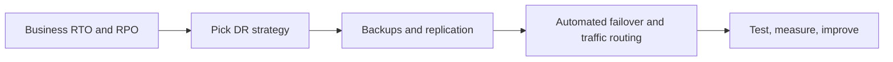

**Interview-ready answer:** “I'd start by defining the acceptable downtime and data loss, then choose the least costly DR strategy that can meet those targets. I'd protect data with tested backups and appropriate replication, maintain required infrastructure in the recovery Region, automate routing and recovery, prevent split-brain writes, and rehearse the complete process to verify real RTO and RPO.”

---

## 20. Quick revision, questions and references

### Quick comparison

| Term | Meaning |
|---|---|
| HA | Maintain service through routine failures |
| DR | Restore service after a major disruption |
| RTO | Maximum acceptable service downtime |
| RPO | Maximum acceptable data loss measured in time |
| Backup and restore | Rebuild and restore from retained data |
| Pilot light | Essential recovery data/resources ready, full app started later |
| Warm standby | Smaller functioning app already running |
| Active/active | Multiple Regions serving concurrently |
| Failover | Transfer service to recovery environment |
| Failback | Restore normal placement in a controlled way |
| Split brain | Conflicting authority over writes |
| Replication lag | Delay before updates reach recovery copy |

### Questions to practice

1. Is multi-AZ sufficient for all Region-level failures?
2. What is the difference between RTO and RPO?
3. If the outage is at 3 PM and RPO is 10 minutes, what is the oldest acceptable recovery point?
4. Why does backup/restore typically have longer RTO than warm standby?
5. What runs continuously in a pilot light?
6. What makes warm standby different from pilot light?
7. What is the biggest complexity in active/active databases?
8. Does synchronous replication across AZs remove the need for historical backups?
9. Why can data deletion propagate to another Region?
10. What does a failover runbook include?
11. What can make actual RTO longer than the target?
12. Which AWS services assist with traffic failover?
13. What is split brain and how could it damage order data?
14. Why should you test backup restoration?
15. How do you calculate the relative cost of the four strategies?

**Final takeaway:** There is **no universally best DR strategy**. Pick one based on business RTO/RPO, complexity, budget and failure scenarios—then **test** that it meets those requirements.

### Sources and scope

- [Video 4: AWS Global Infrastructure (Part-2): Disaster Recovery Strategies](https://www.youtube.com/watch?v=8nKB8Q877XI&list=PL6W8uoQQ2c60g3PAgzVPpi0YWwxITD43p&index=3), *Concept && Coding – by Shrayansh*, approximately 20 minutes 56 seconds.
- [AWS official: Disaster recovery options in the cloud](https://docs.aws.amazon.com/whitepapers/latest/disaster-recovery-workloads-on-aws/disaster-recovery-options-in-the-cloud.html).
- [AWS Well-Architected: Use defined recovery strategies](https://docs.aws.amazon.com/wellarchitected/latest/framework/rel_planning_for_recovery_disaster_recovery.html).
- [AWS Well-Architected: Plan for DR](https://docs.aws.amazon.com/wellarchitected/latest/reliability-pillar/plan-for-disaster-recovery-dr.html).

The video title and playlist placement were verified, but a complete spoken transcript was not accessible. These are independently authored study notes on the identified lesson topic, with explanations cross-checked against AWS documentation—not a transcript-derived account of the instructor's exact words.

---
