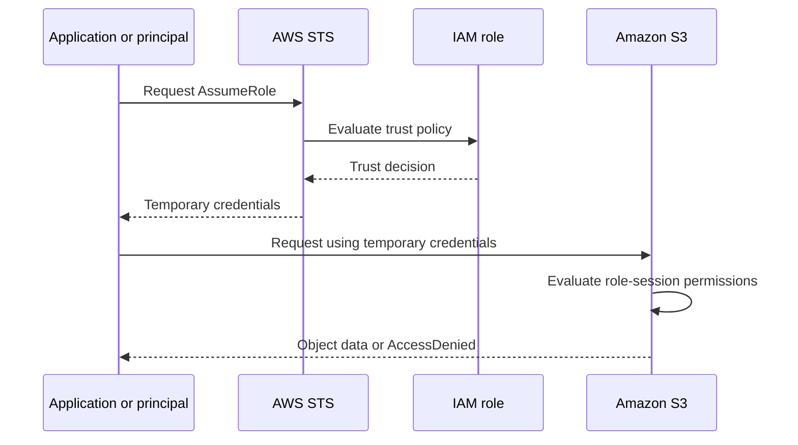
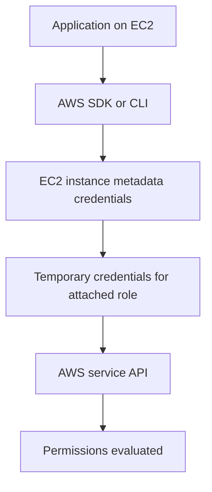
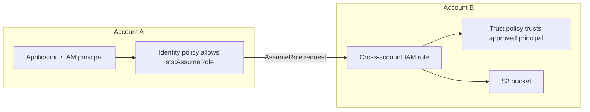

# Lesson 7: AWS IAM Roles Explained with Demo

*AWS Education Notes · Author: Jayesh Sharma*

## Contents
- [1. What is an IAM role?](#1-what-is-an-iam-role)
- [2. IAM user vs IAM role](#2-iam-user-vs-iam-role)
- [3. Trust policy vs permissions policy](#3-trust-policy-vs-permissions-policy)
- [4. How AssumeRole and STS work](#4-how-assumerole-and-sts-work)
- [5. EC2 instance role and instance profile](#5-ec2-instance-role-and-instance-profile)
- [6. Cross-account role access](#6-cross-account-role-access)
- [7. Lambda execution role](#7-lambda-execution-role)
- [8. Hands-on demo: EC2 role with S3 read access](#8-hands-on-demo-ec2-role-with-s3-read-access)
- [9. Troubleshooting AccessDenied](#9-troubleshooting-accessdenied)
- [10. Security best practices](#10-security-best-practices)
- [11. Interview questions](#11-interview-questions)
- [12. Quick revision](#12-quick-revision)

## 1. What is an IAM role?

An **AWS Identity and Access Management (IAM) role** is an identity that has a set of permissions and a **trust policy** describing who or what is allowed to assume it.

A role is not normally used with a permanent username and password. Instead, an approved user, application, or AWS service assumes the role and receives **temporary security credentials**.

Those credentials typically contain:
- An access key ID
- A secret access key
- A session token
- An expiration time

The role defines what the resulting session can do. The trust policy defines who can obtain that session.

### Everyday analogy

Think of a visitor entering an office:

- The security desk checks whether the visitor is authorized to enter.
- The visitor receives a temporary access pass.
- The pass allows access only to approved areas.
- The pass expires at the end of the visit.

In AWS:
- Trust policy = who is allowed to receive the pass.
- Role permissions = what the pass allows them to do.
- STS = the service that issues temporary credentials.

### Why use roles?

Suppose an application running on an EC2 instance needs to read files from S3.

**Without a role:** A developer might store long-lived access keys in a configuration file. If the file is exposed, someone could misuse those credentials.

**With a role:** EC2 obtains temporary credentials for the attached role. The application uses those credentials through the AWS SDK without storing permanent access keys in its source code.

## 2. IAM user vs IAM role

| Feature | IAM user | IAM role |
|---|---|---|
| Main purpose | Identity for a person or application that needs a persistent IAM identity | Temporary access for an approved principal |
| Credentials | Can have a console password and/or access keys | Uses temporary credentials when assumed |
| How used | Signs in or makes API calls as that user | A trusted principal assumes the role |
| Long-lived access keys | Possible, but should be avoided where possible | Not embedded as permanent role credentials |
| Common examples | Legacy automation or a specific IAM user | EC2, Lambda, cross-account access, federated workforce access |

**Important:** For workforce access, AWS generally recommends federation through IAM Identity Center rather than creating an IAM user for every employee. For applications running on AWS, use IAM roles and temporary credentials.

## 3. Trust policy vs permissions policy

Every role has two important policy concepts.

### A. Trust policy — who can assume the role?

The trust policy is attached to the role. It identifies the trusted principal, such as an AWS service, another AWS account, or a federated identity provider.

Example: allow the EC2 service to assume a role.

```json
{
  "Version": "2012-10-17",
  "Statement": [
    {
      "Effect": "Allow",
      "Principal": {
        "Service": "ec2.amazonaws.com"
      },
      "Action": "sts:AssumeRole"
    }
  ]
}
```

Here:
- `Principal` identifies EC2 as the trusted service.
- `Action` allows the service to assume the role.
- This policy does **not** grant access to S3 or any other application resource.

### B. Permissions policy — what can the role do?

A permissions policy defines the AWS actions allowed or denied to a role session.

Example: allow listing one S3 bucket and reading objects inside it.

```json
{
  "Version": "2012-10-17",
  "Statement": [
    {
      "Effect": "Allow",
      "Action": "s3:ListBucket",
      "Resource": "arn:aws:s3:::my-training-bucket"
    },
    {
      "Effect": "Allow",
      "Action": "s3:GetObject",
      "Resource": "arn:aws:s3:::my-training-bucket/*"
    }
  ]
}
```

Replace `my-training-bucket` with your bucket name.

This policy allows listing the bucket and downloading its objects. It does not allow uploading or deleting objects.

### Remember the difference

| Question | Policy |
|---|---|
| Who can use this role? | Trust policy |
| What can the role session do? | Permissions policy |

Both sides must be configured correctly. A role can trust EC2 but have no S3 permissions. It can also have S3 permissions but not be assumable by the intended principal.

## 4. How AssumeRole and STS work

**AWS Security Token Service (STS)** provides temporary security credentials. The `AssumeRole` API is one way to obtain credentials for a role.

Typical flow:



Step by step:

1. An application or principal requests permission to assume a role.
2. AWS evaluates whether the caller is allowed to make the request and whether the role's trust policy trusts that caller.
3. If the request is allowed, STS returns temporary credentials.
4. The application uses those credentials to call AWS services.
5. AWS evaluates the permissions applicable to that role session and the requested resource.
6. The credentials expire. The application obtains a new session when needed.

**Key point:** Receiving temporary credentials does not mean every AWS operation is allowed. The role session still needs the appropriate permissions.

## 5. EC2 instance role and instance profile

An EC2 application often needs to call AWS services such as S3, CloudWatch, or Systems Manager.

Instead of placing access keys on the virtual machine, attach an IAM role to the EC2 instance.

The connection works like this:



### What is an instance profile?

An **instance profile** is the container used by EC2 to pass an IAM role to an EC2 instance. In the console, you commonly select an IAM role when configuring the instance's IAM role setting; AWS handles the instance-profile association.

Remember:
- IAM role = identity and permissions.
- Instance profile = mechanism that makes the role available to EC2.
- EC2 metadata service = endpoint through which software on the instance can obtain temporary credentials.

Use IMDSv2 where possible and protect access to instance metadata, especially in environments where untrusted processes may run.

## 6. Cross-account role access

A role can allow a principal in one AWS account to access resources in another account without sharing long-lived access keys.

Example:
- Account A: application account.
- Account B: data account.
- Account B owns an S3 bucket.
- Account B creates a role that trusts the approved principal from Account A.
- The principal in Account A is allowed to call `sts:AssumeRole` on that role.
- The assumed role has narrowly scoped S3 permissions.



For this common cross-account pattern, check both:
1. The caller's identity permissions in Account A allow `sts:AssumeRole` on the target role.
2. The role trust policy in Account B trusts the caller (or its account/principal, as intentionally configured).

Then check the target role's permissions for the resource access. Resource policies, organization policies, permission boundaries, session policies, and explicit denies can also affect the final result.

## 7. Lambda execution role

AWS Lambda uses an **execution role** to determine which AWS resources a function can access.

For example, if a Lambda function needs to write logs to CloudWatch Logs and read from a particular S3 bucket:
- The role trust policy allows the Lambda service principal, `lambda.amazonaws.com`, to assume the role.
- The role permissions allow only the required logging and S3 actions.
- The function runs using temporary credentials for that role.

Do not confuse:
- **Execution role:** permissions the Lambda function uses when it calls AWS services.
- **Resource-based policy:** can grant another principal or service permission to invoke the function.

A role does not automatically grant permission to invoke the Lambda function.

## 8. Hands-on demo: EC2 role with S3 read access

**Goal:** Attach a role to an EC2 instance and let a test application list and read objects from one S3 bucket—without storing access keys on the instance.

### Before starting

- Use a sandbox AWS account.
- Enable MFA on your administrative identity.
- Choose an existing test bucket or create one only if needed.
- Check current AWS pricing and your account's Free Tier eligibility.
- Do not use production data.
- EC2, storage, data transfer, and other resources may incur charges.

### Step 1: Create a permissions policy

In the IAM console:
1. Open **Policies** and choose **Create policy**.
2. Select the JSON editor.
3. Add the S3 read-only policy shown in Section 3.
4. Replace the bucket name with your test bucket.
5. Give the policy a clear name, such as `TrainingS3ReadOnly`.
6. Review and create it.

### Step 2: Create the EC2 role

1. Open **IAM → Roles → Create role**.
2. Select **AWS service** as the trusted entity type.
3. Choose **EC2** as the use case.
4. Attach `TrainingS3ReadOnly`.
5. Name the role `EC2TrainingS3ReadRole`.
6. Review the trust policy and create the role.

The trust policy should allow the EC2 service principal to assume the role.

### Step 3: Attach the role to an EC2 instance

For an existing test instance:
1. Open **EC2 → Instances**.
2. Select the instance.
3. Choose **Actions → Security → Modify IAM role** (console wording may vary).
4. Select `EC2TrainingS3ReadRole` and save.

For a new instance, select the role in the IAM instance profile setting during launch.

### Step 4: Test from the instance

Install or use the AWS CLI, then run:

```bash
aws sts get-caller-identity
aws s3 ls s3://my-training-bucket/
aws s3 cp s3://my-training-bucket/sample.txt ./sample.txt
```

Replace the bucket and object names with your own. The identity output should show an assumed-role session, rather than a long-lived IAM user's access keys.

Expected results:
- Listing the specified bucket: allowed.
- Downloading an object from that bucket: allowed.
- Uploading an object: denied.
- Deleting an object: denied.

For example, this should fail with an authorization error if no other policy grants the action:

```bash
aws s3 cp ./sample.txt s3://my-training-bucket/sample.txt
```

If a test unexpectedly succeeds, check for other attached policies, bucket policies, or broader permissions. IAM permissions are evaluated across multiple policy types; the demo policy alone does not guarantee a deny if another applicable policy grants access.

### Step 5: Clean up

- Detach the role from the EC2 instance if it is no longer needed.
- Stop or terminate the test EC2 instance.
- Delete only the training policy and role if they are no longer required.
- Remove test objects and buckets only after confirming they contain no needed data.
- Check the billing dashboard for any resources left running.

## 9. Troubleshooting AccessDenied

When an `AssumeRole` request fails, inspect the caller and target role separately.

| Possible cause | What to check |
|---|---|
| Caller is not allowed to assume role | Caller identity policy includes `sts:AssumeRole` for the exact role ARN |
| Trust policy does not trust caller | Correct principal, account ID, role ARN, and conditions |
| External ID or MFA condition not met | Supply the required value or satisfy the condition |
| Organization restriction | Check service control policies (SCPs) |
| Permission boundary or session policy | Check whether it limits the requested action |
| Explicit Deny | Find applicable explicit denies; an explicit Deny overrides an Allow |

If assuming the role succeeds but an S3 operation fails, check:
- The role's identity-based permissions.
- The bucket or object ARN in the policy.
- The bucket policy and any explicit Deny.
- KMS key permissions if the object is encrypted with a customer-managed KMS key.
- Organization policies, permission boundaries, and session policies.

Useful diagnostic commands:

```bash
aws sts get-caller-identity
aws iam get-role --role-name EC2TrainingS3ReadRole
```

The IAM policy simulator can also help test identity-based policy decisions, but it does not replace checking every policy and resource involved in a real request.

## 10. Security best practices

1. **Apply least privilege:** Grant only the actions and resources required.
2. **Prefer temporary credentials:** Use roles instead of embedding long-lived access keys in applications.
3. **Restrict trust relationships:** Trust only the intended AWS services, accounts, or principals.
4. **Use conditions carefully:** Conditions such as external ID, MFA, and source identity can strengthen role-assumption controls where appropriate.
5. **Avoid wildcard access:** Avoid `*` for principals, actions, or resources unless there is a justified reason.
6. **Monitor role usage:** Use AWS CloudTrail to review role-assumption and API activity.
7. **Review unused access:** Remove unnecessary roles, policies, and trust relationships.
8. **Protect EC2 metadata:** Prefer IMDSv2 and restrict untrusted access to instance metadata.
9. **Do not share credentials:** Each workload or trust relationship should have an appropriately scoped identity.
10. **Test changes:** Validate both allowed and denied actions in a non-production environment.

## 11. Interview questions

**Q1. What is an IAM role?**  
An IAM role is an AWS identity with permissions and a trust policy. An approved principal assumes it and receives temporary credentials.

**Q2. What is the difference between an IAM user and an IAM role?**  
An IAM user is a persistent IAM identity that can have long-term credentials. A role is assumed by a trusted principal and provides temporary credentials.

**Q3. What is the difference between a trust policy and a permissions policy?**  
A trust policy defines who can assume the role. A permissions policy defines what actions the role session can perform.

**Q4. What is AWS STS?**  
AWS Security Token Service issues temporary security credentials. The `AssumeRole` API is commonly used to obtain credentials for a role.

**Q5. Why attach a role to EC2?**  
It lets applications on EC2 obtain temporary credentials for AWS API calls without storing long-lived access keys on the instance.

**Q6. What is an instance profile?**  
It is the container through which an IAM role is passed to an EC2 instance.

**Q7. How does cross-account role access work?**  
The caller must be allowed to call `sts:AssumeRole`, and the target role's trust policy must trust that caller. The role then supplies the permissions for the target session.

**Q8. What is a Lambda execution role?**  
It is the IAM role a Lambda function uses when accessing AWS services, such as writing logs or reading from S3.

**Q9. Why can AssumeRole return AccessDenied?**  
The caller may lack `sts:AssumeRole` permission, the target trust policy may not trust the caller, a condition may not be met, or an organization policy or explicit Deny may block the request.

**Q10. Does assuming a role mean the caller can access every AWS service?**  
No. The assumed role session is limited by its applicable permissions and other policy controls.

## 12. Quick revision

| Term | Easy explanation |
|---|---|
| IAM role | An identity that a trusted principal can assume |
| Trust policy | Defines who can assume the role |
| Permissions policy | Defines what the role session can do |
| STS | AWS service that issues temporary security credentials |
| AssumeRole | API used to request temporary credentials for a role |
| Instance profile | Makes an IAM role available to an EC2 instance |
| Execution role | Role used by a service such as Lambda to access AWS APIs |
| Cross-account role | A role in one account that trusts a principal from another account |

### One-minute interview explanation

“An IAM role is an AWS identity designed to be assumed by a trusted user, application, or AWS service. It has a trust policy that answers who can assume it and permissions policies that define what the resulting session can do. AWS STS issues temporary credentials when the role is assumed. For example, an EC2 application can use an attached role to read from S3 without storing permanent access keys. For cross-account access, the caller must be allowed to call AssumeRole and the target role must trust that caller. I would always apply least privilege, restrict trust, and monitor role usage.”

### Useful AWS references

- [IAM roles](https://docs.aws.amazon.com/IAM/latest/UserGuide/id_roles.html)
- [Creating a role for an AWS service](https://docs.aws.amazon.com/IAM/latest/UserGuide/id_roles_create_for-service.html)
- [AssumeRole API](https://docs.aws.amazon.com/STS/latest/APIReference/API_AssumeRole.html)
- [Using IAM roles for Amazon EC2](https://docs.aws.amazon.com/AWSEC2/latest/UserGuide/iam-roles-for-amazon-ec2.html)
- [Cross-account role access](https://docs.aws.amazon.com/IAM/latest/UserGuide/tutorial_cross-account-with-roles.html)
- [IAM best practices](https://docs.aws.amazon.com/IAM/latest/UserGuide/best-practices.html)
- [AWS course playlist](https://www.youtube.com/playlist?list=PL6W8uoQQ2c60g3PAgzVPpi0YWwxITD43p)
