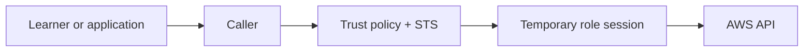
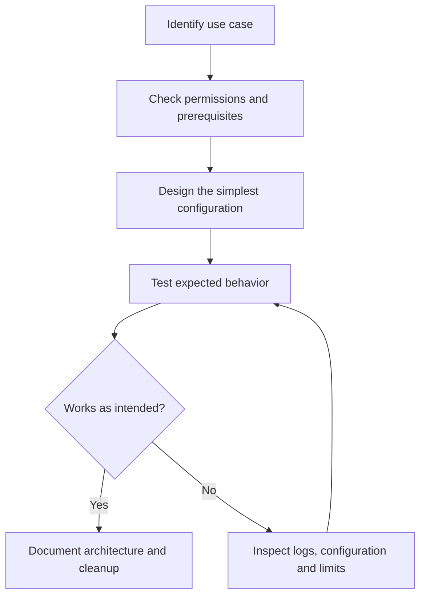
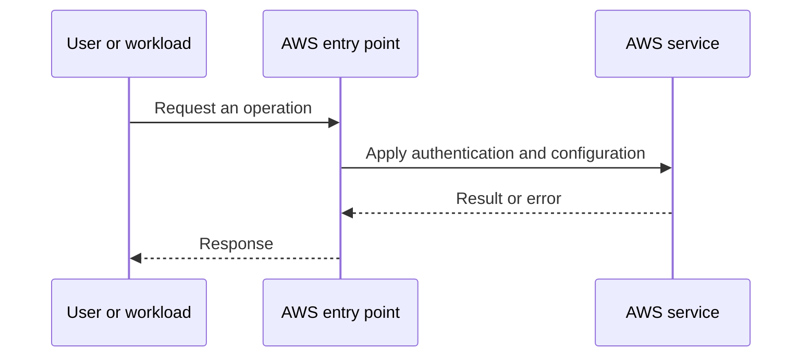
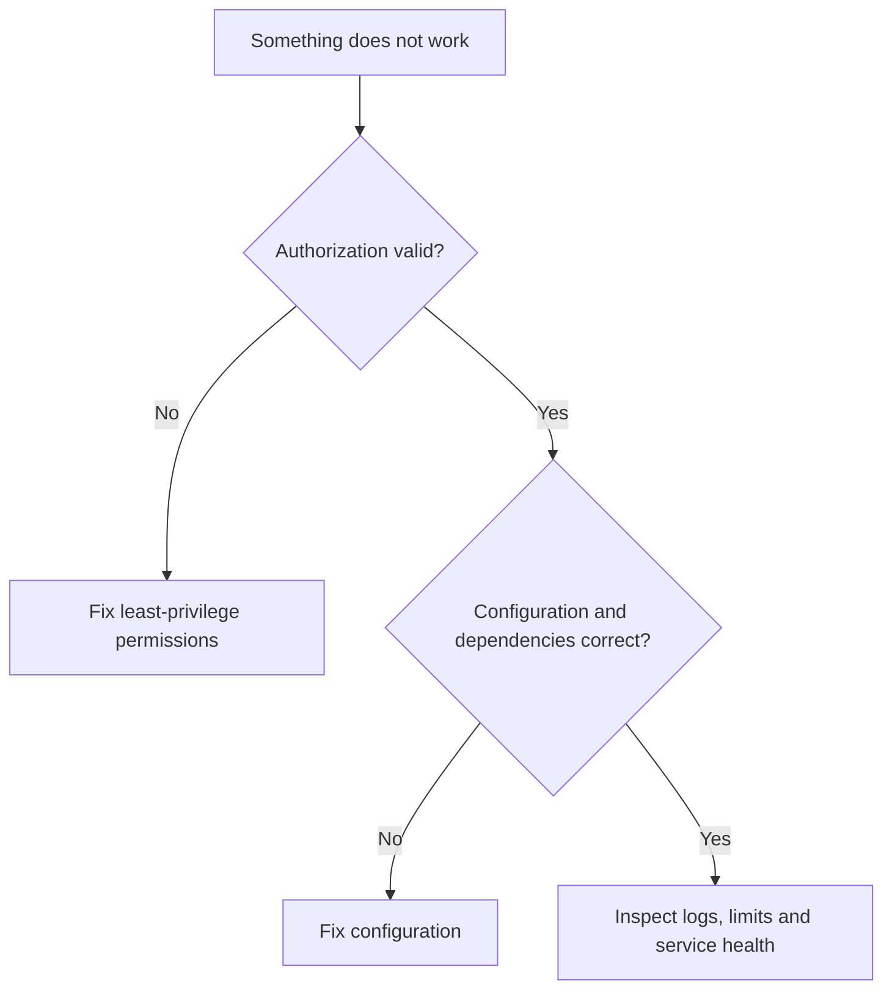

# Lesson 7: AWS IAM Role Explained with Demo — Explained Simply

*AWS Education Notes · Author: Jayesh Sharma*

## Contents
- [1. The big picture](#1-the-big-picture)
- [2. Everyday analogy](#2-everyday-analogy)
- [3. What is a role?](#3-what-is-a-role)
- [4. Trust vs permission policy](#4-trust-vs-permission-policy)
- [5. STS AssumeRole](#5-sts-assumerole)
- [6. EC2 instance profile](#6-ec2-instance-profile)
- [7. Cross-account example](#7-cross-account-example)
- [8. Lambda and service roles](#8-lambda-and-service-roles)
- [9. Hands-on safe demo](#9-hands-on-safe-demo)
- [10. Common errors](#10-common-errors)
- [11. End-to-end workflow](#11-end-to-end-workflow)
- [12. Practical exercise](#12-practical-exercise)
- [13. Failure modes and best practices](#13-failure-modes-and-best-practices)
- [14. Interview questions and revision](#14-interview-questions-and-revision)

## 1. The big picture

In this lesson you learn **temporary AWS permissions using roles**. Many cloud problems get easier when we divide a big system into small responsibilities, identify what AWS manages, and test one concept at a time.

**Learning goals:** Explain the important terms to a beginner; draw the request path; identify where permissions, costs and failures matter; and reason through a simple scenario without memorizing console clicks.

## 2. Everyday analogy

A visitor receives a temporary office pass for a specific purpose rather than permanently keeping a building key.

An analogy is only a memory aid: cloud systems have specific constraints such as API permissions, network direction, limits and failure domains.

## 3. What is a role?

An IAM role is an AWS identity with permissions and a trust policy defining which principals can assume it. Unlike a regular IAM user, it is designed to be assumed and uses temporary credentials.

**Think about it:** Which requirement or failure case would make this important in a production application?

## 4. Trust vs permission policy

Trust answers who can assume the role. Permissions answer what the role session is allowed to do. Both must be correct.

**Think about it:** Which requirement or failure case would make this important in a production application?

## 5. STS AssumeRole

AWS Security Token Service issues temporary credentials for an assumed role. A session expires and can be scoped using session policies where applicable.

**Think about it:** Which requirement or failure case would make this important in a production application?

## 6. EC2 instance profile

An EC2 workload can use a role through an instance profile, letting the AWS SDK obtain temporary credentials without hardcoded secrets.

**Think about it:** Which requirement or failure case would make this important in a production application?

## 7. Cross-account example

An application in account A may assume an approved role in account B when the trust relationship and identity-side permissions permit it.

**Think about it:** Which requirement or failure case would make this important in a production application?

## 8. Lambda and service roles

AWS services such as Lambda use execution roles for AWS API access. A service-linked role has special lifecycle rules and is not a general-purpose human login.

**Think about it:** Which requirement or failure case would make this important in a production application?

## 9. Hands-on safe demo

Create a narrowly scoped demo role, set the trust policy appropriately, test AssumeRole or an EC2 service role, then clean up.

**Think about it:** Which requirement or failure case would make this important in a production application?

## 10. Common errors

An AccessDenied on AssumeRole could come from the caller policy, target trust policy, permission boundary or organization policy. Never loosen every policy at once.

**Think about it:** Which requirement or failure case would make this important in a production application?

## 11. End-to-end workflow

Start with the desired business action and walk through each decision:

**Why this matters:** A service may appear healthy while permissions, security rules or resource dependencies stop the application from working.

## 12. Practical exercise

1. Draw the main objects and request path from this guide.
2. Open the AWS documentation for the service; identify its Region, pricing and permission requirements.
3. Use a sandbox account with MFA and a small AWS Budget or billing alert before deploying any paid resources.
4. Make one deliberate change at a time, and predict the effect before testing it.
5. Record expected behavior, actual behavior and the service-level evidence.
6. Clean up test resources, including gateways, storage, load balancers, or public IPs where applicable.

**Cost warning:** AWS Free Tier eligibility varies. NAT gateways, application load balancers, data transfer and some other resources can incur charges even during a short lab.

## 13. Failure modes and best practices

| Risk | Practical response |
|---|---|
| Access denied | Check the caller identity, policies, service trust and resource scope |
| Service not reachable | Check routing, security, health checks and the target application |
| Configuration drift | Compare deployed resources with the declared/approved configuration |
| Unexpected charges | Inspect pricing first; tag resources; clean up labs |
| Single point of failure | Identify and, when required, replicate critical dependencies |
| Leaked credentials | Prefer roles and short-lived credentials; rotate/revoke exposed secrets |

## 14. Interview questions and revision

1. In your own words, explain **What is a role?** and give one AWS example.
2. In your own words, explain **Trust vs permission policy** and give one AWS example.
3. In your own words, explain **STS AssumeRole** and give one AWS example.
4. In your own words, explain **EC2 instance profile** and give one AWS example.
5. In your own words, explain **Cross-account example** and give one AWS example.
6. In your own words, explain **Lambda and service roles** and give one AWS example.
7. In your own words, explain **Hands-on safe demo** and give one AWS example.
8. In your own words, explain **Common errors** and give one AWS example.
9. Which component would fail first if traffic or usage increased tenfold?
10. What must be secured or monitored before going live?
11. How would you diagnose a failed request end to end?

### Quick revision
- **What is a role?:** An IAM role is an AWS identity with permissions and a trust policy defining which principals can assume it.
- **Trust vs permission policy:** Trust answers who can assume the role.
- **STS AssumeRole:** AWS Security Token Service issues temporary credentials for an assumed role.
- **EC2 instance profile:** An EC2 workload can use a role through an instance profile, letting the AWS SDK obtain temporary credentials without hardcoded secrets.
- **Cross-account example:** An application in account A may assume an approved role in account B when the trust relationship and identity-side permissions permit it.
- **Lambda and service roles:** AWS services such as Lambda use execution roles for AWS API access.
- **Hands-on safe demo:** Create a narrowly scoped demo role, set the trust policy appropriately, test AssumeRole or an EC2 service role, then clean up.
- **Common errors:** An AccessDenied on AssumeRole could come from the caller policy, target trust policy, permission boundary or organization policy.

**One-minute answer:** AWS IAM Role Explained with Demo is about temporary AWS permissions using roles. Explain the main components, the direction of requests, security boundaries, operational trade-offs and a simple failure scenario. Then verify the design with a small reproducible test.

### Useful references

- [Course playlist](https://www.youtube.com/playlist?list=PL6W8uoQQ2c60g3PAgzVPpi0YWwxITD43p)
- [AWS documentation](https://docs.aws.amazon.com/)
- [AWS Well-Architected Framework](https://docs.aws.amazon.com/wellarchitected/latest/framework/welcome.html)
