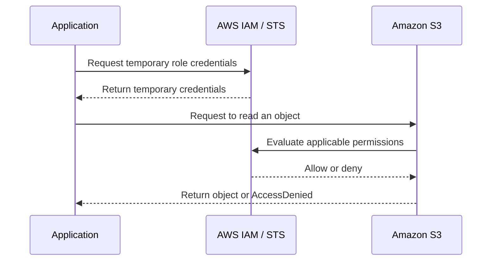

# Lesson 5: AWS IAM Users Explained with Demo

*AWS Education Notes · Author: Jayesh Sharma*

## 1. What is AWS IAM?

**IAM (Identity and Access Management)** is the AWS service that controls:

- **Who** can access your AWS account.
- **What** AWS resources they can access.
- **Which actions** they are allowed to perform.

For example, one employee may be allowed to view files in an S3 bucket, while another may upload files but not delete them.

**Remember:** Authentication answers “Who are you?” Authorization answers “What are you allowed to do?”

## 2. A simple real-world analogy

Think of an office:

| Office concept | AWS IAM concept |
|---|---|
| Employee | IAM identity |
| ID card or login | Credentials |
| Office access rules | IAM policy |
| A room or filing cabinet | AWS resource |
| Allowed activity (read, edit, delete) | IAM action |

Having an employee ID proves who you are. It does not mean you can enter every room. The access rules decide what you can do.

## 3. What is an IAM user?

An **IAM user** is an identity created inside an AWS account. It can represent a person or, in some older setups, an application.

An IAM user can have credentials such as:

- A username and password for AWS Management Console access.
- Access keys for programmatic access through AWS CLI, SDKs or APIs.

An IAM user does not automatically get permission to use AWS services. Permissions must be granted through policies or other applicable permission mechanisms.

### Important modern recommendation

For employees who need access to multiple AWS accounts, AWS generally recommends **IAM Identity Center** rather than creating a separate IAM user for every employee.

For applications running on AWS, use an **IAM role** and temporary credentials instead of storing long-lived access keys.

## 4. Root user vs IAM user

Every AWS account has one **root user**. It is created when the AWS account is created.

| Root user | IAM user |
|---|---|
| Represents the AWS account owner | A separate identity within the account |
| Has extensive account-level permissions | Gets only the permissions granted to it |
| Used for a limited set of account-level tasks | Can be used for specifically assigned access |
| Must be protected carefully | Must also be protected carefully |

**Best practice:** Enable MFA on the root user, do not use it for everyday work, and do not create root access keys.

Use IAM identities or IAM Identity Center for normal access.

## 5. What is an IAM policy?

An **IAM policy is a set of permission rules**. It says which actions are allowed or denied on which resources, and sometimes under which conditions.

For example:

- Allow reading objects from one specific S3 bucket.
- Do not allow deleting objects.
- Do not allow access to unrelated buckets.

A policy commonly contains:

| Element | Meaning |
|---|---|
| Effect | Allow or Deny |
| Action | What operation is requested, such as `s3:GetObject` |
| Resource | Which AWS resource the rule applies to |
| Condition | Optional extra rule, such as requiring a specific network or encryption setting |

### Example: Allow reading objects from one S3 bucket

The following identity-based policy allows listing the bucket and reading objects inside it. Replace the example bucket name with your own.

```json
{
  "Version": "2012-10-17",
  "Statement": [
    {
      "Effect": "Allow",
      "Action": "s3:ListBucket",
      "Resource": "arn:aws:s3:::my-training-bucket"
    },
    {
      "Effect": "Allow",
      "Action": "s3:GetObject",
      "Resource": "arn:aws:s3:::my-training-bucket/*"
    }
  ]
}
```

This policy does **not** grant permission to upload or delete objects.

**Important:** An Allow in one policy does not override an applicable explicit Deny. AWS evaluates all applicable permission controls.

## 6. What is least privilege?

**Least privilege means giving only the permissions needed to perform a task—nothing extra.**

Example:

- A reporting application needs to read sales reports from S3.
- It does not need permission to delete reports.
- It does not need administrator access.

So, grant only the required read permissions on the required bucket.

Why is this important?

- Reduces accidental damage.
- Limits the impact if credentials are compromised.
- Makes permissions easier to review and audit.

## 7. Console access vs programmatic access

There are two common ways to interact with AWS:

| Access type | How it works | Example |
|---|---|---|
| Console access | A person signs in through a web browser | An administrator views an S3 bucket in AWS Console |
| Programmatic access | Code or a command-line tool calls AWS APIs | A Java application uploads a file to S3 |

Console access commonly uses sign-in credentials. Programmatic access uses credentials supplied to the AWS CLI, SDK or application.

**Security recommendation:** Prefer IAM roles and temporary credentials for workloads. Avoid hardcoding access keys in source code or committing them to GitHub.

## 8. What is MFA?

**MFA (Multi-Factor Authentication)** adds another verification step when signing in.

For example, signing in may require:

1. Something you know: your password.
2. Something you have: an authenticator app or security key.

Even if someone learns your password, MFA makes unauthorized sign-in more difficult.

Enable MFA for the root user and for human users wherever supported by your access setup.

## 9. How does AWS decide whether a request is allowed?

Remember these five terms:

| Term | Simple meaning |
|---|---|
| Principal | Who is making the request? |
| Policy | What permission rules apply? |
| Action | What operation is requested? |
| Resource | Which AWS resource is targeted? |
| Context | What additional details affect the decision? |

Example:

An application tries to download a file from S3.

- Principal: the IAM role used by the application.
- Action: `s3:GetObject`.
- Resource: a particular object in an S3 bucket.
- Policy: must allow that action on that object.
- Context: conditions such as encryption requirements may also apply.

A successful login does not mean every AWS API operation is allowed.

**Key rule:** An applicable explicit Deny overrides an Allow.

## 10. Demo: Create an IAM user with read-only S3 access

Use a test or sandbox AWS account. Do not experiment with production identities.

### Step 1: Open IAM

1. Sign in to AWS using an appropriately authorized administrator identity.
2. Search for **IAM** in the AWS Console.
3. Open IAM and choose **Users**.

### Step 2: Create a test user

1. Choose **Create user**.
2. Enter a name such as `s3-read-demo-user`.
3. Configure console access only if you need to demonstrate a human sign-in.
4. Follow the console prompts.

For a real workforce, consider IAM Identity Center instead of creating individual IAM users.

### Step 3: Give minimum permissions

Attach a policy that allows only the S3 read operations required for the demo.

You can use the example policy in Section 5 after replacing the bucket name. Do not attach AdministratorAccess for this exercise.

### Step 4: Test allowed and denied actions

Sign in as the test identity (if console access was configured) and try:

- List the permitted bucket.
- Open an object in that bucket.
- Upload an object.
- Delete an object.

Expected result:

| Operation | Expected result |
|---|---|
| List the permitted bucket | Allowed |
| Read an object in the permitted bucket | Allowed |
| Upload an object | Denied |
| Delete an object | Denied |

The exact result also depends on bucket policies, encryption permissions and other applicable controls.

### Step 5: Clean up

Delete the test user and any credentials created for the exercise when they are no longer needed. Remove test resources if you created them.

**Never share passwords, access keys or secret access keys.**

## 11. What happens when an application accesses S3?

Here is a simplified example of an application using an IAM role:



In practice, AWS services and SDKs handle much of the credential retrieval and signing process. The application should not need to store a permanent access key when it can use an attached role.

## 12. Troubleshooting: Why am I getting AccessDenied?

If an AWS operation returns **AccessDenied**, check these items:

1. **Who is making the request?** Confirm the IAM user or role actually being used.
2. **Is the action allowed?** Check for the required action, such as `s3:GetObject`.
3. **Is the resource correct?** Check the exact ARN, bucket name and object path.
4. **Is there an explicit Deny?** An applicable Deny takes precedence over an Allow.
5. **Are there other permission controls?** Depending on the setup, check resource-based policies, permissions boundaries, session policies and AWS Organizations service control policies (SCPs).
6. **Are service-specific permissions required?** For example, reading an S3 object encrypted with a customer-managed KMS key may also require appropriate KMS permissions.

Do not solve every AccessDenied error by granting AdministratorAccess. Find the missing or conflicting permission and make the smallest appropriate change.

## 13. IAM best practices

- Protect the root user with MFA and avoid using it for everyday tasks.
- Follow least privilege.
- Prefer IAM Identity Center for workforce access where appropriate.
- Use IAM roles and temporary credentials for applications and AWS workloads.
- Do not hardcode or commit access keys.
- Do not share user accounts.
- Review permissions regularly and remove unused identities and credentials.
- Monitor account activity using appropriate AWS logging and security services.
- Test permission changes in a safe environment before applying them to production.

## 14. Interview questions and answers

**Q1. What is AWS IAM?**

IAM is the AWS service used to manage identities and permissions. It controls who can access AWS resources and what actions they can perform.

**Q2. What is an IAM user?**

An IAM user is an identity inside an AWS account. It can have credentials for console or programmatic access, but it needs permissions before it can perform AWS actions.

**Q3. What is the difference between authentication and authorization?**

Authentication verifies who you are. Authorization determines what you are allowed to do.

**Q4. What is the difference between the root user and an IAM user?**

The root user represents the AWS account owner and has extensive account-level authority. An IAM user is a separate identity whose permissions are assigned through applicable policies.

**Q5. What is an IAM policy?**

An IAM policy is a document that defines permissions, including allowed or denied actions, resources and optional conditions.

**Q6. What is least privilege?**

It means granting only the permissions required for a task, and no unnecessary permissions.

**Q7. What is MFA?**

MFA adds another verification factor to sign-in, making account access more secure.

**Q8. What is the difference between an IAM user and an IAM role?**

An IAM user is an identity with credentials that can be long-lived. An IAM role is an identity that is assumed to obtain temporary credentials. Roles are commonly used by AWS services, applications and users who need temporary access.

**Q9. Why should applications use IAM roles instead of hardcoded access keys?**

Roles provide temporary credentials that AWS can refresh, avoiding the need to store long-lived secrets in application code.

**Q10. What does an explicit Deny do?**

An applicable explicit Deny overrides an Allow and blocks the requested action.

## 15. Quick revision

- **IAM:** Controls who can access AWS and what they can do.
- **IAM user:** An identity created inside an AWS account.
- **Root user:** The account's original, highly privileged identity.
- **Policy:** Permission rules.
- **Least privilege:** Grant only the access needed.
- **MFA:** Adds another sign-in verification factor.
- **IAM role:** An identity that provides temporary credentials when assumed.
- **AccessDenied:** Check the caller, action, resource, explicit Denies and other permission controls.

### One-minute interview explanation

AWS IAM manages access to AWS resources. It defines identities such as users and roles, and permissions through policies. Authentication verifies the identity; authorization checks whether the requested action on a resource is allowed. We follow least privilege, protect privileged accounts with MFA, and prefer IAM roles with temporary credentials for applications instead of storing long-lived access keys.

### Useful references

- [AWS IAM User Guide](https://docs.aws.amazon.com/IAM/latest/UserGuide/introduction.html)
- [IAM best practices](https://docs.aws.amazon.com/IAM/latest/UserGuide/best-practices.html)
- [IAM policy evaluation logic](https://docs.aws.amazon.com/IAM/latest/UserGuide/reference_policies_evaluation-logic.html)
- [IAM Identity Center](https://docs.aws.amazon.com/singlesignon/latest/userguide/what-is.html)
- [AWS course playlist](https://www.youtube.com/playlist?list=PL6W8uoQQ2c60g3PAgzVPpi0YWwxITD43p)
