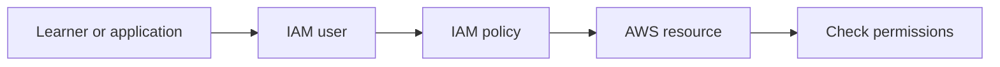
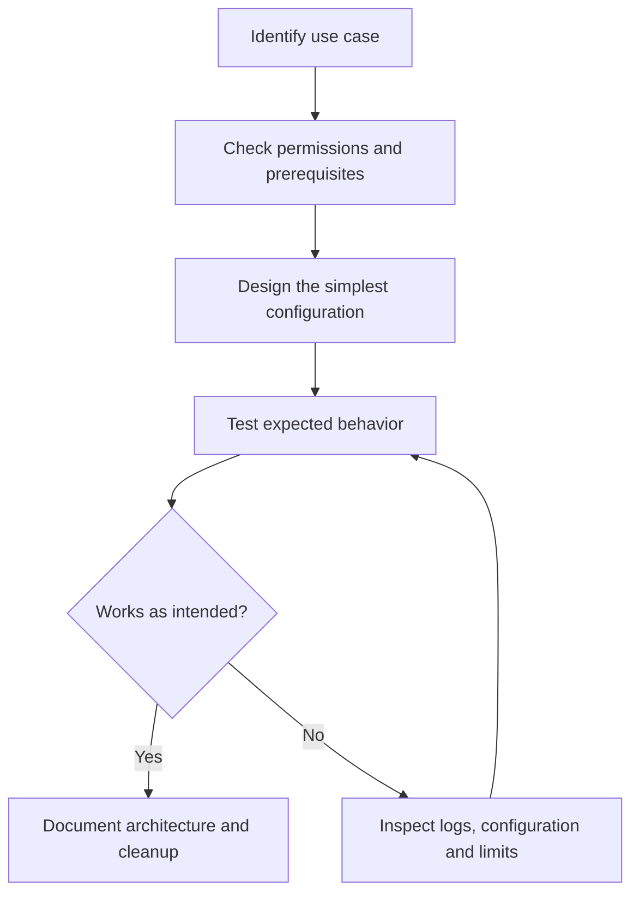
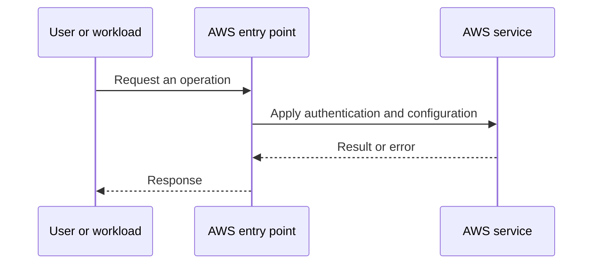
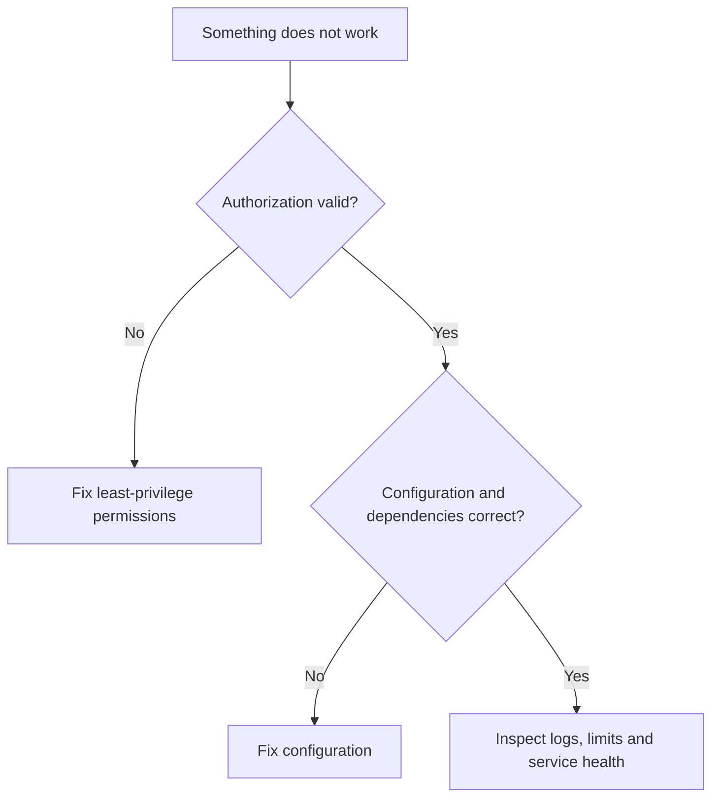

# Lesson 5: AWS IAM Users Explained with Demo — Explained Simply

*AWS Education Notes · Author: Jayesh Sharma*

## Contents
- [1. The big picture](#1-the-big-picture)
- [2. Everyday analogy](#2-everyday-analogy)
- [3. Identity vs authentication](#3-identity-vs-authentication)
- [4. Root user vs IAM user](#4-root-user-vs-iam-user)
- [5. Least privilege](#5-least-privilege)
- [6. Console and programmatic access](#6-console-and-programmatic-access)
- [7. MFA and credential hygiene](#7-mfa-and-credential-hygiene)
- [8. Demo walkthrough](#8-demo-walkthrough)
- [9. Principal / policy / action / resource / context](#9-principal-policy-action-resource-context)
- [10. Security troubleshooting](#10-security-troubleshooting)
- [11. End-to-end workflow](#11-end-to-end-workflow)
- [12. Practical exercise](#12-practical-exercise)
- [13. Failure modes and best practices](#13-failure-modes-and-best-practices)
- [14. Interview questions and revision](#14-interview-questions-and-revision)

## 1. The big picture

In this lesson you learn **IAM users and secure access**. Many cloud problems get easier when we divide a big system into small responsibilities, identify what AWS manages, and test one concept at a time.

**Learning goals:** Explain the important terms to a beginner; draw the request path; identify where permissions, costs and failures matter; and reason through a simple scenario without memorizing console clicks.

## 2. Everyday analogy

A library issues individual ID cards so each staff member has only the keys required for their job.

An analogy is only a memory aid: cloud systems have specific constraints such as API permissions, network direction, limits and failure domains.

## 3. Identity vs authentication

An IAM user is an identity inside an AWS account. Login to the console uses a password; programmatic access uses credentials such as access keys. Neither automatically grants permission: authorization comes from policies.

**Think about it:** Which requirement or failure case would make this important in a production application?

## 4. Root user vs IAM user

The root user has broad account authority and should be secured with MFA, kept out of everyday work, and used only for tasks requiring it. IAM identities are created for specific responsibilities.

**Think about it:** Which requirement or failure case would make this important in a production application?

## 5. Least privilege

Give only the actions and resources necessary for a task. For example, a support engineer might need to read a named S3 bucket but not delete every bucket.

**Think about it:** Which requirement or failure case would make this important in a production application?

## 6. Console and programmatic access

Console passwords and access keys are different credentials. Avoid long-lived access keys where possible; prefer IAM roles and temporary credentials for workloads.

**Think about it:** Which requirement or failure case would make this important in a production application?

## 7. MFA and credential hygiene

Enable MFA and avoid sharing login accounts. Never put access key secrets into screenshots, source control, or chat messages.

**Think about it:** Which requirement or failure case would make this important in a production application?

## 8. Demo walkthrough

In IAM, create a test user, give it a minimal permission set, test an allowed operation and a denied operation, and remove the test user after finishing.

**Think about it:** Which requirement or failure case would make this important in a production application?

## 9. Principal / policy / action / resource / context

A request is authorized by evaluating relevant policies, explicit denies, resource constraints and organization guardrails. A successful login does not imply permission to call every API.

**Think about it:** Which requirement or failure case would make this important in a production application?

## 10. Security troubleshooting

If an action fails with AccessDenied, check identity policies, explicit denies, permission boundaries, service control policies where applicable, resource policies, and exact ARN scope.

**Think about it:** Which requirement or failure case would make this important in a production application?

## 11. End-to-end workflow

Start with the desired business action and walk through each decision:

**Why this matters:** A service may appear healthy while permissions, security rules or resource dependencies stop the application from working.

## 12. Practical exercise

1. Draw the main objects and request path from this guide.
2. Open the AWS documentation for the service; identify its Region, pricing and permission requirements.
3. Use a sandbox account with MFA and a small AWS Budget or billing alert before deploying any paid resources.
4. Make one deliberate change at a time, and predict the effect before testing it.
5. Record expected behavior, actual behavior and the service-level evidence.
6. Clean up test resources, including gateways, storage, load balancers, or public IPs where applicable.

**Cost warning:** AWS Free Tier eligibility varies. NAT gateways, application load balancers, data transfer and some other resources can incur charges even during a short lab.

## 13. Failure modes and best practices

| Risk | Practical response |
|---|---|
| Access denied | Check the caller identity, policies, service trust and resource scope |
| Service not reachable | Check routing, security, health checks and the target application |
| Configuration drift | Compare deployed resources with the declared/approved configuration |
| Unexpected charges | Inspect pricing first; tag resources; clean up labs |
| Single point of failure | Identify and, when required, replicate critical dependencies |
| Leaked credentials | Prefer roles and short-lived credentials; rotate/revoke exposed secrets |

## 14. Interview questions and revision

1. In your own words, explain **Identity vs authentication** and give one AWS example.
2. In your own words, explain **Root user vs IAM user** and give one AWS example.
3. In your own words, explain **Least privilege** and give one AWS example.
4. In your own words, explain **Console and programmatic access** and give one AWS example.
5. In your own words, explain **MFA and credential hygiene** and give one AWS example.
6. In your own words, explain **Demo walkthrough** and give one AWS example.
7. In your own words, explain **Principal / policy / action / resource / context** and give one AWS example.
8. In your own words, explain **Security troubleshooting** and give one AWS example.
9. Which component would fail first if traffic or usage increased tenfold?
10. What must be secured or monitored before going live?
11. How would you diagnose a failed request end to end?

### Quick revision
- **Identity vs authentication:** An IAM user is an identity inside an AWS account.
- **Root user vs IAM user:** The root user has broad account authority and should be secured with MFA, kept out of everyday work, and used only for tasks requiring it.
- **Least privilege:** Give only the actions and resources necessary for a task.
- **Console and programmatic access:** Console passwords and access keys are different credentials.
- **MFA and credential hygiene:** Enable MFA and avoid sharing login accounts.
- **Demo walkthrough:** In IAM, create a test user, give it a minimal permission set, test an allowed operation and a denied operation, and remove the test user after finishing.
- **Principal / policy / action / resource / context:** A request is authorized by evaluating relevant policies, explicit denies, resource constraints and organization guardrails.
- **Security troubleshooting:** If an action fails with AccessDenied, check identity policies, explicit denies, permission boundaries, service control policies where applicable, resource policies, and exact ARN scope.

**One-minute answer:** AWS IAM Users Explained with Demo is about IAM users and secure access. Explain the main components, the direction of requests, security boundaries, operational trade-offs and a simple failure scenario. Then verify the design with a small reproducible test.

### Useful references

- [Course playlist](https://www.youtube.com/playlist?list=PL6W8uoQQ2c60g3PAgzVPpi0YWwxITD43p)
- [AWS documentation](https://docs.aws.amazon.com/)
- [AWS Well-Architected Framework](https://docs.aws.amazon.com/wellarchitected/latest/framework/welcome.html)
