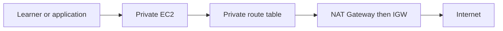
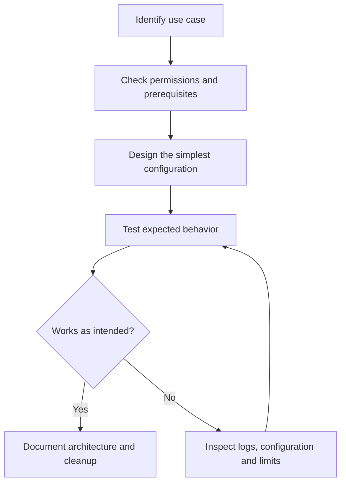
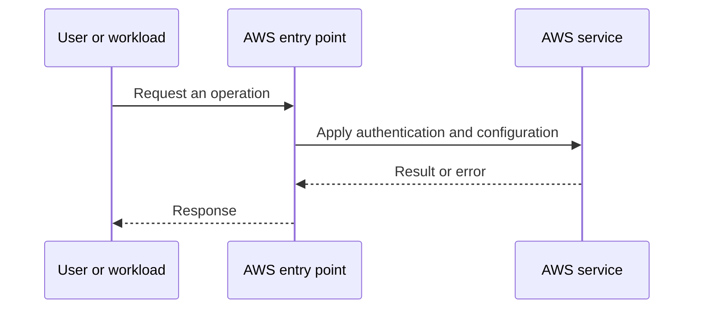
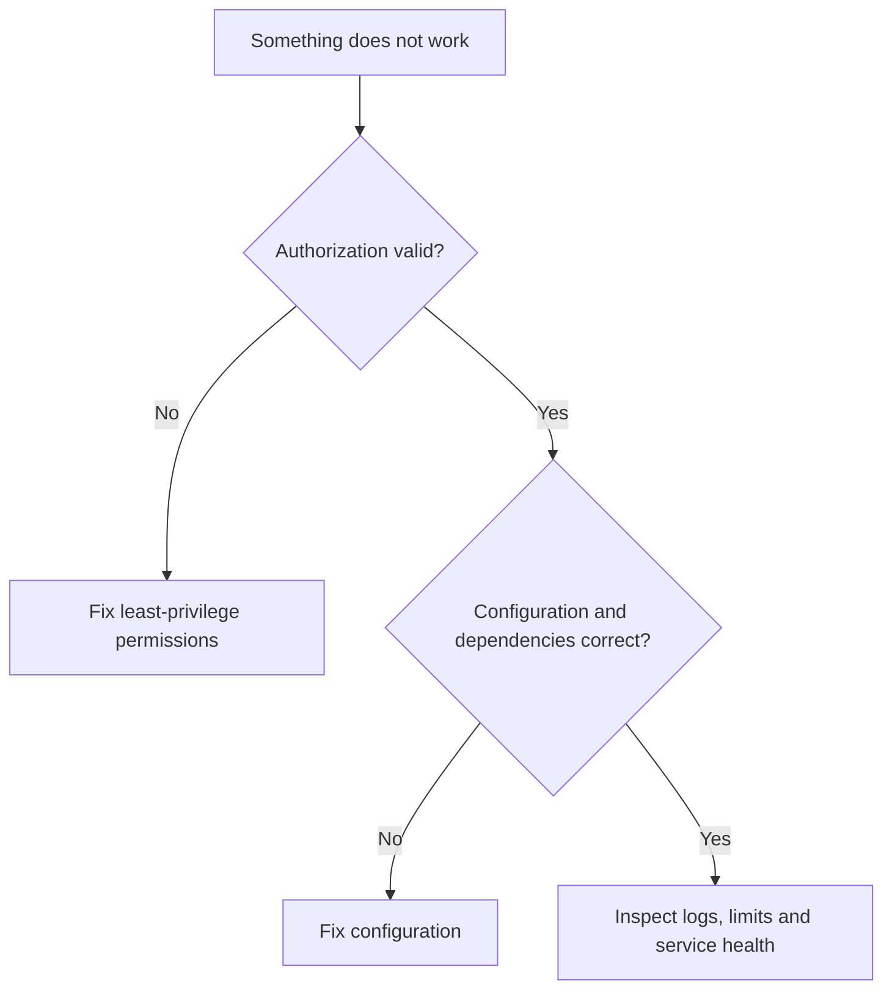

# Lesson 9: AWS Networking (Part-2): VPC, Subnet, NAT Gateway, Internet Gateway, Route Table — Explained Simply

*AWS Education Notes · Author: Jayesh Sharma*

## Contents
- [1. The big picture](#1-the-big-picture)
- [2. Everyday analogy](#2-everyday-analogy)
- [3. What is a VPC?](#3-what-is-a-vpc)
- [4. Public and private subnets](#4-public-and-private-subnets)
- [5. Internet Gateway](#5-internet-gateway)
- [6. NAT Gateway](#6-nat-gateway)
- [7. Route tables](#7-route-tables)
- [8. Per-AZ architecture](#8-per-az-architecture)
- [9. Security groups and NACLs](#9-security-groups-and-nacls)
- [10. Cost and cleanup](#10-cost-and-cleanup)
- [11. End-to-end workflow](#11-end-to-end-workflow)
- [12. Practical exercise](#12-practical-exercise)
- [13. Failure modes and best practices](#13-failure-modes-and-best-practices)
- [14. Interview questions and revision](#14-interview-questions-and-revision)

## 1. The big picture

In this lesson you learn **building an AWS network**. Many cloud problems get easier when we divide a big system into small responsibilities, identify what AWS manages, and test one concept at a time.

**Learning goals:** Explain the important terms to a beginner; draw the request path; identify where permissions, costs and failures matter; and reason through a simple scenario without memorizing console clicks.

## 2. Everyday analogy

Think of a VPC as a private office campus, subnets as buildings, and route tables as road signs.

An analogy is only a memory aid: cloud systems have specific constraints such as API permissions, network direction, limits and failure domains.

## 3. What is a VPC?

A Virtual Private Cloud is a logically isolated regional network. You choose IPv4 CIDRs and configure subnets, routes and security boundaries.

**Think about it:** Which requirement or failure case would make this important in a production application?

## 4. Public and private subnets

A subnet is called public when its effective route configuration includes a route to an internet gateway; instances also need suitable public addressing and security rules for inbound Internet access.

**Think about it:** Which requirement or failure case would make this important in a production application?

## 5. Internet Gateway

An IGW is attached to a VPC and supports Internet traffic for appropriately addressed resources with suitable routing and security.

**Think about it:** Which requirement or failure case would make this important in a production application?

## 6. NAT Gateway

A public NAT gateway in a public subnet can enable private IPv4 resources to initiate outbound traffic when their route points to it. It does not provide unsolicited inbound reachability.

**Think about it:** Which requirement or failure case would make this important in a production application?

## 7. Route tables

Routes map destination CIDRs to targets, such as local, internet gateway, NAT gateway or peering connection. Longest prefix match applies.

**Think about it:** Which requirement or failure case would make this important in a production application?

## 8. Per-AZ architecture

Use private subnets in multiple AZs and consider the resiliency/cost trade-off of NAT gateways per AZ.

**Think about it:** Which requirement or failure case would make this important in a production application?

## 9. Security groups and NACLs

Route selection answers where packets go; security rules decide whether permitted traffic can flow. One does not replace the other.

**Think about it:** Which requirement or failure case would make this important in a production application?

## 10. Cost and cleanup

NAT gateway running charges and data processing may accrue. Prefer private service endpoints where appropriate and delete lab resources afterward.

**Think about it:** Which requirement or failure case would make this important in a production application?

## 11. End-to-end workflow

Start with the desired business action and walk through each decision:

**Why this matters:** A service may appear healthy while permissions, security rules or resource dependencies stop the application from working.

## 12. Practical exercise

1. Draw the main objects and request path from this guide.
2. Open the AWS documentation for the service; identify its Region, pricing and permission requirements.
3. Use a sandbox account with MFA and a small AWS Budget or billing alert before deploying any paid resources.
4. Make one deliberate change at a time, and predict the effect before testing it.
5. Record expected behavior, actual behavior and the service-level evidence.
6. Clean up test resources, including gateways, storage, load balancers, or public IPs where applicable.

**Cost warning:** AWS Free Tier eligibility varies. NAT gateways, application load balancers, data transfer and some other resources can incur charges even during a short lab.

## 13. Failure modes and best practices

| Risk | Practical response |
|---|---|
| Access denied | Check the caller identity, policies, service trust and resource scope |
| Service not reachable | Check routing, security, health checks and the target application |
| Configuration drift | Compare deployed resources with the declared/approved configuration |
| Unexpected charges | Inspect pricing first; tag resources; clean up labs |
| Single point of failure | Identify and, when required, replicate critical dependencies |
| Leaked credentials | Prefer roles and short-lived credentials; rotate/revoke exposed secrets |

## 14. Interview questions and revision

1. In your own words, explain **What is a VPC?** and give one AWS example.
2. In your own words, explain **Public and private subnets** and give one AWS example.
3. In your own words, explain **Internet Gateway** and give one AWS example.
4. In your own words, explain **NAT Gateway** and give one AWS example.
5. In your own words, explain **Route tables** and give one AWS example.
6. In your own words, explain **Per-AZ architecture** and give one AWS example.
7. In your own words, explain **Security groups and NACLs** and give one AWS example.
8. In your own words, explain **Cost and cleanup** and give one AWS example.
9. Which component would fail first if traffic or usage increased tenfold?
10. What must be secured or monitored before going live?
11. How would you diagnose a failed request end to end?

### Quick revision
- **What is a VPC?:** A Virtual Private Cloud is a logically isolated regional network.
- **Public and private subnets:** A subnet is called public when its effective route configuration includes a route to an internet gateway; instances also need suitable public addressing and security rules for inbound Internet access.
- **Internet Gateway:** An IGW is attached to a VPC and supports Internet traffic for appropriately addressed resources with suitable routing and security.
- **NAT Gateway:** A public NAT gateway in a public subnet can enable private IPv4 resources to initiate outbound traffic when their route points to it.
- **Route tables:** Routes map destination CIDRs to targets, such as local, internet gateway, NAT gateway or peering connection.
- **Per-AZ architecture:** Use private subnets in multiple AZs and consider the resiliency/cost trade-off of NAT gateways per AZ.
- **Security groups and NACLs:** Route selection answers where packets go; security rules decide whether permitted traffic can flow.
- **Cost and cleanup:** NAT gateway running charges and data processing may accrue.

**One-minute answer:** AWS Networking (Part-2): VPC, Subnet, NAT Gateway, Internet Gateway, Route Table is about building an AWS network. Explain the main components, the direction of requests, security boundaries, operational trade-offs and a simple failure scenario. Then verify the design with a small reproducible test.

### Useful references

- [Course playlist](https://www.youtube.com/playlist?list=PL6W8uoQQ2c60g3PAgzVPpi0YWwxITD43p)
- [AWS documentation](https://docs.aws.amazon.com/)
- [AWS Well-Architected Framework](https://docs.aws.amazon.com/wellarchitected/latest/framework/welcome.html)
